# ALD Lab

PEALD SiN(DCS/NH3) 배치 장비의 공정 trace 데이터를 분석하여, 장비 상태와 막 품질을 미리 알아내고자 하는 프로젝트이다.

상세 목표는 다음과 같다.

- **미래값 예측**: 압력·온도·RF 매칭 등 8개 신호의 10·20·30초 뒤 값을 예측해, 공정 사고가 발생하기 전에 미리 파악한다.
- **가상 센서 활용**: 주요 센서의 데이터를 나머지 신호들을 통해 추정하고, 실측과 추정의 차이를 통해 이상을 감지한다. 부착되지 않은 센서의 데이터가 궁금할 때에도 활용 가능하다.
- **두께 예측(VM)**: run 마다 생성되는 trace Data로 박막의 두께와 균일도(U/F)를 예측하여, 계측하지 않은 run의 두께도 알 수 있게 한다. 양산 FAB에서는 일부 Wafer만 골라 계측하므로, 이를 보완해 전수 계측에 가까운 효과를 내는 것이 목표다.

목표 달성을 위해 시계열 Transformer 모델인 PatchTST를 중심으로, 하이퍼파라미터 조합을 차수별로 바꿔 가며 학습하고 있다.

대상마다 PatchTST가 단순 기준선(현재값 유지, 레시피 평균)보다 확실히 나은지 확인해, 나은 대상은 PatchTST를 쓰고 그렇지 못한 대상에만 다른 모델(iTransformer, DLinear, LightGBM)을 적용한다.

같은 설정이라도 seed만 바꿔 다시 학습하면 오차가 조금씩 달라지므로, 기준선과의 차이가 이 변동폭(표준편차)의 2배를 넘을 때만 확실히 낫다고 본다.

실험 결과는 매일 아래의 <결과>와 <대시보드>에 반영한다.

---

## 결과 (Daily 갱신)

> 날짜별로 실험 내용과 결과만 간단히 적는다. 표와 세부 수치는 [결과 상세 기록](docs/RESULTS_LOG.md)과 대시보드에서 볼 수 있다.<br>
> 11-03까지는 검증 run 11개로 평가했다. 시험 run 11개는 11-04 최종 설정 평가와 11-16 0.5초 조합 확인(재사용, 참고용)에만 썼다.

### 11-20 R.PWR·P.POS 교차검증, VG11 사이클 밖 오차 원인 (634~648차)

<picture>
  <source media="(prefers-color-scheme: dark)" srcset="docs/images/results_cv_rest_dark.svg">
  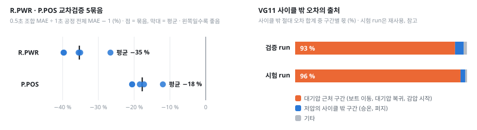
</picture>

**실험 내용**: split_v2에서 효과가 컸던 R.PWR, P.POS를 교차검증 5묶음에서 1초 공정 전체와 0.5초 조합으로 다시 학습해 비교(seed 3개). VG11은 학습 없이 사이클 밖 오차를 step별, run별로 나눠 봄

**결과**

- R.PWR 35%, P.POS 18% 오차 감소. 5묶음 모두 0.5초 조합이 더 정확해 0.5초 조합으로 확정. 이로써 가상 센서 16개의 최종 구성이 모두 정해짐(0.5초 조합 10개, 1초 공정 전체 6개)
- P.POS의 개선은 대부분 사이클 전용 모델에서 나옴. 0.5초로 학습한 것만으로는 1초와 비슷
- VG11 사이클 밖 오차의 93~96%가 대기압 근처 구간(보트 이동, 대기압 복귀, 감압 시작)에서 나옴. 모델이 이 구간 압력을 실제보다 낮게 예측했고(시험 run에서 5 Torr 안팎), 같은 계열 압력계를 모두 뺀 입력으로는 이 수준을 알기 어려움. 사이클 안에서는 시험 run에서도 레시피 평균보다 21% 정확

**다음 실험**: R.PWR·P.POS seed 1개 추가 후 시험 run 확인과 패키지, step별로 레시피 평균이 나은 구간은 레시피 평균을 쓰는 방식 확인(학습 없음)

### 지난 기록

<details>
<summary>11-08~11-16 기록 (전체 내용은 결과 상세 기록)</summary>

#### 11-16 나머지 가상 센서 8개에 0.5초 조합 적용 (630~633차)

<picture>
  <source media="(prefers-color-scheme: dark)" srcset="docs/images/results_rest_dark.svg">
  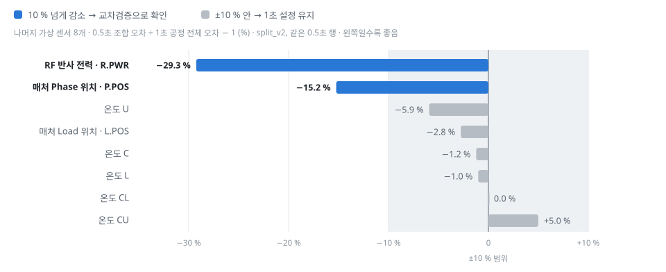
</picture>

- **실험 내용**: 가스·밸브에서 효과를 확인한 0.5초 조합을 나머지 가상 센서 8개(온도 5개, L.POS, P.POS, R.PWR)에 split_v2에서 적용
- **결과**: R.PWR 29%, P.POS 15% 오차 감소(1초 공정 전체 대비)로 교차검증 대상. 온도 5개와 L.POS는 -6~+5%로 1초 설정 유지

#### 11-16 0.5초 조합 시험 run 확인 (609~629차)

<picture>
  <source media="(prefers-color-scheme: dark)" srcset="docs/images/results_pairtest_dark.svg">
  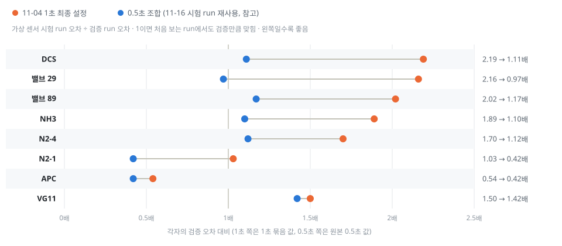
</picture>

- **실험 내용**: 확정한 0.5초 조합을 seed 3개로 다시 학습하고, 학습에 쓰지 않은 시험 run으로 확인 (시험 run 재사용, 참고용)
- **결과**: 가스·밸브의 시험 run 오차가 검증의 0.4~1.2배로, 11-04 1초 설정(1.0~2.2배)보다 검증과의 차이가 크게 줄었음. 시험 run 오차 자체도 1초 설정보다 9~47% 낮음. APC는 시험 run에서도 32% 개선됐고, VG11은 레시피 평균보다 61% 나쁨 (오차 대부분이 사이클 밖에서 발생)

#### 11-15 가스·밸브 가상 센서 최종 구성 (548~608차)

<picture>
  <source media="(prefers-color-scheme: dark)" srcset="docs/images/results_pair_dark.svg">
  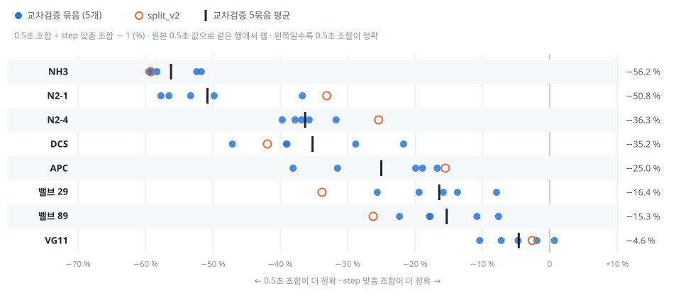
</picture>

- **실험 내용**: 0.5초 원본 간격으로 학습한 모델과 사이클 전용 모델의 조합(0.5초 조합)을 step 맞춤 조합과 같은 기준으로 비교
- **결과**: 가스·밸브·APC는 교차검증 5묶음 모두에서 0.5초 조합이 더 정확 (평균 오차 15~56% 감소), VG11은 4.6% 감소. 가스·밸브 가상 센서 8개를 0.5초 조합으로 확정

#### 11-14 step 맞춤 + 사이클 전용 조합, 원본 0.5초 값으로 재채점 (486~547차)

- **실험 내용**: step 맞춤 1초 묶음에 사이클 전용 모델을 더한 조합을 교차검증 5묶음에서 확인. 묶음 방식이 서로 다른 모델은 원본 0.5초 값을 기준으로 다시 채점
- **결과**: step 맞춤 조합의 가스·밸브 개선율이 69~87%로 당시 최고. 원본 값으로 다시 채점해 보니 1초로 묶는 것 자체가 큰 오차 원인이었고, split_v2에서는 0.5초로 학습한 모델이 가장 정확

#### 11-13 step 맞춤 1초 묶음, 장기 예측 RevIN (383~395, 432~485차)

- **실험 내용**: 1초 묶음의 시작을 step 시작 시점에 맞춰, 한 묶음에 두 step이 섞이지 않게 변경
- **결과**: 밸브 89, DCS, N2-4, APC의 개선율이 6개 분할 모두에서 9.7~49.5%p 상승 (하이퍼파라미터 탐색보다 큰 효과). 장기 예측은 RevIN을 끄면 5~10분 뒤 APC, VG11 오차가 각각 68%, 83% 감소

#### 11-11 구간 전용 학습 교차검증, run 유형 분석 (263~362차)

- **실험 내용**: 사이클 안과 밖을 따로 학습한 모델의 조합을 교차검증 3묶음에서 확인하고, 가스·밸브의 run 간 오차 차이 원인을 분석
- **결과**: 구간 전용 조합으로 DCS, N2-4, APC, 밸브 89, NH3의 개선율이 10~17%p 상승. run 간 차이는 장비 상태 변화 때문이 아니라, 1초 묶음과 step 전환 시점의 흔들림이 겹친 run에서 생김

#### 11-10 학습 run 수, 최근 run, 사이클 구간 학습 (147~230차)

<picture>
  <source media="(prefers-color-scheme: dark)" srcset="docs/images/results_learning_dark.svg">
  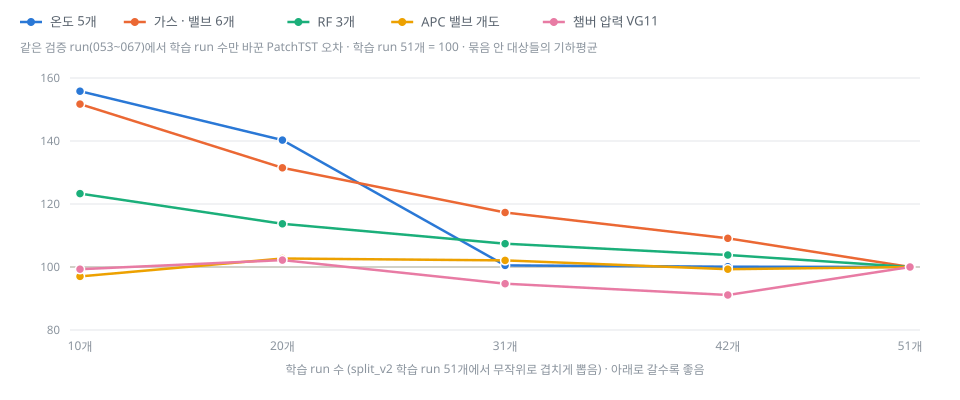
</picture>

- **실험 내용**: 성능이 무엇에 좌우되는지 보기 위한 부가 실험 (학습 run 수, 최근 run만 학습, 시간순 검증, 사이클 구간만 학습, 장기 예측)
- **결과**: 온도는 학습 run 31개면 충분. 가스·밸브는 run 수보다 어떤 run이 학습에 들어갔는지가 더 중요 (11-11 정정). 사이클 구간만 학습하면 사이클 안 오차가 크게 줄어드는 대상이 많음. APC와 VG11은 학습 시기에 따라 결과 차이가 큼

#### 11-08 시험 run 평가, 교차검증 (11-03~11-08)

<picture>
  <source media="(prefers-color-scheme: dark)" srcset="docs/images/results_test_dark.svg">
  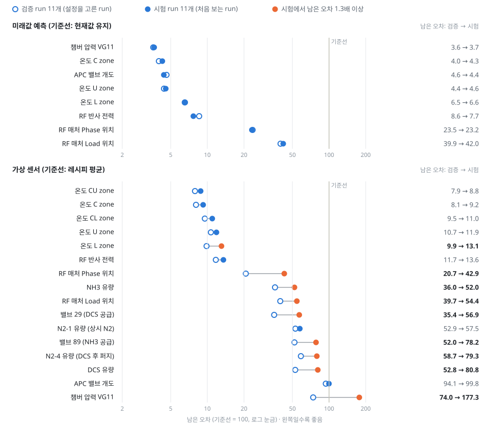
</picture>

- **실험 내용**: 최종 설정을 시험 run 11개로 한 번 평가하고, 성능이 떨어진 원인을 교차검증 5묶음으로 확인
- **결과**: 미래값 예측 8개는 시험 run에서도 검증과 같은 수준 (남은 오차 7.9 → 7.9). 가상 센서는 온도와 RF 반사 전력이 시험 run에서도 86~91% 개선, 가스·밸브와 RF 매처는 개선 폭 감소, APC 0.2%, VG11 -77%. 가스·밸브는 기준선 오차가 큰 run이 시험 run에 많이 들어간 영향이며, 교차검증 5묶음에서는 8개 대상 모두 기준선보다 나아 채택 유지

</details>

### 실험 로드맵 (1~648차, 11-20 기준)

각 실험에서 나온 결과와, 그 결과에 따라 이어진 다음 실험을 한 장에 정리했다. 화살표 위 문구는 다음 실험으로 넘어간 이유이고, 카드 오른쪽 위 표시는 그 실험의 판정이다.

<picture>
  <source media="(prefers-color-scheme: dark)" srcset="docs/images/results_flow_dark.svg">
  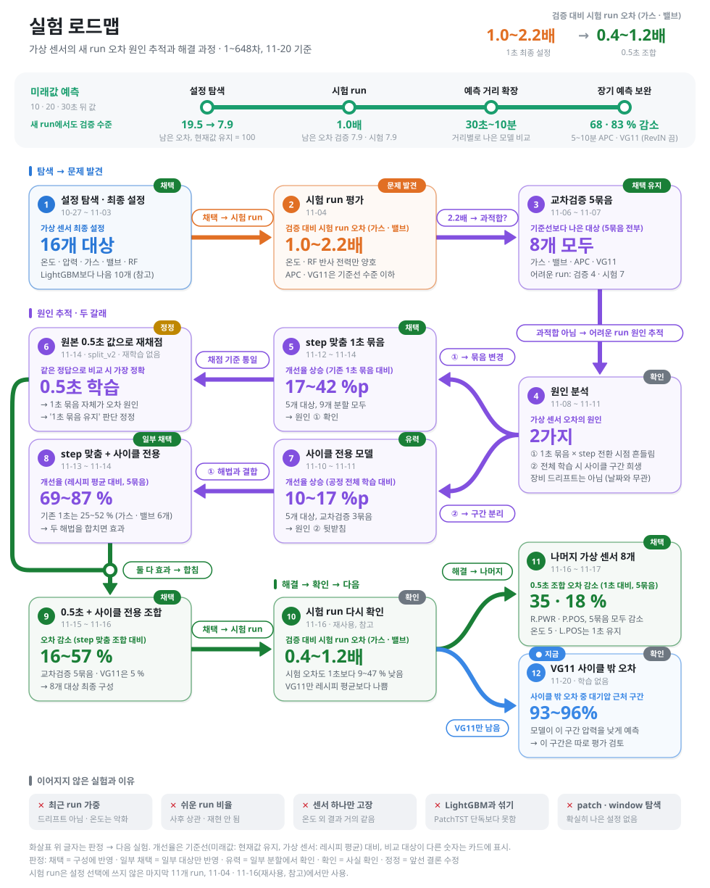
</picture>

### 지금까지의 추이

<picture>
  <source media="(prefers-color-scheme: dark)" srcset="docs/images/results_progress_dark.svg">
  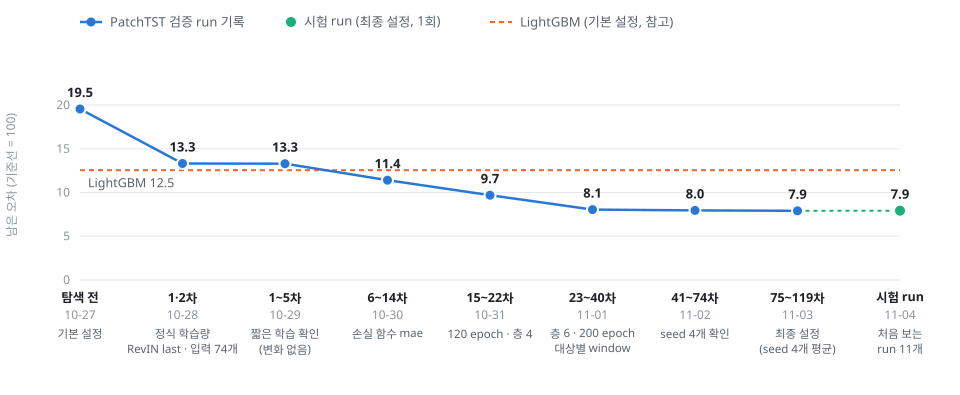
</picture>

<details>
<summary>대상별 오차 변화(탐색 전과 11-02 비교), 설정별 효과</summary>

<picture>
  <source media="(prefers-color-scheme: dark)" srcset="docs/images/results_targets_dark.svg">
  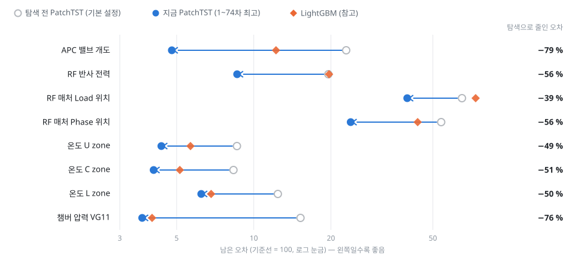
</picture>

<picture>
  <source media="(prefers-color-scheme: dark)" srcset="docs/images/results_effects_dark.svg">
  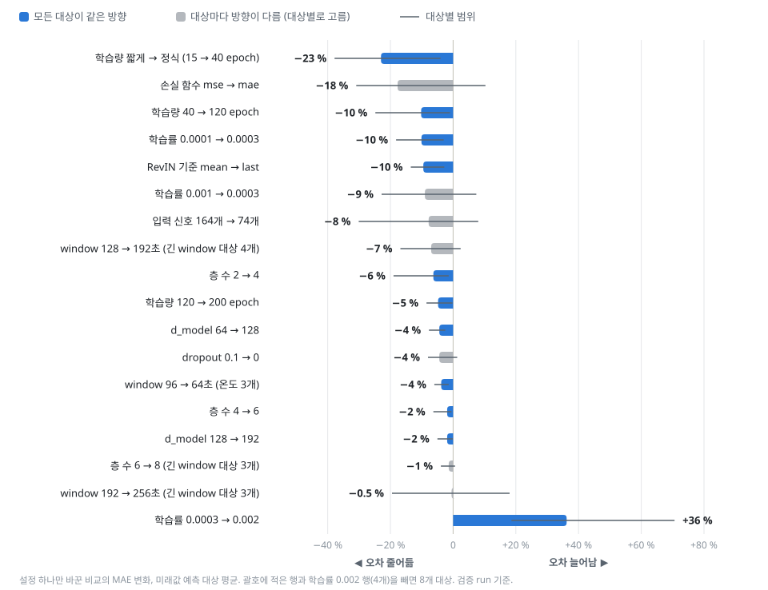
</picture>

</details>

<details>
<summary>지난 날짜 기록</summary>

- **11-02** 전날 대비 -1% (8.1 → 8.0). 미래값 예측은 seed 4개로 편차를 확인하며 대상별 설정을 확정하는 단계라 변화가 작았음. 가상 센서는 입력을 74개로 줄여 온도 오차가 17~43% 줄었고, 16개 대상 중 10개가 LightGBM보다 나아짐
- **11-01** 전날 대비 -17% (9.7 → 8.1). 층 6개와 대상별 window 적용으로 8개 대상 모두 개선. VG11은 window 256초에서 LightGBM을 앞섬
- **10-31** 전날 대비 -15% (11.4 → 9.7). 학습량을 120 epoch로 늘려 7개 대상의 오차가 9~30% 감소
- **10-30** 전날 대비 -14% (13.3 → 11.4). 손실 함수를 mse에서 mae로 바꾼 효과가 가장 큼
- **10-29** 변화 없음 (13.3). 짧게 학습하면 조합 순위가 바뀌는 것을 확인하고, 탐색을 정식 학습량으로 변경
- **10-28** 탐색 전 대비 -32% (19.5 → 13.3). 정식 학습량, RevIN 기준 last, 입력 신호 74개 적용

</details>

---

## 데이터

같은 장비에서 구동한 STANDARD run 74개

| 항목 | 내용 |
|---|---|
| 기록 | 0.5초 간격, run 하나 약 4.7시간 |
| 신호 | 200개. 값이 변하지 않는 25개와 완전 중복 11개를 빼면 164개 |
| 공정 흐름 | 보트 업 → 감압 → 승온 → 리크 체크 → ALD 사이클 반복 → 퍼지 → 대기압 복귀 |
| Ex-situ | run마다 boat 5위치 × 49점 |
| 분할 | run 단위로 학습 51 / 검증 11 / 시험 11 (071 제외) |

### ALD 사이클 한 번

trace를 step별로 잘라낸 사이클 1개에 대한 정보

| step | 하는 일 | trace에서 보이는 것 |
|---|---|---|
| CLOSE1 | 공급 밸브 닫힘, 다음 투입 대기 | DCS(29)·NH3(89) 밸브 닫힘 |
| SI-FL1 | DCS 투입 | DCS(29) 밸브 열림. VG11이 사이클 중 가장 높게 튐. 상시 N2 줄어듦. DCS 후 퍼지 N2는 계속 흐름 |
| SI-EVA1 | 배기·퍼지(DCS 쪽) | DCS(29) 밸브 닫힘. VG11이 다시 내려옴. DCS 후 퍼지 N2 계속 흐름 |
| CHANGE | DCS → NH3 전환 | 상시 N2 다시 올라감 |
| N-PRE1 | NH3 유량 안정화 (플라즈마 켜기 전) | NH3 유량이 올라오기 시작. RF 전력 없음. NH3(89) 밸브는 아직 닫힘. 상시 N2 증가, DCS 후 퍼지 N2 감소 |
| N-FL1 | NH3 + RF (플라즈마) 시작 | NH3(89) 밸브 열림. RF 전력 켜짐. VG11 일정. DCS 후 퍼지 N2는 0 |
| N-FL2 | NH3 + RF (플라즈마) 유지 | RF 전력·NH3 유량·VG11은 N-FL1과 같음. DCS 유량이 사이클 중 이 구간에서만 나타남 |
| N-EVA1 | 배기·퍼지 (NH3 쪽) | RF 전력이 꺼지며 내려감. NH3(89) 밸브 닫힘. DCS 후 퍼지 N2 다시 흐름 |

VG11이 튀는 것은 DCS 밸브가 열리는 구간에 몰려 있고, 나머지 구간의 압력은 거의 레시피대로 움직인다.

아래 모델 설정(192초 window, 16초 조각)은 이 구조에서 출발했다.

## 과제와 평가

| 과제 | 입력 → 출력 | 대상 | 기준선 (개선율 0%) | 참고 기준 |
|---|---|---|---|---|
| 미래값 예측 | 최근 192초 → 10·20·30초 뒤 값 | 8개: VG11, APC 밸브 개도, 온도 3 zone(U·C·L), RF 매처 Load·Phase 위치, RF Reflected Power | 현재값 유지 | LightGBM (기본 설정, 튜닝 없음) |
| 가상 센서 | 대상 센서와 같은 계열 신호를 제외한 나머지 신호의 최근 64초 → 현재 값 | 16개: 압력, 온도 5 zone, APC, RF 매처·Reflected Power, 가스 유량, 밸브 | 레시피 평균값 (학습 run에서 같은 step·같은 경과 시점의 평균) | LightGBM (기본 설정, 튜닝 없음) |
| 두께 (VM) | run 1개의 trace 요약 특성 → 평균 두께, U/F, WtoW | STANDARD run 58개 (이상 run 제외), run 단위 Leave-One-Out 교차검증 | 학습 run 평균값 | LightGBM, Ridge, PLS (run 수가 적어 딥러닝 제외) |

미래값 예측과 가상 센서는 PatchTST 하나로 모든 대상을 학습하고, 하이퍼파라미터 최적화까지 마친다. 그 결과를 기준선과 LightGBM에 비춰 본다.

기준선을 넘지 못하거나 LightGBM보다 뚜렷하게 나쁜 대상(차이가 max(LightGBM MAE의 5%, seed 표준편차의 2배)를 넘는 경우)에 한해 다른 모델(iTransformer, DLinear 등)을 검토한다.

모델과 조합은 검증 run으로만 고르고, 최종 성능은 마지막에 한 번 여는 시험 run으로 확인한다.

모든 결과는 기준선 대비 MAE 개선율(%)로 나타낸다. MAE는 원래 단위(Torr, ℃, % 등)로 계산하고, ALD 사이클 구간과 그 외 구간(감압·승온·벤트 등)을 나눠 본다.

현재값 유지 기준선의 VG11 MAE는 전체 2.016 Torr이지만, 사이클 구간은 0.364 Torr, 그 외 구간은 2.70 Torr다. 전체 평균 하나로는 구간 전환을 잘 맞히는 모델과 사이클 내 미세 변동을 잘 맞히는 모델을 구분할 수 없다.

## 전체 구조

<picture>
  <source media="(prefers-color-scheme: dark)" srcset="docs/images/architecture_dark.svg">
  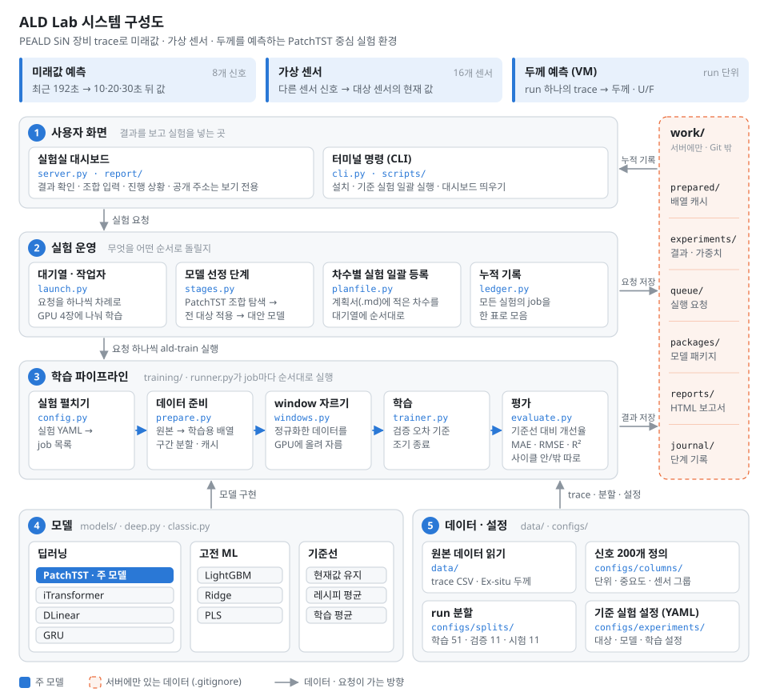
</picture>

연구자가 ① 대시보드에서 조합을 넣으면 ② 대기열이 요청을 하나씩 ③ 학습 파이프라인으로 돌린다. 파이프라인은 ④ 모델과 ⑤ 데이터·설정을 가져다 쓰고, 결과는 서버의 `work/`에 쌓인다. 쌓인 결과는 ① 대시보드에 나타나고, ② 모델 선정 단계가 다음 실험을 정하는 근거가 된다.

`scripts/run_all.sh`는 대기열을 거치지 않고 기준 실험 전부를 바로 돌린다. 파일 단위 흐름은 [`docs/ARCHITECTURE.md`](docs/ARCHITECTURE.md)에 있다.

## PatchTST

```
최근 192초 × 신호 164개 (1초 간격)
  → 16초 조각을 8초씩 밀며 자름: 조각 24개
  → 조각 하나(16초 × 164개 = 값 2,624개)를 128차원 token 하나로        patch embedding
  → Transformer encoder 3층으로 token 24개 사이의 관계를 봄            attention head 16, FFN 256
  → 선형 head → 10·20·30초 뒤 값 3개, RevIN으로 원래 단위로 되돌림
```

192초 안에는 ALD 사이클이 여러 번 들어 있다. 모델은 이 192초를 16초 조각 24개로 나눠 보고, 그중 지금 예측에 도움이 되는 조각을 골라 참고한다. 사이클이 반복되므로 이전 사이클에서 같은 시점 뒤에 무슨 일이 있었는지(예: DCS 투입과 압력 상승)를 보고 다음 변화를 예측할 수 있다.

다만 모델이 실제로 이렇게 참고하는지는 아직 확인하지 않았다.

원형 PatchTST는 신호마다 따로 token을 만든다(채널 독립).

이전 프로젝트(2026-07~08, VG11 예측, 시험 run MAE)에서 VG11 하나만 넣은 원형은 0.235 Torr였는데, 같은 원형에 신호 37개를 넣자 1.117로 오히려 나빠졌다. 한 시점의 신호를 모두 한 token으로 묶는 신호 혼합으로 바꾸고 나서야 0.188이 됐다.

압력이 언제 튈지는 VG11 자신보다 밸브와 MFC가 먼저 알려 준다는 뜻으로 읽었고, 그래서 이번에도 신호 혼합을 기본으로 둔다. 원형은 탐색 후보로 남겼다.

| 구성 | 파라미터 수 |
|---|---:|
| 신호 혼합, 신호 164개 (이번 기본) | 745,731 |
| └ patch embedding (2,624 → 128) | 336,000 (45%) |
| └ encoder 3층 | 397,440 (53%) |
| └ head와 위치 정보 | 12,291 |
| 신호 혼합, 신호 37개 (이전 최고 모델과 같은 구조) | 485,635 |
| 원형, 신호별 독립 (신호 수와 무관) | 411,907 |
| 참고: DLinear | 24,899 |
| 참고: Gemma 3 1B (작은 축에 드는 언어 모델) | 약 10억 |

기본 구성은 Gemma 3 1B의 0.07% 크기이고, float32 가중치 파일로 약 3 MB다. 파라미터의 절반 가까이가 "신호 164개를 token으로 바꾸는" 첫 층에 들어간다.

학습 window가 80만 개를 넘어도 1초씩 겹쳐 있어서 서로 독립인 정보는 학습 run 51개 분량이다. 이전 프로젝트에서도 seed만 바꿨을 때의 차이(0.0145 Torr)가 구조를 바꾼 차이보다 큰 경우가 많았다.

그래서 모델을 키우기보다 조각 길이, 신호를 묶는 방식, 입력 신호 세트를 먼저 찾는다.

가상 센서에서는 대상이 입력에 없어서 RevIN으로 되돌릴 기준이 없다. 대신 입력 신호들의 window 평균·표준편차를 head에 함께 넣어 절대 레벨을 잃지 않게 했다. 이전 프로젝트의 가상 센서 시도가 크게 실패한 원인이 이것이었다.

출력은 레시피 평균에서 벗어난 양(보정량)이고 L1 손실로 학습한다. MSE로 학습하면 승온 구간의 큰 오차에 끌려 사이클 안 정확도가 무너졌다.

## 결과 보기

학습 결과는 실험실 대시보드에서 본다. 회사 데이터가 들어 있어 주소는 공개하지 않는다.

- 보기 전용 화면으로, 학습을 시작하거나 멈추는 버튼은 눌러도 동작하지 않는다.
- 학습 기능이 활성화 되어있는 사용자 버전이 별도로 있으며, 새 학습이 끝나면 몇 분 안에 보고서가 새로 만들어진다.
- 학습이 도는 동안의 진행 상황은 "하이퍼파라미터 탐색" 탭에서 5초마다 갱신된다.

탭은 아래 순서로 읽으면 된다.

| 탭 | 내용 |
|---|---|
| 요약 | 지금까지의 결론과 핵심 숫자 |
| In, Out | 원본 데이터와 전처리, 모델이 내놓는 값 |
| Function, Code Flow Chart | 모델 구조와 코드 흐름 |
| Hyper Parameter, 하이퍼파라미터 탐색 | 조합별 결과, 모델 선정 단계별 현황, 학습 진행 상황 |
| 성능표 | 대상별 모델 순위와 기준선 대비 개선율 |
| 가중치·실행 파일 | 대상별 최고 모델의 가중치와 실행 파일 |
| 특이사항, 이전 실험, 다음 실험 | 학습 속도, 이전 프로젝트 결과, 다음 실험 후보 |

## 실행

GPU 서버(Ubuntu, RTX 4090 × 4, Python 3.10) 기준이다. 자세한 순서는 [`docs/TRAINING.md`](docs/TRAINING.md)에 있다.

```bash
bash scripts/setup_server.sh           # 가상환경, PyTorch(cu124), 설치, GPU 확인, 테스트. scripts/env.sh도 만든다
vi scripts/env.sh                      # trace CSV 폴더와 Ex-situ 워크북 경로
bash scripts/run_all.sh --smoke        # run 몇 개로 끝까지 도는지 확인
nohup bash scripts/run_all.sh > run_all.out 2>&1 &   # 데이터 개요 → 실험 전체 → 모델 패키지 → 보고서
bash scripts/lab.sh                    # 실험실 대시보드 (포트 5273)
```

테스트는 원본 데이터 없이 합성 trace로 돈다: `PYTHONPATH=src python -m pytest -q`

## 폴더

```
configs/columns/       신호 200개 목록: 단위, 역할, 같은 계열 묶음 (공개본. 의미·중요도는 비공개)
configs/splits/        run 분할 (split_v2)
configs/experiments/   실험 계획서. YAML 하나가 대상 × 모델 × 조합 × 입력 세트 × seed로 펼쳐진다
configs/plan/          다음 실험 후보 (보고서 '다음 실험' 탭)
configs/history/       이전 프로젝트 집계 기록
src/ald_lab/data/      CSV 읽기, run 카탈로그, Ex-situ 파싱
src/ald_lab/models/    PatchTST·iTransformer·DLinear·GRU, LightGBM·Ridge, 기준선
src/ald_lab/training/  구간 분할·정규화, GPU window, 학습, 평가, 예측
src/ald_lab/launch.py  실험 대기열과 작업자 (ald-queue)
src/ald_lab/stages.py  모델 선정 단계: PatchTST 조합 탐색 → 전 대상 적용 → 대안 모델
src/ald_lab/ledger.py  누적 기록: 모든 실험의 job을 한 표로
src/ald_lab/report/    대시보드 화면(HTML)을 그리는 코드
src/ald_lab/server.py  실험실 대시보드
scripts/               서버 설치·실행 스크립트, README 구조도 생성(readme_diagrams.py)
tests/                 합성 trace로 도는 테스트
docs/                  연구 계획(PLAN.md), 서버 학습 절차(TRAINING.md), 코드 구조(ARCHITECTURE.md), README 그림
```

함수 단위 호출 관계는 보고서의 Code Flow Chart 탭에 있다. `src/ald_lab/`을 읽어 자동으로 그리므로 코드와 항상 같다.

## 데이터 취급

trace CSV, Ex-situ 워크북, 캐시, 가중치, 샘플 단위 예측값은 저장소에 없다. 모두 `work/` 아래에 생기고
`.gitignore`로 막혀 있다. 저장소에 있는 것은 코드, 신호 이름, 집계 지표뿐이다. 신호 사전의 의미·중요도와 공정 조건은 공개본에서 뺐고, 테스트용 합성 데이터의 공정 조건·두께 값은 실제와 무관한 임의 값이다.
