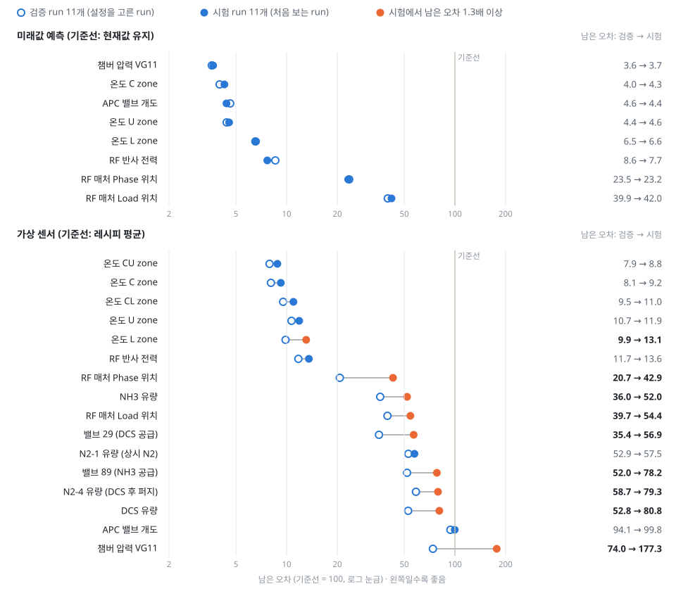
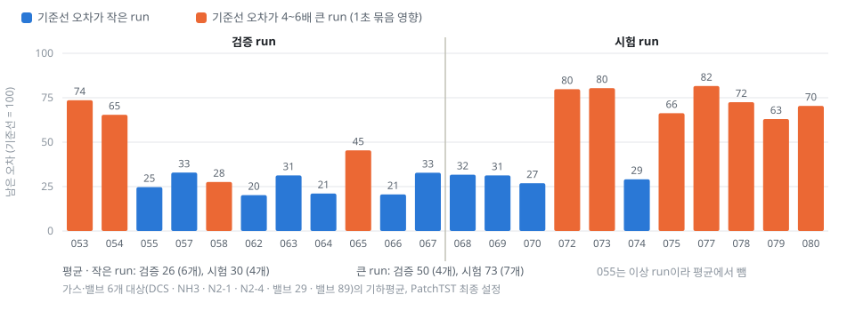
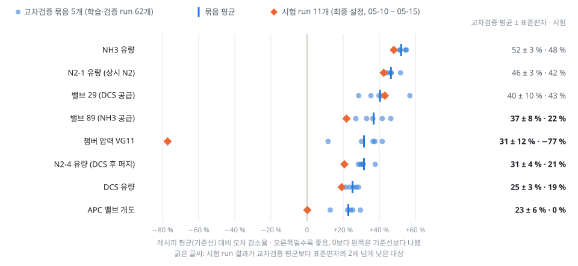
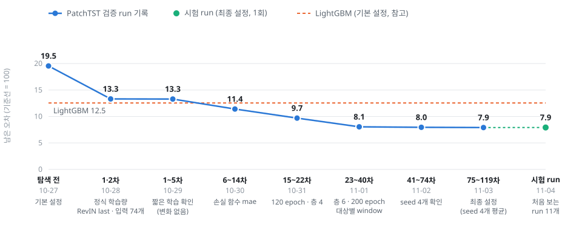
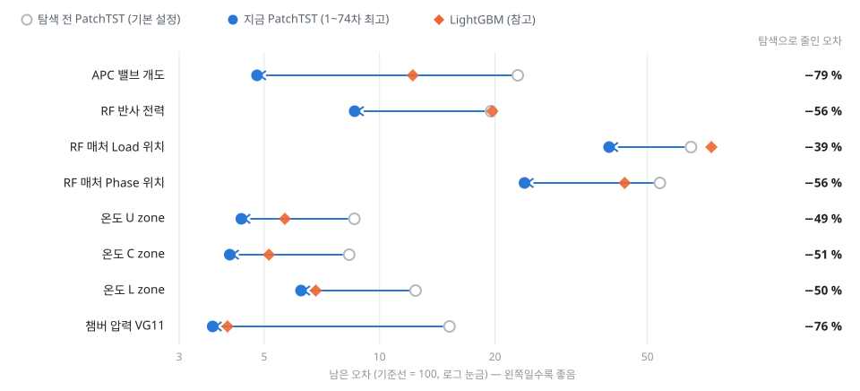
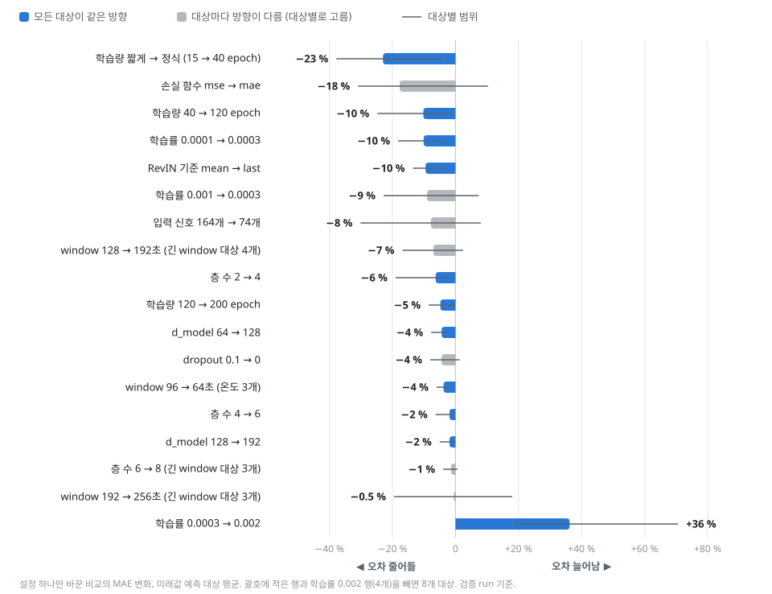
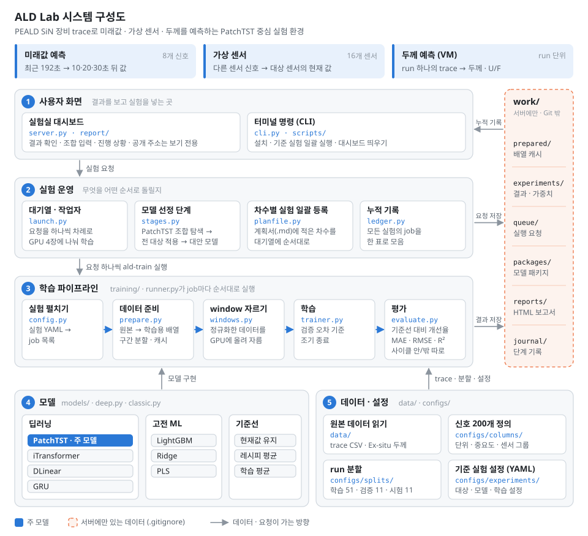

# ALD Lab
PEALD SiN(DCS/NH3) 배치 장비의 공정 trace 데이터를 분석하여, 
장비 상태와 막 품질을 미리 알아내고자 하는 프로젝트이다. 
상세 목표는 다음과 같다. 


- **미래값 예측**: 압력·온도·RF 매칭 등 8개 신호의 10·20·30초 뒤 값을 예측해, 공정 사고가 발생하기 전에 미리 파악한다.
- **가상 센서 활용**: 주요 센서의 데이터를 나머지 신호들을 통해 추정하고, 실측과 추정의 차이를 통해 이상을 감지한다. 부착되지 않은 센서의 데이터가 궁금할 때에도 활용 가능하다.  
- **두께 예측(VM)**: run 마다 생성되는 trace Data로 박막의 두께와 균일도(U/F)를 예측하여, 계측하지 않은 run의 두께도 알 수 있게 한다. 양산 FAB에서는 일부 Wafer만 골라 계측하므로, 이를 보완해 전수 계측에 가까운 효과를 내는 것이 목표다.   


목표 달성을 위해 시계열 Transformer 모델인 PatchTST를 중심으로, 하이퍼파라미터 조합을 차수별로 바꿔 가며 학습하고 있다. 
대상마다 PatchTST가 단순 기준선(현재값 유지 · 레시피 평균)보다 확실히 나은지 확인해, 나은 대상은 PatchTST를 쓰고 그렇지 못한 대상에만 다른 모델(iTransformer · DLinear · LightGBM)을 적용한다. 
같은 설정이라도 seed만 바꿔 다시 학습하면 오차가 조금씩 달라지므로, 기준선과의 차이가 이 변동폭(표준편차)의 2배를 넘을 때만 확실히 낫다고 본다.
실험 결과는 매일 아래의 <결과>와 <대시보드>에 반영한다.

## 결과 (Daily 갱신)

> 매일 그날까지의 최고 기록을 전날과 비교해 갱신한다. 11-03까지의 숫자는 검증 run 11개 기준이고, 11-04에 최종 설정으로 시험 run 11개를 한 번 평가했다. 그 뒤의 교차검증 · 예측 거리 확장은 시험 run을 쓰지 않는다.

### 11-08 · 시험 run 평가, 원인 분석, 교차검증 (11-03 ~ 11-08)

미래값 예측 8개는 처음 보는 시험 run에서도 검증과 같은 수준이었다(대상 평균 남은 오차 7.9 → 7.9).
가상 센서는 온도 5개와 RF 반사 전력이 시험에서도 기준선 대비 86~91 % 줄었지만, 가스·밸브 6개와 RF 매처 위치 2개는 개선 폭이
19~57 %로 줄었고, APC는 기준선과 같아졌으며(0.2 %), VG11은 기준선보다 나빠졌다(−77 %).

<picture>
  <source media="(prefers-color-scheme: dark)" srcset="docs/images/results_test_dark.svg">
  
</picture>

**가상 센서가 시험 run에서 떨어진 원인 (드리프트 · 과적합 여부 확인)**

- 가스·밸브 6개는 run이 두 무리로 갈린다. 레시피 평균(기준선) 오차가 4~6배 큰 run이 따로 있고, PatchTST의 남은 오차도 이 run들에서 크다.
- 이런 run은 학습 run에도 절반가량 있고 날짜와 상관없이 섞여 있다. 시간이 갈수록 나빠지는 드리프트는 아니다.
- 0.5초 원본 그대로 계산하거나 step이 바뀔 때마다 1초 묶음을 새로 시작하면 두 무리의 기준선 오차 차이가 사라진다(2.6배 → 1.0배).
  0.5초 데이터를 1초로 묶는 전처리와 step 표시 시점의 흔들림(±0.5초)이 겹쳐 생긴 차이로 본다.
- 시험 run에는 이런 run이 11개 중 7개로 검증(4개)보다 많이 들어가 평균이 떨어졌다. 오차가 작은 run끼리는 검증 26 · 시험 30으로 비슷하다.
  큰 run끼리는 검증 50 · 시험 73인데, 검증의 큰 run 4개 중 058 · 065는 덜 어려웠다.
- APC · VG11은 검증 run 11개의 평균이 run 몇 개에 좌우됐다. 아래 교차검증으로 다시 판정했다.

<picture>
  <source media="(prefers-color-scheme: dark)" srcset="docs/images/results_runs_dark.svg">
  
</picture>

**교차검증 결과 (120~139차, 11-06 ~ 11-07)**

시험 run은 쓰지 않고 학습·검증 run 62개(04-15 ~ 05-10)를 5묶음으로 나눠, 최종 설정을 묶음마다 다시 학습했다.

- 8개 대상 모두 5묶음 전부에서 기준선보다 나았고, 평균이 묶음 간 표준편차의 2배를 넘어 미리 정한 기준대로 채택을 유지한다.
- 가스·밸브 6개는 묶음 평균 25~52 % 감소였다. DCS · N2-4 · 밸브 89는 시험 결과가 교차검증보다 낮은데,
  시험 run에 기준선 오차가 큰 run이 많이 들어간 영향과 맞는다.
- APC(23 ± 6 %)와 VG11(31 ± 12 %)은 교차검증에서는 모든 묶음에서 나았지만, 가장 나중 run인 시험 run(05-10 ~ 05-15)에서는
  기준선과 같거나 나빴다. VG11은 시험 run 070 이후 모든 run에서 기준선보다 나빴다. 시기에 따른 변화일 수 있어 시간순 검증으로 확인한다.
- 구간별로 보면 APC는 사이클 안에서 좋아지고(13~31 %) 사이클 밖은 기준선과 비슷하거나 약간 나쁘다(−10~0 %).
  VG11은 반대로 사이클 밖에서 좋아지고(13~43 %) 사이클 안은 기준선보다 나쁘다.

<picture>
  <source media="(prefers-color-scheme: dark)" srcset="docs/images/results_cv_dark.svg">
  
</picture>

**예측 거리 확장 (140~146차, 11-07)**

최종 설정 그대로 30초 · 1분 · 2분 · 5분 · 10분 뒤 값을 예측했다. 아래는 다섯 거리의 평균이다(검증 run).

| 대상 | 10~30초 예측 개선율 | 30초~10분 예측 개선율 | 30초~10분 오차: 사이클 안 · 밖 |
|---|---:|---:|---|
| 온도 U · C · L zone | 93~96 % | 91~92 % | 0.04~0.17 · 0.68~0.81 ℃ |
| RF 반사 전력 | 91 % | 81 % | 0.27 · 0.006 |
| APC 밸브 개도 | 95 % | 78 % | 0.84 · 2.15 % |
| RF 매처 Phase 위치 | 76 % | 71 % | 0.87 · 0.18 |
| 챔버 압력 VG11 | 96 % | 68 % | 0.29 · 9.7 Torr |
| RF 매처 Load 위치 | 60 % | 45 % | 0.84 · 0.11 |

- 개선율은 모두 현재값 유지 대비다. 8개 대상 모두 긴 예측에서도 현재값 유지보다 45~92 % 나았지만, 10~30초보다 개선 폭이 줄었다.
- 온도 · VG11 · APC는 사이클 안 오차가 작고, 감압 · 승온 · 벤트처럼 공정 단계가 바뀌는 사이클 밖에서 크게 틀렸다.
  RF 관련 신호(반사 전력 · 매처 위치)는 반대로 사이클 안 오차가 더 크다.
- 레시피 평균 기준선이 빠진 채로 돌아서(대시보드가 이전 코드로 요청을 만듦), 레시피 평균과의 비교와 예측 거리별 오차는 보충해서 반영한다.

**다음 실험**

- 예측 거리 확장 보충: 레시피 평균 기준선을 더하고 30초 ~ 10분 거리별 오차를 정리해 쓸 수 있는 예측 거리를 정한다 (학습 없음).
- APC · VG11 가상 센서 시간순 검증: 앞쪽 run으로 학습하고 바로 다음 run 묶음으로 검증하기를 시간 순서대로 반복해, 시기에 따라 성능이 떨어지는지 확인한다.
- VG11 · APC 구간별 결합: 사이클 안 · 밖에서 더 나은 쪽(PatchTST 또는 레시피 평균)을 쓰는 방식을 교차검증으로 판단한다.

### 지금까지의 추이

<picture>
  <source media="(prefers-color-scheme: dark)" srcset="docs/images/results_progress_dark.svg">
  
</picture>

<details>
<summary>대상별 탐색 전 → 11-02 · 설정별 효과</summary>

<picture>
  <source media="(prefers-color-scheme: dark)" srcset="docs/images/results_targets_dark.svg">
  
</picture>

<picture>
  <source media="(prefers-color-scheme: dark)" srcset="docs/images/results_effects_dark.svg">
  
</picture>

</details>

<details>
<summary>지난 날짜 기록</summary>

- **11-02** · 전날 대비 −1 % (8.1 → 8.0) — 미래값 예측은 seed 4개로 흔들림을 확인하며 대상별 설정을 확정하는 단계라 변화가 작았고, 가상 센서는 입력을 74개로 줄여 온도 오차가 17~43 % 줄면서 16개 대상 중 10개가 LightGBM보다 나아졌다.
- **11-01** · 전날 대비 −17 % (9.7 → 8.1) — 층 6과 대상별 window로 8개 대상 모두 좋아졌고, VG11이 window 256초에서 LightGBM을 앞섰다.
- **10-31** · 전날 대비 −15 % (11.4 → 9.7) — 학습량을 120 epoch로 늘린 것이 7개 대상의 오차를 9~30 % 줄였다.
- **10-30** · 전날 대비 −14 % (13.3 → 11.4) — 손실 함수를 mse에서 mae로 바꾼 것이 가장 컸다.
- **10-29** · 변화 없음 (13.3) — 짧게 학습하면 조합 순위가 바뀐다는 것을 확인하고, 탐색을 정식 학습량으로 바꿨다.
- **10-28** · 탐색 전 대비 −32 % (19.5 → 13.3) — 정식 학습량, RevIN 기준 last, 입력 신호 74개.

</details>

## 데이터
같은 장비에서 구동한 STANDARD run 74개

| 항목 | 내용 |
|---|---|
| 기록 | 0.5초 간격, run 하나 약 4.7시간 |
| 신호 | 200개. 값이 변하지 않는 25개와 완전 중복 11개를 빼면 164개 |
| 공정 흐름 | 보트 업 → 감압 → 승온 → 리크 체크 → ALD 사이클 반복 → 퍼지 → 대기압 복귀 |
| Ex-situ | run마다 boat 5위치 × 49점 |
| 분할 | run 단위로 학습 51 / 검증 11 / 시험 11 (071 제외) |

### ALD 사이클 한 번
trace를 step별로 잘라낸 사이클 1개에 대한 정보

| step | 하는 일 | trace에서 보이는 것 |
|---|---|---|
| CLOSE1 | 공급 밸브 닫힘, 다음 투입 대기 | DCS(29)·NH3(89) 밸브 닫힘 |
| SI-FL1 | DCS 투입 | DCS(29) 밸브 열림. VG11이 사이클 중 가장 높게 튐. 상시 N2 줄어듦. DCS 후 퍼지 N2는 계속 흐름 |
| SI-EVA1 | 배기·퍼지(DCS 쪽) | DCS(29) 밸브 닫힘. VG11이 다시 내려옴. DCS 후 퍼지 N2 계속 흐름 |
| CHANGE | DCS → NH3 전환 | 상시 N2 다시 올라감 |
| N-PRE1 | NH3 유량 안정화 (플라즈마 켜기 전) | NH3 유량이 올라오기 시작. RF 전력 없음. NH3(89) 밸브는 아직 닫힘. 상시 N2 증가, DCS 후 퍼지 N2 감소 |
| N-FL1 | NH3 + RF (플라즈마) 시작 | NH3(89) 밸브 열림. RF 전력 켜짐. VG11 일정. DCS 후 퍼지 N2는 0 |
| N-FL2 | NH3 + RF (플라즈마) 유지 | RF 전력·NH3 유량·VG11은 N-FL1과 같음. DCS 유량이 사이클 중 이 구간에서만 나타남 |
| N-EVA1 | 배기·퍼지 (NH3 쪽) | RF 전력이 꺼지며 내려감. NH3(89) 밸브 닫힘. DCS 후 퍼지 N2 다시 흐름 |

VG11이 튀는 것은 DCS 밸브가 열리는 구간에 몰려 있고, 나머지 구간의 압력은 거의 레시피대로 움직인다.
아래 모델 설정(192초 window, 16초 조각)은 이 구조에서 출발했다.

## 과제와 평가

| 과제 | 입력 → 출력 | 대상 | 기준선 (개선율 0 %) | 참고 기준 |
|---|---|---|---|---|
| 미래값 예측 | 최근 192초 → 10·20·30초 뒤 값 | 8개: VG11, APC 밸브 개도, 온도 3 zone(U·C·L), RF 매처 Load·Phase 위치, RF Reflected Power | 현재값 유지 | LightGBM (기본 설정, 튜닝 없음) |
| 가상 센서 | 대상 센서와 같은 계열 신호를 제외한 나머지 신호의 최근 64초 → 현재 값 | 16개: 압력, 온도 5 zone, APC, RF 매처·Reflected Power, 가스 유량, 밸브 | 레시피 평균값 (학습 run에서 같은 step·같은 경과 시점의 평균) | LightGBM (기본 설정, 튜닝 없음) |
| 두께 (VM) | run 1개의 trace 요약 특성 → 평균 두께, U/F, WtoW | STANDARD run 58개 (이상 run 제외), run 단위 Leave-One-Out 교차검증 | 학습 run 평균값 | LightGBM, Ridge, PLS (run 수가 적어 딥러닝 제외) |

미래값 예측과 가상 센서는 PatchTST 하나로 모든 대상을 학습하고, 하이퍼파라미터 최적화까지 마친다. 그 결과를 기준선과 LightGBM에 비춰 본다. 기준선을 넘지 못하거나 LightGBM보다 뚜렷하게 나쁜 대상(차이가 max(LightGBM MAE의 5 %, seed 표준편차의 2배)를 넘는 경우)에 한해 다른 모델(iTransformer, DLinear 등)을 검토한다. 모델과 조합은 검증 run으로만 고르고, 최종 성능은 마지막에 한 번 여는 시험 run으로 확인한다.

모든 결과는 기준선 대비 MAE 개선율(%)로 나타낸다. MAE는 원래 단위(Torr, ℃, % 등)로 계산하고, ALD 사이클 구간과 그 외 구간(감압·승온·벤트 등)을 나눠 본다. 현재값 유지 기준선의 VG11 MAE는 전체 2.016 Torr이지만, 사이클 구간은 0.364 Torr, 그 외 구간은 2.70 Torr다. 전체 평균 하나로는 구간 전환을 잘 맞히는 모델과 사이클 내 미세 변동을 잘 맞히는 모델을 구분할 수 없다.

## 전체 구조

<picture>
  <source media="(prefers-color-scheme: dark)" srcset="docs/images/architecture_dark.svg">
  
</picture>

연구자가 ① 대시보드에서 조합을 넣으면 ② 대기열이 요청을 하나씩 ③ 학습 파이프라인으로 돌린다. 파이프라인은 ④ 모델과 ⑤ 데이터·설정을 가져다 쓰고, 결과는 서버의 `work/`에 쌓인다. 쌓인 결과는 ① 대시보드에 나타나고, ② 모델 선정 단계가 다음 실험을 정하는 근거가 된다. `scripts/run_all.sh`는 대기열을 거치지 않고 기준 실험 전부를 바로 돌린다. 파일 단위 흐름은 [`docs/ARCHITECTURE.md`](docs/ARCHITECTURE.md)에 있다.

## PatchTST

```
최근 192초 × 신호 164개 (1초 간격)
  → 16초 조각을 8초씩 밀며 자름: 조각 24개
  → 조각 하나(16초 × 164개 = 값 2,624개)를 128차원 token 하나로        patch embedding
  → Transformer encoder 3층으로 token 24개 사이의 관계를 봄            attention head 16, FFN 256
  → 선형 head → 10·20·30초 뒤 값 3개, RevIN으로 원래 단위로 되돌림
```

192초 안에는 ALD 사이클이 여러 번 들어 있다. 모델은 이 192초를 16초 조각 24개로 나눠 보고, 그중 지금 예측에 도움이 되는 조각을 골라 참고한다. 사이클이 반복되므로 이전 사이클에서 같은 시점 뒤에 무슨 일이 있었는지(예: DCS 투입과 압력 상승)를 보고 다음 변화를 예측할 수 있다. 다만 모델이 실제로 이렇게 참고하는지는 아직 확인하지 않았다.

원형 PatchTST는 신호마다 따로 token을 만든다(채널 독립). 이전 프로젝트(2026-07~08, VG11 예측, 시험 run MAE)에서
VG11 하나만 넣은 원형은 0.235 Torr였는데, 같은 원형에 신호 37개를 넣자 1.117로 오히려 나빠졌다.
한 시점의 신호를 모두 한 token으로 묶는 신호 혼합으로 바꾸고 나서야 0.188이 됐다. 압력이 언제 튈지는 VG11 자신보다
밸브와 MFC가 먼저 알려 준다는 뜻으로 읽었고, 그래서 이번에도 신호 혼합을 기본으로 둔다. 원형은 탐색 후보로 남겼다.

| 구성 | 파라미터 수 |
|---|---:|
| 신호 혼합, 신호 164개 (이번 기본) | 745,731 |
| └ patch embedding (2,624 → 128) | 336,000 (45 %) |
| └ encoder 3층 | 397,440 (53 %) |
| └ head와 위치 정보 | 12,291 |
| 신호 혼합, 신호 37개 (이전 최고 모델과 같은 구조) | 485,635 |
| 원형, 신호별 독립 (신호 수와 무관) | 411,907 |
| 참고: DLinear | 24,899 |
| 참고: Gemma 3 1B (작은 축에 드는 언어 모델) | 약 10억 |

기본 구성은 Gemma 3 1B의 0.07 % 크기이고, float32 가중치 파일로 약 3 MB다. 파라미터의 절반 가까이가
"신호 164개를 token으로 바꾸는" 첫 층에 들어간다. 학습 window가 80만 개를 넘어도 1초씩 겹쳐 있어서
서로 독립인 정보는 학습 run 51개 분량이다. 이전 프로젝트에서도 seed만 바꿨을 때의 차이(0.0145 Torr)가 구조를 바꾼
차이보다 큰 경우가 많았다. 그래서 모델을 키우기보다 조각 길이, 신호를 묶는 방식, 입력 신호 세트를 먼저 찾는다.

가상 센서에서는 대상이 입력에 없어서 RevIN으로 되돌릴 기준이 없다. 대신 입력 신호들의 window 평균·표준편차를
head에 함께 넣어 절대 레벨을 잃지 않게 했다. 이전 프로젝트의 가상 센서 시도가 크게 실패한 원인이 이것이었다.
출력은 레시피 평균에서 벗어난 양(보정량)이고 L1 손실로 학습한다. MSE로 학습하면 승온 구간의 큰 오차에 끌려
사이클 안 정확도가 무너졌다.

## 결과 보기

학습 결과는 실험실 대시보드에서 본다. 회사 데이터가 들어 있어 주소는 공개하지 않는다.

- 보기 전용 화면으로, 학습을 시작하거나 멈추는 버튼은 눌러도 동작하지 않는다.
- 학습 기능이 활성화 되어있는 사용자 버전이 별도로 있으며, 새 학습이 끝나면 몇 분 안에 보고서가 새로 만들어진다.
- 학습이 도는 동안의 진행 상황은 "하이퍼파라미터 탐색" 탭에서 5초마다 갱신된다.

탭은 아래 순서로 읽으면 된다.

| 탭 | 내용 |
|---|---|
| 요약 | 지금까지의 결론과 핵심 숫자 |
| In · Out | 원본 데이터와 전처리, 모델이 내놓는 값 |
| Function · Code Flow Chart | 모델 구조와 코드 흐름 |
| Hyper Parameter · 하이퍼파라미터 탐색 | 조합별 결과, 모델 선정 단계별 현황, 학습 진행 상황 |
| 성능표 | 대상별 모델 순위와 기준선 대비 개선율 |
| 가중치·실행 파일 | 대상별 최고 모델의 가중치와 실행 파일 |
| 특이사항 · 이전 실험 · 다음 실험 | 학습 속도, 이전 프로젝트 결과, 다음 실험 후보 |

## 실행

GPU 서버(Ubuntu, RTX 4090 × 4, Python 3.10) 기준이다. 자세한 순서는 [`docs/TRAINING.md`](docs/TRAINING.md)에 있다.

```bash
bash scripts/setup_server.sh           # 가상환경, PyTorch(cu124), 설치, GPU 확인, 테스트. scripts/env.sh도 만든다
vi scripts/env.sh                      # trace CSV 폴더와 Ex-situ 워크북 경로
bash scripts/run_all.sh --smoke        # run 몇 개로 끝까지 도는지 확인
nohup bash scripts/run_all.sh > run_all.out 2>&1 &   # 데이터 개요 → 실험 전체 → 모델 패키지 → 보고서
bash scripts/lab.sh                    # 실험실 대시보드 (포트 5273)
```

테스트는 원본 데이터 없이 합성 trace로 돈다: `PYTHONPATH=src python -m pytest -q`

## 폴더

```
configs/columns/       신호 200개 목록: 단위, 역할, 같은 계열 묶음 (공개본. 의미·중요도는 비공개)
configs/splits/        run 분할 (split_v2)
configs/experiments/   실험 계획서. YAML 하나가 대상 × 모델 × 조합 × 입력 세트 × seed로 펼쳐진다
configs/plan/          다음 실험 후보 (보고서 '다음 실험' 탭)
configs/history/       이전 프로젝트 집계 기록
src/ald_lab/data/      CSV 읽기, run 카탈로그, Ex-situ 파싱
src/ald_lab/models/    PatchTST·iTransformer·DLinear·GRU, LightGBM·Ridge, 기준선
src/ald_lab/training/  구간 분할·정규화, GPU window, 학습, 평가, 예측
src/ald_lab/launch.py  실험 대기열과 작업자 (ald-queue)
src/ald_lab/stages.py  모델 선정 단계: PatchTST 조합 탐색 → 전 대상 적용 → 대안 모델
src/ald_lab/ledger.py  누적 기록: 모든 실험의 job을 한 표로
src/ald_lab/report/    대시보드 화면(HTML)을 그리는 코드
src/ald_lab/server.py  실험실 대시보드
scripts/               서버 설치·실행 스크립트, README 구조도 생성(readme_diagrams.py)
tests/                 합성 trace로 도는 테스트
docs/                  연구 계획(PLAN.md), 서버 학습 절차(TRAINING.md), 코드 구조(ARCHITECTURE.md), README 그림
```

함수 단위 호출 관계는 보고서의 Code Flow Chart 탭에 있다. `src/ald_lab/`을 읽어 자동으로 그리므로 코드와 항상 같다.

## 데이터 취급

trace CSV, Ex-situ 워크북, 캐시, 가중치, 샘플 단위 예측값은 저장소에 없다. 모두 `work/` 아래에 생기고
`.gitignore`로 막혀 있다. 저장소에 있는 것은 코드, 신호 이름, 집계 지표뿐이다. 신호 사전의 의미·중요도와 공정 조건은 공개본에서 뺐고, 테스트용 합성 데이터의 공정 조건·두께 값은 실제와 무관한 임의 값이다.
