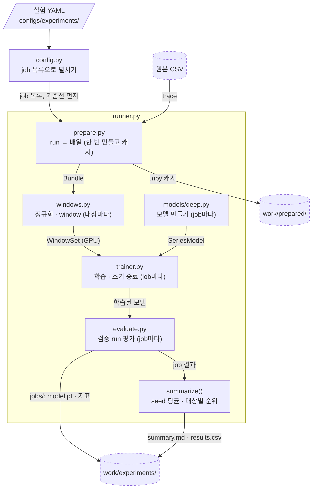
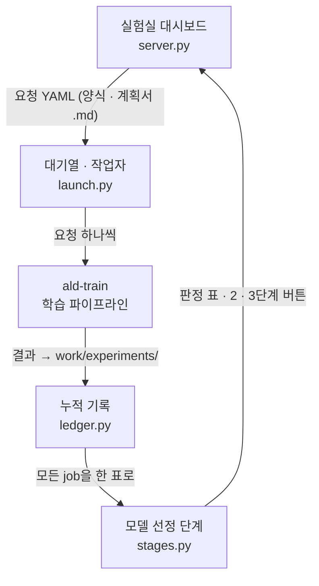

# 코드 구조

README의 [전체 구조](../README.md#전체-구조)에서 한 단계 들어가, 파일 단위로 무엇이 무엇을 넘기는지 보여 준다.
구조는 세 수준으로 나눠 그린다.

| 수준 | 무엇을 보나 | 어디에 |
|---|---|---|
| 시스템 | 구성요소 7개와 그 사이에 오가는 것 | README [전체 구조](../README.md#전체-구조) |
| 파일 | 학습 파이프라인, 실험 반복 | 이 문서 |
| 함수 | 명령별 함수 호출 그림 | 보고서의 Code Flow Chart 탭 (`report/codemap.py`가 `src/ald_lab/`을 읽어 자동으로 그림) |

함수 수준은 손으로 그리지 않는다. 코드에서 자동으로 만들어야 코드가 바뀌어도 그림이 틀리지 않는다.
이 문서의 그림은 Mermaid 글이라 여기서 바로 고치면 되고, GitHub이 그려 준다. 점선 테두리는 서버에만 있는 데이터다.

## 1. 학습 파이프라인 — `ald-train` 한 번

- 실험 YAML 하나가 대상 × 하이퍼파라미터 조합 × 입력 세트 × seed의 job 목록으로 펼쳐진다 (`config.expand_jobs`).
- 기준선 job(현재값 유지 · 레시피 평균)을 먼저 돌리고, 나머지 job은 GPU마다 작업자 프로세스 하나가 나눠 받는다 (`runner.run_experiment`, `runner._run_parallel`).
- 그림은 딥러닝 job의 경로다. Ridge · LightGBM은 `models/classic.py`를 쓰고 `trainer.py`를 거치지 않는다.
  두께(VM) 과제는 이 경로 대신 `training/vm.py`에서 run 단위 leave-one-out으로 돈다.
- 정규화 통계, 레시피 평균, 복사본 판정은 모두 학습 run에서만 계산한다.
- 시험 run은 이 흐름에서 열지 않는다. 후보가 정해진 뒤 `ald-final-test`(`runner.run_final_test`)가 한 번 연다.
- 결과 폴더의 파일 목록은 [`TRAINING.md`](TRAINING.md) 5장에 있다.

## 2. 실험 반복 — 모델 선정 단계

PatchTST를 먼저 충분히 탐색해 모든 대상에 쓰고, 기준선을 확실히 넘지 못한 대상에만 다른 모델을 쓰는 순서다.

| 단계 | 하는 일 | 코드 |
|---|---|---|
| 1 탐색 | 대표 대상 3개에서 PatchTST 조합을 학습하고, 대상마다 최고 조합을 1.0으로 둔 상대 MAE의 평균으로 순위를 매긴다 | `stages.search_ranking` |
| 2 전체 적용 | 상위 k개 조합을 그 과제의 모든 대상에 seed 여러 개로 학습한다 → `p2_patchtst_all_<과제>` | `stages.stage2_configs` |
| 3 대안 | PatchTST 최고가 기준선보다 seed 표준편차 2배를 넘게 좋지 않은 대상에만 iTransformer · DLinear · LightGBM을 돌린다 → `p3_fallback_<과제>` | `stages.patchtst_first`, `stages.stage3_config` |

- 대시보드의 탐색 양식과 계획서(.md, `planfile.py`)는 둘 다 같은 요청 YAML로 바뀌어 `work/queue/`에 쌓인다.
  작업자 하나가 요청을 차례로 돌리므로 두 요청이 GPU를 나눠 쓰지 않는다.
- LightGBM과의 차이는 판정 표에 참고로만 나오고 판정에는 쓰지 않는다.
- 터미널에서는 `ald-queue stage2 --task forecast`처럼 같은 단계를 대기열에 넣는다 ([`TRAINING.md`](TRAINING.md) 8장).
