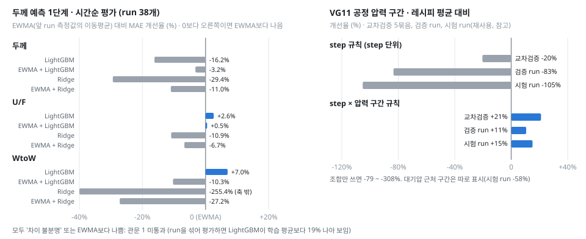
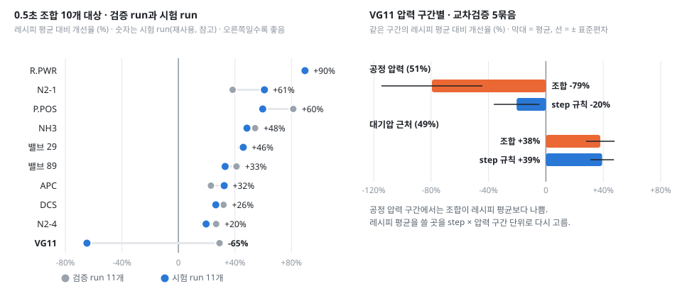
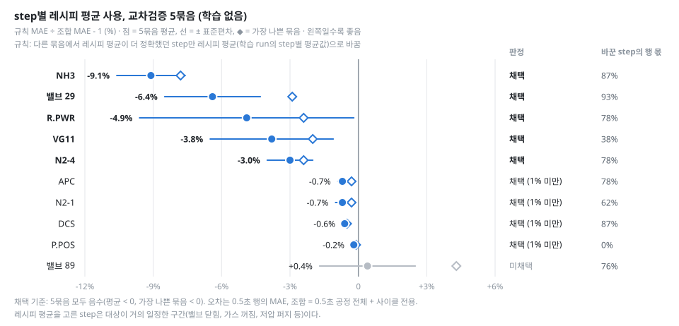
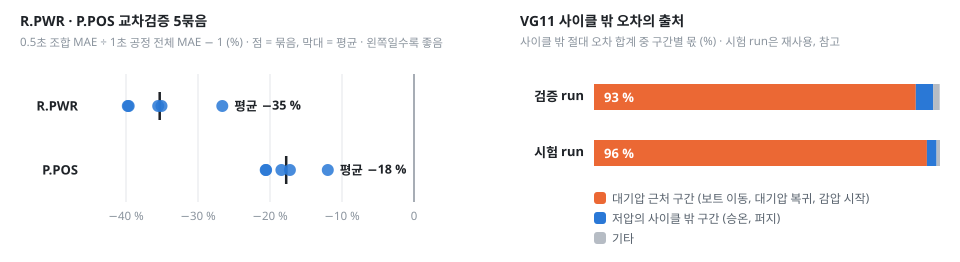
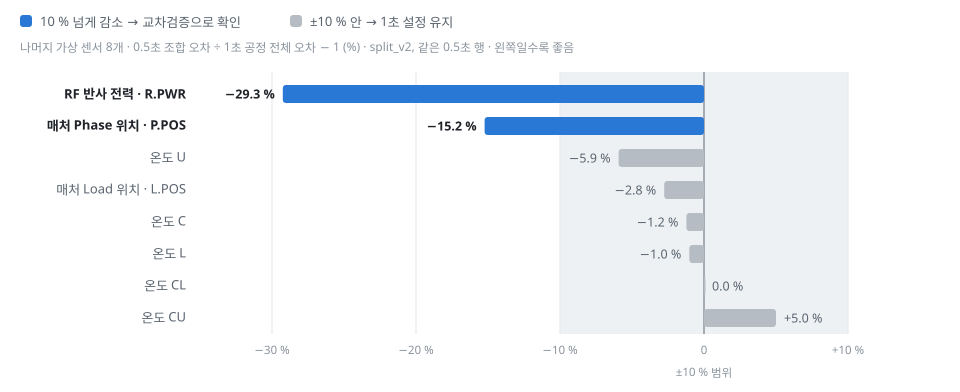
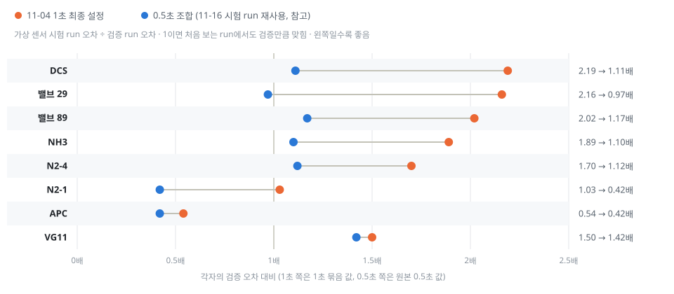
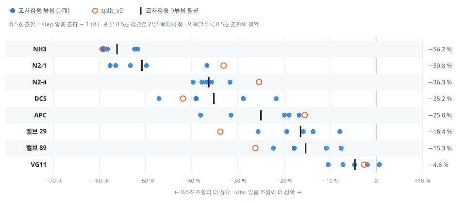
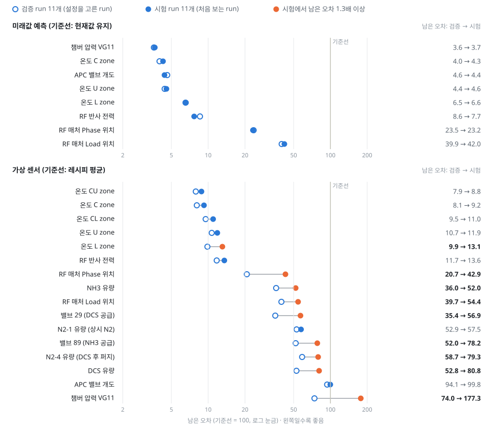
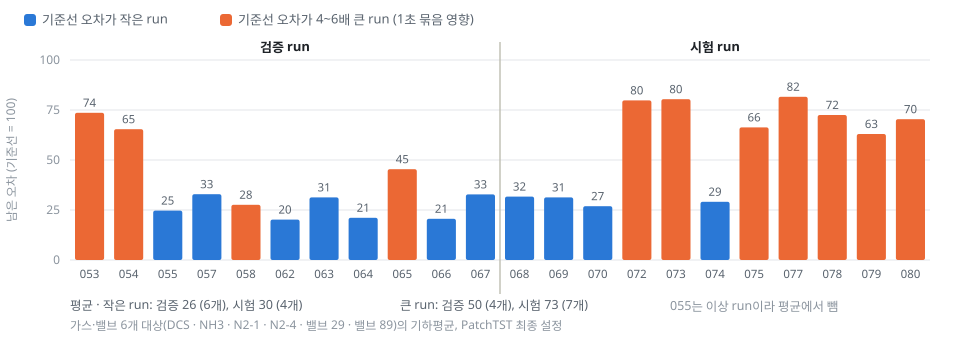
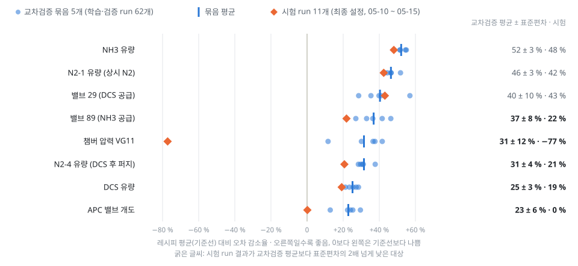

# 결과 상세 기록

README의 '결과 (Daily 갱신)'에는 날짜별 요지와 결과만 남기고, 표와 세부 수치는 여기에 둔다. 최신이 위에 있다.

오차는 모두 MAE(평균 절대 오차)다. 절대값에는 대상의 단위(Torr, ℃, slm, W, APC 개도 %)를 붙이고, 단위를 확인하지 못한 매처 위치(L.POS, P.POS)는 '단위 미확인'으로 적는다. 11-21에 DCS · NH3 유량을 sccm에서 slm으로, RF 반사 전력을 W로 정정했다(장비 자료). 단위가 없는 값은 다음과 같다.

- 개선율(%) = (기준선 MAE - 모델 MAE) ÷ 기준선 MAE × 100. 기준선은 미래값 예측이 현재값 유지, 가상 센서가 레시피 평균이다.
- 남은 오차 = 모델 MAE ÷ 기준선 MAE × 100 (기준선 = 100).
- 'A ÷ B - 1 (%)', 'B 대비 X % 감소' = A의 MAE ÷ B의 MAE - 1. 음수면 A가 정확하다.
- 배 = MAE끼리의 비, %p = 개선율끼리의 차이, 몫(%) = 절대 오차 합계 중 해당 구간이 차지하는 비율.

## 11-24 · 극한 탐색 0단계: 탐색 실행기(ald-hpo)와 대시보드, 논문 원문 검토, 1단계 탐색 설정 19개

연구 목표를 '하이퍼파라미터와 공정 파라미터를 극한까지 탐색해 어디까지 나오는지'로 다시 잡았다(11-23 사용자 결정).
극한은 탐색을 더 해도 교차검증 성능이 좋아지지 않는 지점(포화)으로 정의한다.

**지금까지의 탐색 방식 점검**

| 축 | 지금까지 | 빈 곳 |
|---|---|---|
| 하이퍼파라미터 (미래값 예측) | 하나씩 바꾼 비교(1~74차), 짧은 무작위 탐색 16조합 | 설정끼리의 상호작용, 학습률 일정 · weight decay · batch |
| 하이퍼파라미터 (가상 센서) | 짧은 무작위 탐색 16조합, 0.5초 사이클 전용 patch · window 일부 | 사실상 전부 |
| 입력 신호 | 164개 대 74개, 대상 계열 제외 | 계열 하나씩 빼기, 신호 수 곡선 |
| 데이터 처리 | 가상 센서: 묶음 · 구간 전용 · step 규칙 | 미래값 예측의 0.5초 학습, step 그룹 전용 모델 |
| 새 기법 | 없음 | 사전학습, 미래 step 정보, 주기 모듈, 다중 과제 |

**논문 원문 검토 (34편 + 유료 4편, 11-23)**

- 새 기법 후보 34개를 원문 표의 수치로 정리했다(중간보고 v2 12절). 먼저 할 5개: 다변수 탐색, 마스크 patch 사전학습, 미래 step 정보 + TimeXer,
  학습형 주기 template(CycleNet식), 계열 가림 다중 과제.
- 원문으로 바로잡은 점: TimeXer는 대상 이력을 0으로 채우면 MSE가 3.7배라 가상 센서에는 맞지 않는다. TimesNet의 보간 1위는 무작위 시점 결측이라
  신호 하나가 통째로 빠지는 가상 센서와 과제가 다르다. TimeMixer는 양쪽을 튜닝하면 PatchTST와의 차이가 11%에서 5%로 줄었다.
- 두께: Han 외(IEEE TSM 2025, 공개 CMP, 시간순)에서 온라인 GP MSE 11.57, EWMA 19.63. 'EWMA를 평균으로 둔 GP'는 원문에 없는 우리 설계안이다.
  CBCT는 서로 다른 출력이 아니라 같은 출력의 여러 운전 상태를 함께 학습한다(우리 두께 · U/F · WtoW에는 그대로 맞지 않음). TabPFN의 샘플 1만 · 특성 500개는 평가 범위다.

**탐색 실행기 (ald-hpo, 0단계 코드)**

- Optuna TPE(다변수, 작업자 여러 개가 같은 제안을 피하는 constant liar) + Hyperband(epoch별 검증 MAE로 중간 중단). GPU마다 작업자 1개, 탐색 기록 파일 하나를 함께 쓰고, 멈춘 탐색은 이어서 돈다.
- 첫 trial = 누적 기록의 지금 최고 설정을 그 실험의 학습 설정 그대로 다시 학습(기준점, 중간 중단 없음). 기록에 없는 항목은 그 실험의 학습 설정과 모델 기본값으로 채운다.
  smoke에서 이 항목을 탐색기가 고르던 문제를 찾아 고쳤고, 이미 시작한 탐색에는 `ald-hpo requeue-reference`(대시보드 '기준 trial 다시 넣기')로 새 기준 trial을 넣는다.
- trial은 지표와 학습 기록만 남긴다(가중치 · 예측 파일 없음). trial 결과는 study 표시 `hpo:<이름>`으로 본 기록에서 빠진다.
- 보고(`work/reports/hpo_<이름>.txt`, 5 trial마다 갱신): 진행과 예상 끝 시각, 포화 곡선(trial 수별 최고 기록과 기대 최고치), 포화 판정, 설정 중요도(fANOVA), 상위 trial의 실제 설정.
- 학습 루프: 최소 epoch, 학습률 일정 cosine · warmup, epoch별 검증 MAE. 기본값에서는 지금과 같이 동작한다.
- 대시보드 하이퍼파라미터 탐색 탭 '극한 탐색': 탐색 19개의 상태 · 진행 · 지금 설정 · 최고 · 지금 대비 · 포화 · 예상 끝, 체크한 탐색 대기열에 넣기, 기준점 다시 뽑기, 상위 5개 재학습, 기준 trial 다시 넣기.

**1단계 탐색 설정 19개 (configs/hpo, scripts/hpo_studies.py)**

| 묶음 | 탐색 | 기준 실험 | 목표 지표 |
|---|---|---|---|
| 미래값 예측 | VG11, APC, 온도 C, L.POS | g1_forecast_params (1초) | 검증 MAE |
| 가상 센서 0.5초 공정 전체 | NH3, 밸브 29, DCS, APC, VG11, P.POS, R.PWR | g1_virtual_sensor_res05 | 사이클 밖 MAE |
| 가상 센서 0.5초 사이클 전용 | 같은 7개 | g1_virtual_sensor_res05_cycleonly | 사이클 안 MAE |
| 가상 센서 1초 | 온도 C | g1_virtual_sensor | 검증 MAE |

탐색 공간(미래값 / 가상 센서): 학습률 0.00003~0.003, plateau · cosine, warmup 0 · 5, weight decay 0.000001~0.1, batch 256~2048, 최대 80~300 / 40~200 epoch,
층 2~10, d_model 64~384, head 4~16, d_ff 128~1024, dropout 0~0.3, patch 8~39 / 2~16초, stride = patch의 0.25~1배, window 64~1024 / 32~256초, RevIN 켬 · 끔 · 기준.

**다음**

- 1단계 탐색을 대시보드에서 차례로 넣는다(11-24 NH3 사이클 전용 실행 중, VG11 미래값 예측 대기). 첫 탐색의 trial당 시간으로 전체 일정을 다시 계산한다.
- 포화한 탐색은 상위 5개를 seed 3개로 다시 학습하고, 1위 설정을 교차검증 5묶음에서 판정한다.
- 두께 예측은 EWMA가 남긴 차이를 맞히는 GP와 TabPFN을 같은 시간순 평가로 병행한다(CPU).

## 11-22 · VG11 step × 압력 구간 규칙, 두께 예측 1단계 시간순 평가 (학습 없음)

<picture>
  <source media="(prefers-color-scheme: dark)" srcset="images/results_vmstage1_dark.svg">
  
</picture>

학습 없이 step_choice.py(교차검증), step_rule_test.py(검증 · 시험 run, 재사용 · 참고), export_pair.py, vm_stage1.py를 돌렸다.

**VG11 step × 압력 구간 규칙 (대기압 근처 = 학습 run 레시피 평균 > 10 Torr인 행, 개선율은 같은 구간의 레시피 평균 대비)**

| 구분 | 구간 | 레시피 평균 MAE (Torr) | 조합 MAE (Torr) | 규칙 MAE (Torr) | 조합 개선율 (%) | 규칙 개선율 (%) |
|---|---|---:|---:|---:|---:|---:|
| 교차검증 5묶음 | 공정 압력 (51 %) | 0.0469 | 0.0838 | 0.0370 | −79.4 ± 35.2 | +21.1 ± 2.0 (가장 작은 묶음 +18.8) |
| 교차검증 5묶음 | 대기압 근처 (49 %) | 2.114 | 1.297 | 1.274 | +37.9 ± 10.0 | +39.2 ± 8.2 |
| 검증 run | 공정 압력 | 0.0485 | 0.190 | 0.0434 | −292.3 | +10.6 |
| 검증 run | 대기압 근처 | 4.393 | 2.858 | 2.792 | +34.9 | +36.4 |
| 시험 run | 공정 압력 | 0.0443 | 0.181 | 0.0376 | −307.6 | +15.1 |
| 시험 run | 대기압 근처 | 2.593 | 4.130 | 4.090 | −59.3 | −57.8 |

- step 단위 규칙(11-21)은 공정 압력 구간에서 −20.4 %(교차검증), −105 %(시험 run)였다. step × 구간 36칸(행 38 %)을 레시피 평균으로 바꾸자 세 평가 모두 레시피 평균보다 나아졌다.
  VG11 전체 MAE 변화(규칙 ÷ 조합 − 1)는 교차검증 −5.2 ± 2.7 %, 검증 −7.5 %, 시험 −4.3 %.
- 효과가 큰 칸: 감압 시작 step(S.P-1)의 저압 부분(행 0.7 %, 조합 1.495 · 레시피 평균 0.149 Torr), 감압 다음 step(S.P-2) 저압 부분(1.204 · 0.019 Torr),
  사이클 밖 퍼지(A.PRG5, 행 8.5 %, 0.083 · 0.045 Torr), 사이클 안 N-FL2(행 9.9 %, 0.0021 · 0.0012 Torr).
  S.P-1은 step 전체로 보면 대기압 부분에서 모델이 나아 바뀌지 않던 step이다.
- 판정: VG11 가상 센서는 공정 압력 구간에서 이 규칙으로 채택한다. 대기압 근처 구간은 시험 run에서 레시피 평균보다 나빠(−58 %) 따로 표시한다.

**두께 예측 1단계 (vm_stage1.py, 학습 + 검증 run 58개를 run 번호 순으로, 처음 20개는 학습만, 평가 run 38개)**

run i는 그 앞의 run만으로 학습한 모델로 예측한다. 특성 462개(신호 164개 요약 + 사이클 수 + 대기 시간), Ridge는 앞 run에서 고른 상위 10개 특성,
LightGBM은 seed 3개 평균. 'EWMA +'는 EWMA가 남긴 차이(실측 − EWMA)를 trace 특성으로 맞힌다. 판정은 run별 |모델 오차| − |EWMA 오차|의 평균이 표준오차 2배를 넘는지다.

| 대상 (단위) | 이전 run 평균 | EWMA | LightGBM | EWMA + LightGBM | Ridge | EWMA + Ridge |
|---|---:|---:|---:|---:|---:|---:|
| 두께 (Å) | 0.204 (−15.6 %) | 0.177 | 0.205 (−16.2 %) | 0.182 (−3.2 %) | 0.229 (−29.4 %) | 0.196 (−11.0 %) |
| U/F (%) | 0.0754 (−7.2 %) | 0.0703 | 0.0685 (+2.6 %) | 0.0700 (+0.5 %) | 0.0779 (−10.9 %) | 0.0750 (−6.7 %) |
| WtoW (%) | 0.0639 (−32.3 %, 확실히 나쁨) | 0.0483 | 0.0449 (+7.0 %) | 0.0533 (−10.3 %) | 0.172 (−255 %) | 0.0615 (−27.2 %) |
| 사이클당 두께 (Å/cycle) | 0.0196 | 0.0016 | 0.0037 (확실히 나쁨) | 0.0063 (확실히 나쁨) | 0.0064 (확실히 나쁨) | 0.0105 (확실히 나쁨) |

괄호는 EWMA 대비 개선율. 표시가 없으면 '차이 불분명'이다.

- 어느 모델도 EWMA보다 확실히 낫지 않다. 1단계 관문(EWMA + trace 특성이 EWMA보다 표준오차 2배 넘게 나음)은 통과하지 못했다.
- 같은 특성으로 run을 섞어 평가(leave-one-run-out)하면 LightGBM이 학습 평균보다 두께 19.2 %, U/F 18.8 %, WtoW 30.0 % 나아 보인다.
  시간 순서대로 평가하면 이 이점이 사라진다. 10-27의 개선은 뒤 run까지 보고 배운 시간 흐름(run 순서와 함께 변하는 특성)이었던 것으로 본다.
- 사이클당 두께는 EWMA가 이전 run 평균보다 92 % 나았다. 사이클 수가 바뀐 시점의 단차를 EWMA만 바로 따라간다.
- EWMA가 남긴 차이와 자주 함께 뽑힌 특성: 두께는 MFCRcpSet_N2-1 사이클 표준편차, PressSet, O.HT_Act_L. U/F는 AUXMon_JH7, APC 개도. WtoW는 CascadeTC_CL ·
  O.HT_Act_CL 사이클 표준편차, Power_HT.CL, 대기 시간. 뽑혀도 예측을 확실히 개선하지는 못했다.

**다음**

- 학습 없음: 가상 센서 잔차로 이상 run(001 · 002 · 055 · 057)을 가려낼 수 있는지 확인한다(vs_anomaly.py, 교차검증에서 그 run을 보지 않은 모델의 예측).
- 두께 예측: 2단계(PatchTST)로 갈지 결정이 필요하다. trace 요약값으로는 EWMA를 넘지 못했으므로, 사이클 안의 시간 변화를 보는 PatchTST가 더하는지 한 번 확인할지,
  아니면 'EWMA가 실용 기준이고 trace로는 더 맞히지 못한다'로 정리할지다.

## 11-21 · VG11 압력 구간별 평가, 0.5초 조합 시험 run 확인, 두께 예측 데이터 점검 (학습 없음)

<picture>
  <source media="(prefers-color-scheme: dark)" srcset="images/results_vg11range_dark.svg">
  
</picture>

651~654차(VG11 · 밸브 29 split_v2 seed 48)로 0.5초 조합 10개 대상이 모두 seed 3개가 됐다(남은 오차 VG11 70.3 → 70.6, 밸브 29 31.8 → 32.3, 기준선 = 100).
그 뒤 학습 없이 step_choice.py(교차검증), vm_audit.py, pair_test.py · step_rule_test.py(시험 run 재사용, 참고), export_pair.py를 돌렸다.

**0.5초 조합 시험 run 확인 (pair_test.py, 레시피 평균 대비 개선율 %, 구간별 MAE로 추정한 조합, step 규칙 전)**

| 대상 | 검증 | 시험 | 시험 - 검증 (%p) |
|---|---:|---:|---:|
| R.PWR | 89.4 | 89.6 | +0.2 |
| N2-1 | 38.4 | 60.9 | +22.5 |
| P.POS | 81.3 | 59.7 | −21.6 |
| NH3 | 54.3 | 48.5 | −5.8 |
| 밸브 29 | 44.6 | 45.9 | +1.3 |
| 밸브 89 | 41.1 | 33.1 | −8.0 |
| APC | 23.0 | 32.4 | +9.4 |
| DCS | 31.9 | 26.5 | −5.4 |
| N2-4 | 26.7 | 19.6 | −7.1 |
| VG11 | 29.1 | −64.7 | −93.8 |

- VG11을 뺀 9개 대상은 시험 run에서도 레시피 평균보다 20~90 % 나았다. P.POS는 21.6 %p 줄었다(공정 전체 모델도 같은 폭으로 줄어 사이클 전용 모델 탓은 아니다).

**step 규칙 시험 run 확인 (step_rule_test.py, 변화 = 규칙 MAE ÷ 조합 MAE − 1)**

- 검증 · 시험: NH3 −11.8 · −14.6 %, R.PWR −7.3 · −5.6 %, 밸브 29 −11.1 · −4.4 %, N2-4 −4.2 · −3.2 %, VG11 −5.8 · −3.0 %,
  APC · DCS · P.POS −0.3 ~ −0.9 %, N2-1 0.0 · +0.1 %. 처음 보는 run에서도 규칙이 오차를 줄였다.

**VG11 압력 구간별 (대기압 근처 = 학습 run 레시피 평균 > 10 Torr인 행, 개선율은 같은 구간의 레시피 평균 대비)**

| 구분 | 구간 | 행 % | 레시피 평균 MAE (Torr) | 조합 MAE (Torr) | 규칙 MAE (Torr) | 조합 개선율 (%) | 규칙 개선율 (%) |
|---|---|---:|---:|---:|---:|---:|---:|
| 교차검증 5묶음 | 공정 압력 | 51.0 | 0.0469 | 0.0838 | 0.0563 | −79.4 ± 35.2 | −20.4 ± 15.9 |
| 교차검증 5묶음 | 대기압 근처 | 49.0 | 2.114 | 1.297 | 1.274 | 37.9 ± 10.0 | 39.2 ± 8.2 |
| 검증 run | 공정 압력 | 52.8 | 0.0485 | 0.190 | 0.0889 | −292.3 | −83.4 |
| 검증 run | 대기압 근처 | 47.2 | 4.393 | 2.858 | 2.792 | 34.9 | 36.4 |
| 시험 run | 공정 압력 | 50.5 | 0.0443 | 0.181 | 0.0909 | −307.6 | −105.2 |
| 시험 run | 대기압 근처 | 49.5 | 2.593 | 4.130 | 4.090 | −59.3 | −57.8 |

- 판정 구간인 공정 압력에서 조합은 레시피 평균보다 나빴다. 사이클 안은 조합이 낫지만(634~648차 vg11_steps), 사이클 밖 저압 step의 오차가 크다.
  step 규칙은 step 전체를 보고 고르므로, 대기압에서 저압으로 내려가는 step처럼 두 구간에 걸친 step의 저압 부분을 놓친다.
- 그래서 VG11은 step × 압력 구간 칸마다 레시피 평균을 쓸지 고르도록 바꿨다(step_choice.json의 cells, ald-predict --recipe-steps가 읽음).

**두께 예측 데이터 점검 (vm_audit.py, 학습 + 검증 run 58개, 시험 run 봉인)**

| 확인 | 결과 |
|---|---|
| split-half 신뢰도 (두께 평균) | 같은 WAP 안에서 점을 반씩 0.999, WAP 1 · 3 · 5 대 2 · 4 0.949. 점 표집 잡음은 run 간 표준편차의 3 % 이하 |
| split-half 신뢰도 (U/F) | WAP 나누기 0.848 |
| run 순서 | 두께는 run 번호와 순위 상관 0.43, 바로 앞 run과 0.53. WtoW는 run 번호와 −0.59 |
| 앞 run 측정값 기준선 (학습 평균 대비 MAE) | EWMA 0.3이 두께 −17.7 %(0.196 → 0.161 Å), U/F −6.6 %, WtoW −13.7 % |
| 사이클 수 | 사이클 수가 다른 두 묶음의 두께 평균이 같다(사이클당 두께가 다르다) |
| 대기 시간 | 앞 run과의 대기 시간과 순위 상관: 두께 0.23, WtoW 0.45 |
| run 요약 특성 460개 | 우연 수준(순서를 섞었을 때 최대 상관의 95 % 분위)을 넘는 특성: 두께 6개, U/F 0개, WtoW 64개 |

- run 간 두께 차이는 측정 잡음이 아니다. 모델 R²의 상한이 0.95 수준이라 예측할 거리는 있다.
- 앞 run 측정값의 EWMA만으로 두께 MAE가 18 % 준다. 10-27 LightGBM의 개선(17 %)도 run 순서를 따라 변하는 특성으로 이 흐름을 잡았을 수 있다.
  그래서 두께 예측의 기준선을 EWMA로 두고, trace 특성이 그보다 더 알려 주는지를 시간 순서대로 확인한다(scripts/vm_stage1.py).
- WtoW와 함께 움직인 특성(온도, 히터 출력, N2 퍼지 설정)은 run 순서와도 함께 움직여, 시간 흐름의 대리 변수인지 따로 봐야 한다.
- U/F는 신뢰도가 0.85인데 run 요약 특성 중 우연 수준을 넘는 것이 없다. 사이클 안의 시간 변화를 보는 모델(2단계 PatchTST)의 후보다.

**단위 정정 (11-21)**: DCS · NH3 유량 slm(sccm에서 정정), RF 반사 전력 W. 대시보드와 패키지는 이미 학습한 결과도 지금 컬럼 사전의 단위로 보인다.

**다음 (학습 없음)**

- VG11 step × 압력 구간 규칙을 교차검증으로 다시 고르고(step_choice.py), 시험 run 확인(step_rule_test.py)과 패키지(export_pair.py)를 다시 만든다.
- 두께 예측 1단계: vm_stage1.py. 시간순 평가(앞 run만으로 학습)에서 trace 특성 모델, EWMA + trace 특성 모델이 EWMA보다 확실히 나은지 본다.

## 11-20 · step별 레시피 평균 사용, R.PWR · P.POS seed 보강 (649~650차)

<picture>
  <source media="(prefers-color-scheme: dark)" srcset="images/results_steprule_dark.svg">
  
</picture>

649~650차는 split_v2의 R.PWR · P.POS 0.5초 공정 전체 · 사이클 전용에 seed 48을 더했다(115차 설정, 시험 run 미사용).
대기열이 빈 뒤 결과 정리에서 step_choice.py가 처음 돌았다(학습 없음).

**step별 레시피 평균 사용 (step_choice.py, 교차검증 5묶음)**

조합은 0.5초 공정 전체 + 사이클 전용(사이클 안은 사이클 전용 예측)이다. 묶음 k에서 레시피 평균으로 바꿀 step은 나머지 4묶음에서
그 step의 레시피 평균 절대 오차 합이 조합보다 작았던 step이다. MAE는 5묶음 평균, 변화는 '규칙 MAE ÷ 조합 MAE − 1'(평균 ± 묶음 간 표준편차)이다.
바꾼 step은 묶음의 절반을 넘게 고른 step이고, 행 %는 그 step들이 차지하는 0.5초 행의 몫이다.

| 대상 | 단위 | 조합 MAE | 규칙 MAE | 변화 (%) | 가장 나쁜 묶음 (%) | 바꾼 step 수 | 바꾼 step 행 % | 판정 |
|---|---|---:|---:|---:|---:|---:|---:|---|
| NH3 | slm | 0.01562 | 0.01418 | −9.1 ± 1.5 | −7.8 | 42 | 86.6 | 채택 |
| 밸브 29 | on/off | 0.002008 | 0.001879 | −6.4 ± 2.1 | −2.9 | 44 | 92.8 | 채택 |
| R.PWR | W | 0.02106 | 0.01997 | −4.9 ± 4.7 | −2.4 | 39 | 78.1 | 채택 |
| VG11 | Torr | 0.6816 | 0.6565 | −3.8 ± 2.7 | −2.0 | 32 | 37.7 | 채택 |
| N2-4 | slm | 0.001678 | 0.001628 | −3.0 ± 1.0 | −2.4 | 30 | 77.5 | 채택 |
| APC | %(개도) | 0.3515 | 0.3495 | −0.7 ± 0.2 | −0.3 | 38 | 77.6 | 채택 (1 % 미만) |
| N2-1 | slm | 0.003543 | 0.003523 | −0.7 ± 0.3 | −0.3 | 28 | 61.9 | 채택 (1 % 미만) |
| DCS | slm | 0.003293 | 0.003272 | −0.6 ± 0.1 | −0.5 | 44 | 86.8 | 채택 (1 % 미만) |
| P.POS | 단위 미확인 | 0.3933 | 0.3925 | −0.2 ± 0.1 | −0.1 | 2 | 0.4 | 채택 (1 % 미만) |
| 밸브 89 | on/off | 0.002534 | 0.002546 | +0.4 ± 2.1 | +4.3 | 39 | 76.4 | 미채택 |

- 9개 대상이 5묶음 모두에서 줄었다. 계획서 기준(평균 < 0, 가장 나쁜 묶음 < 0)대로 9개 대상의 예측과 패키지에 넣는다.
  1 % 넘게 준 대상은 NH3 · 밸브 29 · R.PWR · VG11 · N2-4 다섯 개다.
- 바꾼 step은 대상이 거의 변하지 않는 구간이다. 레시피 평균 MAE가 0에 가까운 step(가스 꺼짐, 밸브 닫힘)이 대부분이고,
  모델은 이 구간에서 작은 흔들림을 더하고 있었다. 행 몫은 62~93 %로 크지만 원래 오차가 작아 줄어드는 폭은 대상마다 다르다.
- NH3 감소의 대부분은 N-FL2(조합 0.0099 · 레시피 평균 0.0015 slm)와 CHANGE(0.031 · 0.000 slm) 두 step에서 나왔다.
- VG11은 대기압 근처 구간(B.FILL5, B.DOWN, S.P-1, START, B.UP, B.FILL4, WAIT, END)이 바뀌지 않았다. 바뀐 것은 저압의 사이클 밖 step
  (R.UP1, A.PRG5, STAB1, R.DOWN1, A.VAC1~4, PREPRG1 등)과 사이클 안 N-FL2 · CLOSE1이다. 634~648차 vg11_steps에서 본
  '저압의 사이클 밖 구간은 레시피 평균이 6~7배 정확'과 맞는다. 사이클 밖 오차의 대부분인 대기압 근처 구간은 그대로 남는다.
- 밸브 89는 가장 나쁜 묶음에서 +4.3 %로 늘어 넣지 않는다.
- 약점: 바꾼 step 안에서는 입력 신호와 상관없이 레시피 평균을 내므로, 그 구간의 이상(밸브 고장, 가스 누설 등)은 가상 센서 값에 나타나지 않는다.
- 코드: step_choice.py가 step_choice.json(대상별 채택 여부와 step 목록)을 남기고, export_pair.py가 채택된 대상의 패키지에
  recipe_steps.json과 `--recipe-steps`를 넣는다. 처음 보는 run에서의 확인은 step_rule_test.py(시험 run 재사용, 참고)로 한다.

**R.PWR · P.POS seed 3개 (split_v2, raw_scale.py '구간 전용 조합')**

값은 같은 0.5초 행에서 잰 남은 오차(%, 100 = 기존 1초 레시피 평균)다.

| 대상 | 1초 공정 전체 (지금까지의 최종 설정) | 0.5초 공정 전체 | 0.5초 조합 | 0.5초 조합 ÷ 1초 공정 전체 − 1 (%) | seed 2개일 때 (%) |
|---|---:|---:|---:|---:|---:|
| R.PWR | 14.7 | 10.8 | 10.3 | −29.9 | −29.3 |
| P.POS | 21.0 | 20.3 | 18.6 | −11.4 | −15.2 |

- P.POS는 seed 48을 더하자 차이가 줄었지만, 교차검증 5묶음(−17.7 ± 3.6 %)과 같은 방향이라 0.5초 조합을 유지한다.

**다음 실험 (651~654차)**

- VG11 · 밸브 29의 split_v2 0.5초 공정 전체 · 사이클 전용은 seed 46 · 47 두 개뿐이다. seed 48을 더해 0.5초 조합 10개 대상을 모두 seed 3개로 맞춘다.
- 끝나면 한 번: 0.5초 조합 10개 대상의 시험 run 확인(pair_test.py), step 규칙의 시험 run 확인(step_rule_test.py), 규칙을 넣은 패키지(export_pair.py). 시험 run은 재사용, 참고.
- 결정 필요: VG11 대기압 근처 구간 평가 방식, 두께 예측 설계 시작.

## 11-20 · R.PWR · P.POS 교차검증, VG11 사이클 밖 오차 원인 (634~648차)

<picture>
  <source media="(prefers-color-scheme: dark)" srcset="images/results_cv_rest_dark.svg">
  
</picture>

634~648차(부가 실험, 시험 run 미사용)는 교차검증 5묶음마다 1초 공정 전체, 0.5초 공정 전체, 0.5초 사이클 전용을 seed 46 · 47 · 48로 학습했다(115차 설정).
값은 같은 0.5초 행에서 잰 남은 오차(%)이고, 100 = 기존 1초 레시피 평균이다(raw_scale.py '구간 전용 조합' [교차검증 1~5]). 결과 정리는 이번부터 대기열이 비면 자동으로 돈다.

| 묶음 | R.PWR 1초 공정 전체 | 0.5초 공정 전체 | 0.5초 조합 | 변화 (%) | P.POS 1초 공정 전체 | 0.5초 공정 전체 | 0.5초 조합 | 변화 (%) |
|---|---:|---:|---:|---:|---:|---:|---:|---:|
| 1 | 15.9 | 11.1 | 9.6 | −39.6 | 30.1 | 29.8 | 23.9 | −20.6 |
| 2 | 15.2 | 10.9 | 9.8 | −35.5 | 30.4 | 30.3 | 24.8 | −18.4 |
| 3 | 16.1 | 11.0 | 9.7 | −39.8 | 29.2 | 28.4 | 23.2 | −20.5 |
| 4 | 15.4 | 11.4 | 11.3 | −26.6 | 25.9 | 25.9 | 22.8 | −12.0 |
| 5 | 15.4 | 10.4 | 10.0 | −35.1 | 29.0 | 28.9 | 24.0 | −17.2 |

- 변화는 '0.5초 조합 ÷ 1초 공정 전체 − 1'이다. R.PWR −35.3 ± 5.3 %, P.POS −17.7 ± 3.6 %로 5묶음 모두 음수라 계획서 기준대로 0.5초 조합으로 정한다.
  가상 센서 16개의 최종 구성: 0.5초 조합 10개(가스 4 · 밸브 2 · APC · VG11 · R.PWR · P.POS), 1초 공정 전체 6개(온도 5 · L.POS).
- 사이클 전용 몫(combine_predictions 1-13, 0.5초 레시피 평균 대비 개선율 증가분): R.PWR +0.9 ± 0.6 %p(가장 작은 묶음 0.1), P.POS +4.9 ± 1.1 %p(3.1).
  R.PWR은 0.5초 학습만으로 27~31 % 줄었고 사이클 전용 몫은 작지만 모든 묶음에서 0보다 크다. P.POS는 0.5초 공정 전체가 1초와 거의 같아, 개선이 사이클 전용 모델에서 나왔다.

**VG11 사이클 밖 오차 (vg11_steps.py, split_v2 0.5초 조합, 학습 없음, 시험 run은 재사용 · 참고)**

| 구분 | 사이클 안 MAE 조합 · 레시피 평균 | 사이클 밖 MAE 조합 · 레시피 평균 | 사이클 밖 몫 |
|---|---|---|---:|
| 검증 run 11개 | 0.044 · 0.052 Torr (−14 %) | 2.22 · 3.22 Torr | 98.9 % |
| 시험 run 11개 | 0.038 · 0.049 Torr (−21 %) | 3.12 · 1.89 Torr | 99.4 % |

| 사이클 밖 구간 | 행 몫 | 오차 몫 (검증 · 시험) | 조합 ÷ 레시피 평균 (검증 · 시험) | 평균 부호 오차 (검증 · 시험) |
|---|---:|---|---|---|
| 대기압 근처 (보트 이동, 대기압 복귀, 감압 시작) | 약 60 % | 93.0 · 96.2 % | 0.65 · 1.60 | −2.6 · −4.8 Torr |
| 저압의 사이클 밖 (승온, 퍼지) | 약 26 % | 5.0 · 2.8 % | 7.2 · 6.2 | −0.4 · −0.3 Torr |

- 사이클 밖 오차는 거의 모두 대기압 근처 구간에서 나온다. 이 구간에서 모델은 압력을 실제보다 낮게 예측했다(부호 오차 음수). 레시피 평균의 오차도
  run마다 2~6 Torr로 커서, 이 구간의 압력 수준이 run마다 다르다는 뜻이다. 같은 계열 압력계를 모두 뺀 입력으로는 이 수준을 알기 어렵다고 본다(해석).
- 검증 run 064~067에서는 모델이 레시피 평균보다 크게 나았고(0.2~0.3배), 시험 run 072~080에서는 1.8~8.1배 나빴다. run 번호와의 순위 상관 +0.38로 시기에 따라 달라진다.
- step 전환 직후 3초는 사이클 밖 오차의 1 % 미만이다. 타이밍 문제는 아니다.
- 저압의 사이클 밖 구간은 레시피 평균이 6~7배 정확하다. 이 구간만 레시피 평균으로 바꾸면 사이클 밖 MAE가 검증 4.3 %, 시험 2.4 % 줄어든다(같은 run에서 고르고 잰 값이라 낙관적).
  고르는 것과 재는 것을 나눠 확인하도록 scripts/step_choice.py를 결과 정리에 넣었다(교차검증 묶음 하나씩 비워 두고 고름).

**다음 실험 (649~650차)**

- R.PWR · P.POS: split_v2 0.5초 공정 전체 · 사이클 전용에 seed 48을 더해 seed 3개로 맞춘 뒤, 시험 run 재사용(참고)과 패키지를 만든다.
- step별 레시피 평균 사용: 결과 정리(step_choice.py)로 교차검증에서 확인한다(학습 없음).
- VG11 대기압 근처 구간을 따로 평가할지는 결정이 필요하다.

## 11-16 · 나머지 가상 센서 8개 0.5초 조합 (630~633차)

<picture>
  <source media="(prefers-color-scheme: dark)" srcset="images/results_rest_dark.svg">
  
</picture>

가스 · 밸브 · APC · VG11에서 확정한 0.5초 조합(0.5초 공정 전체 + 0.5초 사이클 전용)을 나머지 8개에 split_v2로 학습했다(630~633차, seed 46 · 47, 부가 실험, 시험 run 미사용).
값은 같은 0.5초 행에서 잰 남은 오차(%)이고, 100 = 기존 1초 레시피 평균이다(raw_scale.py '구간 전용 조합' [split_v2]).

| 대상 | 기존 1초 공정 전체 (지금 최종 설정) | 기존 1초 조합 | 0.5초 공정 전체 | 0.5초 조합 | 0.5초 조합 ÷ 1초 공정 전체 − 1 (%) |
|---|---:|---:|---:|---:|---:|
| R.PWR | 14.7 | 15.0 | 11.0 | 10.4 | −29.3 |
| P.POS | 21.0 | 21.7 | 20.0 | 17.8 | −15.2 |
| 온도 U | 11.8 | 11.4 | 11.8 | 11.1 | −5.9 |
| L.POS | 39.8 | 40.2 | 40.1 | 38.7 | −2.8 |
| 온도 C | 8.2 | 7.6 | 8.7 | 8.1 | −1.2 |
| 온도 L | 9.8 | 9.4 | 10.0 | 9.7 | −1.0 |
| 온도 CL | 9.6 | 9.8 | 10.2 | 9.6 | 0.0 |
| 온도 CU | 8.0 | 7.0 | 9.0 | 8.4 | +5.0 |

- 계획서 기준(10 % 넘게 감소)을 넘은 R.PWR · P.POS만 교차검증 5묶음(1초 · 0.5초 모두)으로 확인한다. 나머지 6개는 1초 설정을 유지한다. 분할 하나 · seed 2개라 채택은 하지 않는다.
- 이 8개는 0.5초 레시피 평균이 1초 레시피 평균과 거의 같다(97.3 ~ 99.9, 가스 · 밸브 · APC는 57.6 ~ 67.3). 1초 묶음이 기준선을 흔드는 문제가 작은 대상이다.
- 사이클 안만 보면 0.5초 사이클 전용 모델이 기존 1초 사이클 전용(window 32초)보다 R.PWR −31 %, P.POS −32 %, 온도 C −37 %, CL −35 %, L.POS −10 %였고, 온도 CU는 2.1배였다(+112 %).
  온도는 사이클 안 오차가 공정 전체 오차보다 훨씬 작아 전체 결과에는 거의 영향이 없었다.
- 기존 1초 조합(1초 사이클 전용 window 32초, 217~222차)은 온도 CU에서 1초 공정 전체보다 12.5 % 작았다(8.0 → 7.0, 온도 C −7.3 %). 분할 하나의 결과라 참고로 둔다.

**다음 실험 (634차~)**

- R.PWR · P.POS: 교차검증 5묶음에서 1초 공정 전체 · 0.5초 공정 전체 · 0.5초 사이클 전용을 seed 3개(46 · 47 · 48)로 학습해 같은 0.5초 행에서 비교한다.
- VG11: 시험 run 오차의 약 99 %가 사이클 밖이다. step별 오차로 원인을 확인한다(학습 없음).

## 11-16 · 0.5초 조합 seed 3개 재확인 · 시험 run 재사용 (609~629차)

<picture>
  <source media="(prefers-color-scheme: dark)" srcset="images/results_pairtest_dark.svg">
  
</picture>

seed 48(609~629차)을 더해 0.5초 조합 모델을 seed 3개로 맞췄다(밸브 29 · VG11은 seed 2개).

**같은 0.5초 행 비교 · 교차검증 5묶음 (raw_scale.py · combine_predictions 1-13)**

| 대상 | 0.5초 조합 ÷ step 맞춤 조합 − 1 (%) | 가장 큰 값 | 사이클 전용 몫 (%p, 가장 작은 묶음) |
|---|---:|---:|---:|
| NH3 | −57.1 ± 3.5 | −53.3 | 21.7 ± 6.3 (14.3) |
| N2-1 | −50.8 ± 7.8 | −37.5 | 22.7 ± 3.0 (18.0) |
| N2-4 | −35.8 ± 2.6 | −31.7 | 21.7 ± 6.2 (11.6) |
| DCS | −29.8 ± 8.1 | −15.9 | 19.9 ± 9.4 (4.7) |
| APC | −23.4 ± 8.2 | −17.2 | 23.7 ± 7.1 (16.3) |
| 밸브 29 | −16.4 ± 6.6 | −7.8 | 13.9 ± 9.6 (4.5) |
| 밸브 89 | −15.9 ± 5.9 | −10.6 | 18.6 ± 4.1 (13.1) |
| VG11 | −4.6 ± 4.3 | +0.8 | 1.2 ± 0.6 (0.6) |

- 결정은 11-15와 같다. DCS의 사이클 전용 몫은 19.9 ± 9.4 %p로 기준(평균 > 표준편차의 2배, 가장 작은 묶음 > 0)을 근소하게 넘었다.

**시험 run 재사용 (pair_test.py, 참고)**

split_v2의 0.5초 조합을 시험 run 11개에서 한 번 평가했다. 시험 결과로 설정을 바꾸지 않는다.
1초 최종 설정은 11-04 시험(114~119차) 값이다. 그 MAE는 1초 묶음 값 기준이라, 원본 0.5초 값으로 재면 더 커진다.

| 대상 | 0.5초 조합 개선율 검증 → 시험 (%) | 0.5초 조합 시험 MAE ÷ 검증 MAE | 1초 최종 설정 시험 MAE ÷ 검증 MAE | 시험 MAE: 0.5초 조합 ÷ 1초 최종 설정 |
|---|---:|---:|---:|---:|
| DCS | 31.9 → 26.5 | 1.11 | 2.19 | 0.70 |
| N2-1 | 38.4 → 60.9 | 0.42 | 1.03 | 0.53 |
| N2-4 | 26.7 → 19.6 | 1.12 | 1.70 | 0.73 |
| NH3 | 54.3 → 48.5 | 1.10 | 1.89 | 0.89 |
| 밸브 29 | 45.4 → 46.4 | 0.97 | 2.16 | 0.70 |
| 밸브 89 | 41.1 → 33.1 | 1.17 | 2.02 | 0.63 |
| APC | 23.0 → 32.4 | 0.42 | 0.54 | 0.58 |
| VG11 | 29.5 → −61.4 | 1.42 | 1.50 | 0.91 |

- 개선율은 같은 실험의 0.5초 레시피 평균 대비다. 조합은 구간별 MAE로 만든 추정이다(사이클 안 비율 검증 0.35 · 시험 0.32).
- VG11: 시험의 사이클 안은 사이클 전용 모델이 공정 전체 모델보다 69 % 낮았고, 조합 시험 MAE의 약 99 %가 사이클 밖(감압 · 벤트 등) 몫이다(구간별 MAE로 계산). 원인 분석 대상으로 두고 설정은 바꾸지 않는다.

## 11-15 · 0.5초 조합 최종 구성, 같은 0.5초 행 비교 (교차검증 5묶음, 548~608차)

정리 스크립트(raw_scale.py · combine_predictions.py · side_studies.py)로 저장한 예측값을 다시 계산한 값이다(학습 없음, 시험 run 미사용).
아래 '11-15 · 0.5초 조합 교차검증 5묶음' 항목의 학습 로그 추정은 이 결과로 대체한다.

<picture>
  <source media="(prefers-color-scheme: dark)" srcset="images/results_pair_dark.svg">
  
</picture>

조합은 사이클 안은 사이클 전용 모델, 나머지는 공정 전체 모델의 예측을 쓴다. 남은 오차는 원본 0.5초 값으로 같은 행에서 잰 값(%)이고,
100은 그 묶음의 첫 묶음 방식의 레시피 평균이다(교차검증 1~3은 기존 1초, 4 · 5는 기존 1초의 저장된 예측값이 없어 step 맞춤).
'0.5초 ÷ step 맞춤 − 1'은 같은 행끼리의 비라 기준과 상관없다. 사이클 전용 몫은 0.5초 레시피 평균 대비 개선율의 증가분(%p)이다.

| 대상 | step 맞춤 조합 | 0.5초 조합 | 0.5초 ÷ step 맞춤 − 1 (%) | 가장 큰 값 | 사이클 전용 몫 (%p, 가장 작은 묶음) |
|---|---:|---:|---:|---:|---:|
| NH3 | 64.9 ± 10.7 | 28.2 ± 3.6 | −56.2 ± 3.9 | −51.7 | 22.3 ± 8.5 (10.4) |
| N2-1 | 61.1 ± 11.2 | 30.8 ± 11.4 | −50.8 ± 8.5 | −36.6 | 22.2 ± 3.2 (17.8) |
| N2-4 | 64.1 ± 11.6 | 41.0 ± 8.7 | −36.3 ± 2.9 | −31.7 | 22.7 ± 5.7 (14.3) |
| DCS | 65.6 ± 9.1 | 42.4 ± 7.6 | −35.2 ± 9.9 | −21.7 | 26.0 ± 9.7 (12.3) |
| APC | 55.9 ± 20.8 | 41.7 ± 16.7 | −25.0 ± 9.3 | −16.7 | 25.7 ± 10.0 (14.8) |
| 밸브 29 | 40.9 ± 16.1 | 33.7 ± 11.6 | −16.4 ± 6.6 | −7.8 | 13.9 ± 9.6 (4.5) |
| 밸브 89 | 45.6 ± 16.4 | 38.0 ± 11.5 | −15.3 ± 5.9 | −7.7 | 18.8 ± 4.8 (13.2) |
| VG11 | 67.2 ± 10.6 | 64.0 ± 9.6 | −4.6 ± 4.3 | +0.8 | 1.2 ± 0.6 (0.6) |

- 7개 대상은 '0.5초 ÷ step 맞춤 − 1'의 가장 큰 값도 음수다. 5묶음 모두 0.5초 조합이 정확해 계획서 기준대로 0.5초 조합으로 정한다.
- VG11은 교차검증 1에서만 +0.8 %로 갈렸다. 기준대로 5묶음 평균이 작은 0.5초 조합을 쓴다.
- 사이클 전용 몫은 6개 대상이 '평균 > 표준편차의 2배, 가장 작은 묶음 > 0' 기준을 넘었다. 밸브 29와 VG11은 넘지 못했지만,
  같은 0.5초 행에서 0.5초 공정 전체만 쓴 경우보다 6개 분할(split_v2 + 교차검증 5묶음) 모두 오차가 작아(밸브 29 2.9 ~ 14.1, VG11 0.6 ~ 2.2) 조합을 쓴다.
- 학습 로그 추정과 달라진 점: DCS 사이클 전용 몫은 seed 48(606~608차)을 넣은 예측 조합에서 26.0 ± 9.7 %p로 기준을 넘었다.
  밸브 89는 같은 행 비교에서 5묶음 모두 0.5초 조합이 더 정확했다(−7.7 ~ −22.3 %).
- 0.5초 사이클 전용 설정 탐색(598~605차, side_studies 1-19): split_v2와 교차검증 1 두 곳에서 모두 '확실히 나음'인 설정이 없어
  지금 설정(patch 8초 · window 64초)을 유지한다. 교차검증 1의 DCS만 patch 16초 · window 64초가 −26.2 %로 확실히 나았다.

## 11-15 · 0.5초 조합 교차검증 5묶음, 0.5초 사이클 전용 설정 확인 (11-15)

582~608차(부가 실험, 시험 run 미사용) 결과다. 0.5초 간격 + 사이클 전용 조합은 교차검증 5묶음 모두 0.5초 레시피 평균보다 나았다.
0.5초 사이클 전용 모델의 설정은 지금 그대로(patch 8초 · window 64초) 둔다. 값은 학습 로그로 계산했고, step 맞춤 조합과의 최종 비교는 같은 0.5초 행에서 잰 값(raw_scale.py)으로 정한다.

**0.5초 간격 + 사이클 전용 조합 · 교차검증 5묶음 (552~597차)**

값은 0.5초 레시피 평균 대비 개선율(%)이다(5묶음 평균, 괄호는 묶음 범위). 조합은 구간별 MAE로 만든 추정이고(사이클 안 비율은 레시피 평균의 구간별 MAE에서 구함),
사이클 전용 몫은 조합 − 공정 전체(%p, 평균 ± 묶음 간 표준편차)다.

| 대상 | 0.5초 공정 전체 | 0.5초 + 사이클 전용 | 사이클 전용 몫 | 교차검증 4 · 5 (조합) |
|---|---:|---:|---:|---:|
| NH3 | 38.8 | 61.1 (55.7 ~ 64.2) | +22.3 ± 8.5 | 62.5 · 64.0 |
| N2-1 | 38.0 | 59.5 (41.5 ~ 66.9) | +21.5 ± 2.7 | 41.5 · 62.7 |
| 밸브 29 | 36.4 | 50.3 (46.6 ~ 55.9) | +13.9 ± 9.6 | 49.7 · 46.6 |
| 밸브 89 | 25.3 | 44.1 (40.9 ~ 47.5) | +18.8 ± 4.8 | 46.5 · 40.9 |
| APC | 17.8 | 43.5 (28.8 ~ 50.6) | +25.8 ± 10.0 | 28.8 · 49.1 |
| N2-4 | 20.5 | 41.6 (39.0 ~ 44.4) | +21.2 ± 6.0 | 41.0 · 41.5 |
| VG11 | 34.0 | 35.3 (19.4 ~ 42.9) | +1.2 ± 0.6 | 40.4 · 42.7 |
| DCS | 10.9 | 33.5 (13.7 ~ 49.8) | +22.5 ± 14.5 | 30.8 · 49.8 |

- 사이클 전용 몫은 8개 대상 · 5묶음 모두 0보다 큼. 평균이 표준편차의 2배를 넘는 대상: APC · NH3 · N2-1 · N2-4 · 밸브 89 · VG11.
  DCS(가장 작은 묶음 2.8)와 밸브 29는 묶음 간 차이가 커 기준 미달.
- 교차검증 4 · 5도 1~3과 같은 방향. 교차검증 4의 N2-1(41.5)과 APC(28.8)만 1~3의 범위(61.6 ~ 66.9, 43.6 ~ 50.6)보다 낮음.
- 11-15 기록 보충: step 맞춤 조합과 비교한 '가장 유리한 추정'은 엄밀한 하한이 아니다(사이클 전용이 나빠진 묶음은 원본 0.5초 값에서 덜 나빠진다).
  DCS · N2 · NH3는 차이가 6.7 ~ 31.7로 커 결론을 유지하고, 밸브 89는 1.7 ~ 4.1로 작아 같은 행 비교 전까지 미확정으로 둔다.

**0.5초 사이클 전용 설정 확인 (598~605차, split_v2 · 교차검증 1, seed 2개)**

- window 128초: 확실히 나은 경우 없음(오차가 낮아진 두 경우도 seed 편차 수준). split_v2에서는 6개 대상 모두 오차가 커짐.
- patch 16초 · window 64초: DCS는 교차검증 1에서 −30 %(seed 편차 2배 넘게 나음)지만 split_v2에서 +6 %(seed 편차 수준). N2-1은 두 분할 모두 +13 ~ +16 %로 나쁨. 나머지는 seed 편차 수준.
- 두 분할 모두 확실히 나은 설정이 없어 지금 설정을 유지하고 설정 탐색은 마친다.
- 602차 window 128초 작업 3개는 GPU 3을 다른 프로세스가 쓰고 있어 메모리 부족으로 실패. window 128초가 다른 분할에서 나빠 다시 돌리지 않는다.

**seed 48 추가 (606~608차, 교차검증 1~3 · 0.5초 사이클 전용 DCS · N2)**

- seed 48은 seed 46 · 47 평균과 −16 ~ +27 % 차이. N2-4 교차검증 1은 seed 2개 편차가 1.9 %인데 seed 48은 −15.8 %.
- seed 3개 편차: DCS 12 ~ 22 %, N2-1 4 ~ 8 %, N2-4 2 ~ 10 %. seed 2개로 잰 편차는 작게 잡히므로 판정은 seed 3개로 한다.

**다음 실험 (609~629차, 약 4.5시간)**

- 0.5초 조합의 모든 모델(split_v2 + 교차검증 5묶음, 가스 · 밸브 89 · APC)에 seed 48을 더해 seed 3개로 맞춘다.
- 정리 스크립트(raw_scale.py)의 교차검증 5묶음 요약으로 대상별 최종 구성을 정한다.
- 최종 구성이 정해진 대상만 0.5초 조합을 시험 run에서 평가한다(시험 run 재사용, 참고; scripts/pair_test.py).

## 11-15 · 0.5초 간격 교차검증 · 사이클 전용 조합, step 맞춤 patch 16초 (11-14 ~ 11-15)

548~581차(부가 실험, 시험 run 미사용) 결과다. 가스 · 밸브 가상 센서의 최종 구성은 0.5초 간격 + 사이클 전용 조합으로 좁혀졌다.
DCS · N2-1 · N2-4 · NH3 · 밸브 89는 교차검증 3묶음 모두 0.5초 조합이 가장 정확했다. APC · 밸브 29 · VG11은 세 묶음 방식의 조합을 같은 0.5초 행에서 잰 비교(raw_scale.py)로 정한다.

**0.5초 간격 + 사이클 전용 조합 · 교차검증 3묶음 (552~575차)**

값은 남은 오차다(기존 1초 레시피 평균의 원본 0.5초 값 오차 = 100, 교차검증 1~3 평균, 괄호는 묶음 범위).
0.5초 모델은 원본 값을 그대로 맞히므로 학습 로그의 오차가 곧 원본 값 오차다. 1초 모델 값은 원본 0.5초 값으로 다시 잰 값이다.

| 대상 | 기존 1초 공정 전체 | step 맞춤 공정 전체 | 0.5초 공정 전체 | 0.5초 + 사이클 전용 | 0.5초 레시피 평균 |
|---|---:|---:|---:|---:|---:|
| N2-1 | 76.9 | 54.8 | 40.2 | 24.5 (23.6 ~ 25.8) | 68.8 |
| 밸브 29 | 84.1 | 44.9 | 34.4 | 25.3 (22.8 ~ 26.9) | 52.4 |
| NH3 | 75.9 | 61.6 | 37.0 | 26.0 (22.9 ~ 28.3) | 64.4 |
| 밸브 89 | 84.6 | 34.2 | 40.2 | 29.7 (27.7 ~ 31.8) | 53.3 |
| APC | 89.2 | 49.4 | 45.8 | 31.0 (29.2 ~ 33.9) | 58.1 |
| N2-4 | 87.9 | 60.2 | 49.0 | 36.3 (35.6 ~ 37.2) | 62.5 |
| DCS | 89.9 | 60.7 | 53.7 | 42.7 (34.5 ~ 51.9) | 60.3 |
| VG11 | 72.3 | 71.1 | 68.9 | 68.0 (56.6 ~ 78.9) | 98.7 |

- 0.5초 사이클 전용 모델이 사이클 안 오차를 0.5초 공정 전체 모델보다 감소: VG11 47 %, N2-1 45 %, APC 33 %, NH3 30 %, N2-4 29 %, 밸브 89 · 29 26 %.
  DCS는 3 ~ 40 %로 묶음마다 다르고 seed 간 차이가 MAE의 9 ~ 19 %(설정 불안정).
- step 맞춤 조합과 비교: step 맞춤 조합은 원본 값 비교가 아직 없어, 가장 유리한 추정(step 맞춤 공정 전체의 원본 값 오차에서 조합으로 줄어든 자기 기준 오차를 모두 뺀 값)과 비교했다.
  DCS · N2-1 · N2-4 · NH3는 3묶음 모두 0.5초 조합이 8.6 ~ 31.7 낮고, 밸브 89도 1.7 ~ 4.1 낮다. APC(−8.9 ~ +3.1)와 VG11(−5.5 ~ +0.8)은 묶음마다 갈리고, 밸브 29는 판정 보류.
- 밸브 89는 0.5초 공정 전체가 step 맞춤 공정 전체보다 12 ~ 20 % 나빴지만, 사이클 전용을 더하면 앞섰다.
- split_v2(548~551차)의 0.5초 조합: NH3 29.3, 밸브 29 31.8, 밸브 89 35.5, DCS 40.4, APC 48.5, N2-4 49.0, N2-1 57.0, VG11 70.3.

**step 맞춤 patch 16초 · 교차검증 3묶음 (576~581차)**

- N2-4는 split_v2 포함 4개 분할 모두 오차 −12 ~ −31 %, seed 편차는 1/3 ~ 1/24로 감소. 판정 기준(seed 편차 2배)은 patch 8초의 seed 편차가 커서 넘지 못함.
- DCS +5 ~ −19 %, N2-1 0 ~ −6 %, 밸브 89 −1 ~ −9 %로 차이가 작음. step 맞춤이 최종 구성에서 빠지면 참고로만 쓴다.

**다음 실험 (582~608차, 약 7시간)**

- 0.5초 공정 전체 · 사이클 전용을 교차검증 4 · 5에서 학습해 5묶음으로 맞춘다.
- 0.5초 사이클 전용 설정 확인(patch 16초 · window 64 · 128초, patch 8초 · window 128초; split_v2 · 교차검증 1), DCS · N2 seed 48 추가.
- 정리 스크립트(raw_scale.py)로 세 묶음 방식의 조합을 같은 0.5초 행에서 비교해 APC · 밸브 29 · VG11의 구성을 정한다.

## 11-14 · step 맞춤 + 사이클 전용 조합 교차검증, 원본 0.5초 값 기준 재채점 (11-13 ~ 11-14)

486~547차(부가 실험, 시험 run 미사용) 결과와, 저장한 예측값을 원본 0.5초 값으로 다시 채점한 결과(학습 없음)다.
step 맞춤 1초 묶음 + 사이클 전용 모델 조합이 교차검증 5묶음에서 가장 좋았다(DCS · NH3 · N2 · 밸브 29 · 89 개선율 69~87 %).
원본 0.5초 값으로 다시 재면 1초 묶음 자체가 큰 오차 원인이었다. split_v2에서는 0.5초 간격 학습이 가장 정확했고, 이를 교차검증으로 확인한다(548~581차).

**step 맞춤 + 사이클 전용 조합 · 교차검증 5묶음 (489~508차)**

사이클 안은 사이클만 학습한 모델(window 64초, 밸브 29는 32초), 나머지는 공정 전체 모델의 예측을 쓴다. 값은 각자의 레시피 평균 대비 개선율(%)이다.

| 대상 | 기존 1초 공정 전체 | step 맞춤 공정 전체 | step 맞춤 + 사이클 전용 (평균 ± 묶음 간 표준편차) |
|---|---:|---:|---:|
| 밸브 29 | 40.4 | 25.3 (seed 다수 학습 멈춤) | 86.5 ± 2.6 |
| 밸브 89 | 36.9 | 77.6 | 81.6 ± 2.7 |
| NH3 | 52.1 | 54.8 | 74.7 ± 2.8 |
| N2-4 | 31.5 | 57.2 | 71.8 ± 3.6 |
| DCS | 25.2 | 58.1 | 71.1 ± 3.1 |
| N2-1 | 46.4 | 65.3 | 69.0 ± 12.4 |
| APC | 22.8 | 38.2 | 62.9 ± 15.1 |
| VG11 | 31.5 | 31.6 | 33.2 ± 11.0 |

- 사이클 전용을 더한 효과가 확실한 대상: APC +24.7, NH3 +19.9, N2-4 +14.6, N2-1 +3.7, VG11 +1.6 %p (5묶음 모두 증가, 평균이 표준편차의 2배 초과).
- DCS · 밸브 89는 더해진 폭이 묶음마다 다름(공정 전체 모델이 seed마다 흔들린 탓). 조합 결과 자체는 묶음 간 편차 ±3 %p 수준.
- 밸브 29는 공정 전체 학습에서 여러 seed가 레시피 평균에 머물렀지만, 조합하면 개선율 86.5 ± 2.6 %로 안정.
- split_v2에서 사이클 전용 window 64초 대 32초(486~488차)는 대상별로 갈림: 조합 개선율 기준 APC 31.4 → 40.8 %, N2-4 74.1 → 79.0 %, DCS 83.5 → 82.2 %, 나머지는 ±0.5 %p 이내.

**step 맞춤 1초 묶음 확정 (9개 분할: split_v2 · 교차검증 5 · 시간순 3, seed 2~3개)**

기존 1초 묶음 대비 늘어난 개선율(%p, 평균 ± 표준편차, 가장 작은 분할)이다.

| 대상 | 늘어난 개선율 | 시간순 3구간 |
|---|---|---|
| 밸브 89 | +42.4 ± 9.2 (+25.2) | +37 ~ +59 |
| DCS | +36.3 ± 11.8 (+15.4) | +37 ~ +57 |
| N2-4 | +28.4 ± 8.1 (+20.3) | +25 ~ +47 |
| N2-1 | +21.4 ± 16.5 (+1.1) | +19 ~ +58 |
| APC | +17.2 ± 6.2 (+9.5) | +19 ~ +26 |
| NH3 | +5.4 ± 8.8 (−8.0) | −0.1 ~ +22 |
| VG11 | −2.3 ± 7.9 (−23.0) | −23 ~ +3 |

- 밸브 89 · DCS · N2-4 · APC · N2-1은 9개 분할 모두에서 증가. NH3는 분할마다 다르고, VG11은 효과 없음.
- 기준선의 어려운 run ÷ 쉬운 run 오차 비율이 가스 · 밸브 대상에서 1.3~3.7배 → 대부분 0.8~1.2배(1초 묶음과 step 전환 흔들림이 겹친 효과 제거).

**원본 0.5초 값 기준 재채점 (scripts/raw_scale.py)**

묶음 방식마다 맞히는 값(1초 평균 · 0.5초 원본)이 달라 각자의 개선율은 직접 비교할 수 없다. 각 묶음의 예측을 그 묶음이 덮는 0.5초 행에 펼쳐, 같은 행 · 같은 원본 값으로 다시 쟀다.
값은 기존 1초 레시피 평균의 오차를 100으로 놓은 남은 오차다(split_v2, 공정 전체 모델, seed 평균).

| 대상 | 기존 1초 PatchTST | step 맞춤 PatchTST | 0.5초 PatchTST | 0.5초 레시피 평균 |
|---|---:|---:|---:|---:|
| NH3 | 76.0 | 72.5 | 39.4 | 63.6 |
| 밸브 29 | 80.7 | 58.4 | 42.4 | 58.3 |
| 밸브 89 | 88.9 | 48.2 | 47.4 | 57.6 |
| N2-4 | 82.3 | 69.4 | 54.9 | 67.3 |
| APC | 100.4 | 60.3 | 58.1 | 63.0 |
| DCS | 83.9 | 72.5 | 59.6 | 62.5 |
| N2-1 | 75.6 | 85.7 | 72.0 | 91.8 |
| VG11 | 73.1 | 73.5 | 71.6 | 99.6 |

- 원본 값 기준으로도 step 맞춤이 기존 1초보다 정확: 교차검증 1~3에서 밸브 89 −56 ~ −61 %, APC −39 ~ −51 %, DCS −30 ~ −35 %, N2-4 −28 ~ −35 %, N2-1 −24 ~ −33 %, NH3 −16 ~ −23 %, 밸브 29 −30 ~ −65 %, VG11 −0.4 ~ −2.3 %.
  split_v2에서는 N2-1만 +13 %로 반대였다.
- 0.5초 간격 학습이 모든 가스 · 밸브 대상에서 가장 정확(split_v2 하나). DCS · NH3 · N2-4는 0.5초 레시피 평균만으로도 step 맞춤 1초 PatchTST보다 정확.
  1초 묶음은 1초 안의 변화(밸브 개폐 · 유량 전환)를 평균으로 지우므로, 묶음 방식을 어떻게 바꿔도 원본 값과의 차이가 남는다.
- 11-10 · 11-11 정정: "0.5초 학습은 개선율이 떨어진다(DCS 43.5 → 4.6 %)"는 0.5초 레시피 평균이 이미 정확해서 생긴 숫자였다. 원본 값으로 재면 0.5초 학습이 가장 정확하다.
- 교차검증 4 · 5묶음과 시간순 3구간은 기존 1초 실험이 예측값 저장 기능 전에 돌아 원본 값 비교가 없다.

**step 맞춤 설정 탐색 (521~526차, split_v2, seed 2개)**

- patch 16초 · window 32초가 지금 설정(patch 8초)보다 DCS −31 %, N2-4 −30 %, 밸브 89 −12 %. APC는 +4 %로 비슷.
- NH3는 모든 설정에서 seed 편차가 커서 판단 불가. NH3는 사이클 전용 조합에서 안정(74.7 ± 2.8 %).

**장기 예측 (527~535차)**

- 5~10분 RevIN 끔은 APC · VG11에서만 도움. 온도는 오차 2.1~4.1배, P.POS는 12~30 % 증가, L.POS는 거리별로 갈리고 R.PWR은 3~9 % 감소.
- 30초~2분 RevIN 끔은 APC 1.6~2.2배, VG11 7~31배로 오차 증가. 이 거리에서는 RevIN 유지.
- 5~10분 구간 조합: APC는 사이클 전용 PatchTST + 사이클 밖 레시피 평균이 레시피 평균 대비 −62 %, VG11은 사이클 전용 PatchTST + 사이클 밖 LightGBM이 레시피 일정 평균 대비 −50 %.

**다음 실험 (548~581차, 약 7시간)**

- 0.5초 간격 + 사이클 전용 조합(split_v2), 0.5초 공정 전체 · 사이클 전용 교차검증 3묶음.
  원본 0.5초 값으로 기존 1초 · step 맞춤 · 0.5초의 구간 전용 조합을 같은 행에서 비교해, 가스 · 밸브 가상 센서의 최종 구성을 정한다.
- step 맞춤 patch 16초를 교차검증 3묶음에서 확인(DCS · N2 · 밸브 89).

## 11-13 · step 맞춤 1초 묶음, 학습 run 구성 정정, 장기 예측 RevIN · 구간 전용 (11-12 ~ 11-13)

432~485차 · 383~395차(부가 실험, 시험 run 미사용) 결과다. 값은 실험 로그의 검증 결과이고,
원본 0.5초 기준 비교와 run 유형별 결과는 정리 스크립트로 확인하는 중이다.
1초 묶음을 step 시작에 맞추자 밸브 89 · DCS · N2-4 · APC 가상 센서 개선율이 분할 6개 모두에서 9.7~49.5 %p 올랐다.
지금까지의 하이퍼파라미터 탐색보다 큰 변화다. 장기 예측은 RevIN을 끄면 APC · VG11의 5~10분 오차가 68 · 83 % 줄었다.

**step 맞춤 1초 묶음 (432~448 · 478~485차)**

0.5초 행 두 개씩 묶을 때 step이 바뀌면 묶음을 새로 시작했다(묶음 하나에 두 step이 섞이지 않음). 같은 설정 · 같은 seed로 기존 묶음과 비교했다.
값은 각자의 레시피 평균 대비 개선율(%)이고, 분할은 split_v2와 교차검증 5묶음이다.

| 대상 | 기존 1초 (6개 분할 평균) | step 맞춤 | 늘어난 개선율 (평균 ± 표준편차, 가장 작은 분할) |
|---|---:|---:|---|
| 밸브 89 | 38.2 | 79.2 | +40.9 ± 8.8 (+24.4) |
| DCS | 28.2 | 62.2 | +34.0 ± 7.4 (+25.2) |
| N2-4 | 32.2 | 54.2 | +22.0 ± 4.8 (+16.1) |
| APC 밸브 개도 | 20.1 | 36.0 | +16.0 ± 5.9 (+9.7) |
| N2-1 | 46.5 | 61.9 | +15.4 ± 11.4 (+0.8) |
| NH3 | 54.0 | 56.3 | +2.3 ± 9.4 (−13.9) |
| 챔버 압력 VG11 | 30.7 | 30.8 | +0.1 ± 1.6 (−3.0) |

- 밸브 89 · DCS · N2-4 · APC는 6개 분할 모두에서 올랐다(평균이 표준편차의 2배 이상). 온도 C 대조군은 그대로였다(91.9 → 91.9 %).
- 레시피 평균 자체의 오차도 줄었다(교차검증 1의 DCS 기준 −29 %). 맞히는 값이 쉬워진 부분이 있으니, 원본 0.5초 값으로 같은 기준에서 다시 잰다.
  (11-14 확인: 원본 0.5초 값으로 다시 재도 step 맞춤이 기존 1초보다 정확했다. 교차검증 1~3에서 밸브 89 −56 ~ −61 %, DCS −30 ~ −35 %)
- 밸브 29는 step 맞춤 공정 전체 학습에서 seed 12개 중 8개가 레시피 평균에 머물렀다(판정 보류). 사이클만 학습하면 멈추지 않았다(95 %).
- step 맞춤 + 사이클만 학습(split_v2, 474~477차)은 사이클 안 오차를 공정 전체 학습보다 더 줄였다.
  DCS −47 %, N2-4 −49 %, NH3 −37 %, APC −18 %, VG11 −80 %, 밸브 29 −91 %.
  공정 전체 모델과 합치면 DCS 약 84 %, N2-4 75 %, NH3 82 %, 밸브 29 93 %로 추정된다(사이클 window 비율로 계산).

**사이클 window 64초 · 교차검증 3묶음 (465~473차)**

- 7개 대상 × 3묶음 21개 모두 64초가 32초보다 나았다(사이클 안 개선율 +0.6~+11.4 %p, 대상 평균 +1.9~+5.4 %p).

**학습 run 유형 구성 (449~464차) · 11-11 결론 정정**

학습 run 25개의 유형 구성만 바꿨다. 값은 학습 run 51개의 PatchTST 오차를 100으로 놓은 값이다.

| 대상 | 쉬운 run만 | 어려운 run만 | 섞음 | 섞음 두 번째 |
|---|---:|---:|---:|---:|
| DCS | 126 | 167 | 116 | 96 |
| N2-1 | 126 | 153 | 106 | 106 |
| N2-4 | 104 | 150 | 106 | 87 |
| NH3 | 157 | 203 | 121 | 101 |
| 밸브 89 | 138 | 117 | 98 | 92 |

- 쉬운 run만으로 학습한 것이 섞은 두 묶음보다 나빴다. 11-11에 쓴 "쉬운 run 비율이 DCS를 좌우한다"는 분할 11개에서 사후에 찾은 관계였고, 이 실험에서 재현되지 않았다.
- 두 유형이 섞이면 25개로도 51개 수준에 가깝다.

**장기 예측 보완 (383~395차)**

- 5~10분 PatchTST는 RevIN을 끄면 MAE가 APC 3.31 → 1.05 %(개도), VG11 13.3 → 2.23 Torr로 68 · 83 % 줄었다.
  "window마다 수준을 지우는 RevIN이 절대 수준을 놓치게 한다"는 가설이 맞았다. 그래도 단일 모델로는 APC는 레시피 평균(0.858 %(개도)), VG11은 LightGBM(1.38 Torr)이 낫다.
- 5~10분을 사이클만 학습한 PatchTST의 사이클 안 MAE는 APC 0.86 %(개도, 레시피 평균의 29 %), VG11 0.037 Torr(레시피 평균의 66 %)였다.
  사이클 밖을 레시피 평균에 맡기면 APC 5~10분 전체 MAE가 약 0.28 %(개도, 레시피 평균 대비 −68 %)로 줄 것으로 추정된다.
- 거리 전용 LightGBM(잎 최소 샘플 20이 대체로 나음): 30초~2분은 MAE로 APC(0.43 대 PatchTST 0.61 %(개도)) · VG11(0.15 대 0.53 Torr)에서 PatchTST보다 낫고,
  RF 매처 · 반사 전력 · 온도는 PatchTST가 낫다. 5~10분 온도는 LightGBM이 5~20 % 낫다.
- 30초~2분을 사이클만 학습하면 8개 대상 모두 사이클 안 오차가 10~62 % 줄었다(VG11 −62 %, 온도 C −47 %, RF 반사 전력 −38 %, APC −31 %).

**다음 실험 (486~547차, 약 11시간)**

- step 맞춤 확정: 원본 0.5초 기준 비교(학습 없음), 시간순 검증 3구간, seed 48 추가.
- step 맞춤 + 사이클 전용(window 64초, 밸브 29는 32초) 교차검증 5묶음, step 맞춤에서 patch 길이 × window 탐색.
- 장기 예측: 나머지 6개 대상 5~10분 RevIN 끔, APC · VG11 5~10분 사이클 전용 + RevIN 끔, 30초~2분 RevIN 끔.

## 11-11 · 구간 전용 학습 교차검증, run 유형(1초 묶음 흔들림) 확인, 최근 run 가중 학습, 예측 거리 전용 모델 (11-10 ~ 11-11)

263~362차(부가 실험, 시험 run 미사용) 결과와, 저장한 예측값 · run별 분석(학습 없음)으로 다시 계산한 값이다.
사이클 구간 전용 학습은 교차검증 3묶음 모두에서 DCS · N2-4 · APC · 밸브 89 · NH3의 개선율을 10~17 %p 올렸다.
가스 · 밸브 가상 센서의 run 간 차이는 장비 상태 변화가 아니었다. 1초 묶음과 step 전환 시점의 흔들림이 겹치는 run(어려운 run)에서 생겼고,
DCS 등은 학습 run 중 쉬운 run의 비율이 결과를 좌우했다(어제 쓴 "run 048"은 이 효과로 정정).
(11-13 정정: 같은 25개 run으로 구성만 바꾼 449~464차에서 재현되지 않았다. 두 유형이 섞여야 오차가 작다)

**사이클 구간 전용 학습 · 교차검증 3묶음 (저장한 예측값으로 조합)**

사이클 안 window는 사이클만 학습한 모델, 사이클 밖은 사이클 밖만 학습한 모델로 예측했다. 값은 레시피 평균 대비 개선율(%)이다.

| 대상 | 공정 전체 학습 (3묶음 평균) | 구간 전용 조합 | 늘어난 개선율 (평균 ± 표준편차, 가장 작은 묶음) |
|---|---:|---:|---|
| DCS | 24.6 | 41.1 | +16.5 ± 1.2 (15.7) |
| N2-4 | 29.7 | 46.5 | +16.8 ± 2.0 (14.6) |
| APC 밸브 개도 | 26.3 | 42.9 | +16.7 ± 7.5 (11.8) |
| 밸브 89 | 37.0 | 47.8 | +10.8 ± 1.5 (9.4) |
| NH3 | 50.4 | 60.0 | +9.7 ± 1.4 (8.8) |
| N2-1 | 48.2 | 51.3 | +3.1 ± 1.0 (2.2) |
| 밸브 29 | 36.5 | 52.4 | +15.9 ± 13.8 (6.0) |
| 챔버 압력 VG11 | 27.8 | 30.7 | +2.9 ± 4.4 (0.4) |

- 6개 대상(DCS · N2-4 · APC · 밸브 89 · NH3 · N2-1)은 평균이 표준편차의 2배를 넘고 가장 작은 묶음도 0보다 크다. 밸브 29는 묶음마다 차이가 크고, VG11은 효과가 작다.
- 어제 사이클 window 비율로 추정한 값(교차검증 3/5: APC 30 → 42 %, DCS 21 → 37 %, N2-4 28 → 44 %)과 실제 조합 결과가 같았다.
- 기본 분할(split_v2)에서도 DCS 43.5 → 62.4 %, N2-4 36.0 → 58.2 %, 밸브 89 45.0 → 66.6 %, 밸브 29 62.5 → 69.7 %, NH3 63.6 → 67.7 %로 올랐다.
- seed 2개의 예측을 평균하면 0.2~2.3 %p가 더 오른다.
- 사이클 window 길이는 64초가 32초보다 가스 · APC · VG11 7개 대상에서 0.4~7.5 % 나았다(밸브 29만 32초가 나음, split_v2 한 분할).
- 사이클 안은 PatchTST, 사이클 밖은 LightGBM으로 나누면 가스 · 밸브는 오히려 나빠졌다(LightGBM의 사이클 밖 오차가 큼).
  PatchTST와 LightGBM의 예측 평균도 RF 매처 P.POS(+1.6 %p)를 빼면 PatchTST 단독보다 못했다.
- 미래값 10~30초도 사이클만 학습하면 사이클 안 남은 오차(현재값 유지 대비)가 VG11 32 %, APC 25 %, RF 반사 전력 23 %, 매처 P.POS 12 % 줄었다.
  다만 오차 대부분이 사이클 밖이라 run 전체 개선율은 P.POS 77.4 → 80.0 %만 눈에 띄고 나머지는 −0.4~+0.2 %p였다.

**run 유형: 1초 묶음과 step 전환 흔들림 (run별 분석, 학습 없음)**

- 학습 · 검증 run 62개의 사이클 구간 평균은 가스 · 밸브 모두 run 사이에 거의 같았다(통신 끊김 run 055를 빼면 표준편차 0.6배 이내).
  변화점도 뚜렷한 곳이 없었다(효과 크기 = 앞뒤 run 묶음 평균 차이 ÷ 묶음 안 표준편차, 모두 2 미만, 온도 C의 2.2는 평균 변화 0.0 %). 장비 상태가 시기마다 바뀐 흔적은 없다.
- 달라진 것은 레시피 평균과의 차이였다. 001~002 · 008~012 · 025~036 · 051~054 · 065는 +1 표준편차 안팎, 나머지 대부분은 −1 표준편차 안팎으로 run이 묶음 단위로 갈렸다.
  이 구분은 지난번 위상 점검의 어려운 · 쉬운 run과 같다(상관 0.95). 그 점검에서 0.5초 간격이나 step에 맞춘 묶음으로 계산하면 이 차이가 사라졌다.
  step 전환 시점이 0.5초씩 흔들리는 것이 1초 묶음과 겹치는 run이 어려운 run이다.
- PatchTST도 어려운 run에서는 오차를 크게 줄이지 못했다. 교차검증 5묶음의 run 61개에서 남은 오차(레시피 평균 = 100)는 다음과 같았다.

| 대상 | 쉬운 run | 어려운 run |
|---|---:|---:|
| 밸브 29 | 34 | 79 |
| 밸브 89 | 32 | 85 |
| N2-1 | 34 | 66 |
| NH3 | 38 | 51 |
| DCS | 54 | 81 |
| N2-4 | 56 | 77 |

  - 가스 · 밸브 6개 기하평균은 40 대 70이다. 절대 오차로는 어려운 run이 약 3.8배 크다. run별 상관은 0.76이다.
- 학습 run 구성: 검증 run(053~067)이 같은 분할 11개 중, 학습 run에서 쉬운 run이 46 % 미만인 4개(무작위 20 · 31 · 42개, 최근 30개)는 DCS 오차가 나머지 7개보다 36 % 컸다.
  run 수와는 관계가 없었다(순위 상관 +0.18). run 048이 들어간 최근 30개도 쉬운 run이 37 %라 나빴다.
  N2-1(−10 %) · N2-4(−14 %)도 같은 방향이고, NH3 · 밸브 89는 약했다.
  (11-13 정정: 이 관계는 사후 상관이었다. 쉬운 run만으로 학습하면 섞은 묶음보다 나빴다)
- 밸브 29는 다르다. 초기 run(001~011)이 빠지면 오차가 2배 이상인데(최근 30 · 40개 0.0042 · 0.0039, 초기 11 + 최근 19개 0.0019),
  최근 40개는 쉬운 run이 53 %라 유형 비율로는 설명되지 않는다. 초기 run의 무엇이 필요한지는 아직 모른다.
- 0.5초 간격 학습은 기준선의 run 유형 차이를 없앴지만, PatchTST 개선율도 DCS 43.5 → 4.6 %, 밸브 29 62.5 → 27.4 %, 밸브 89 45.0 → 17.6 %로 떨어졌다(APC · VG11 · 온도는 그대로).
  1초 묶음은 쉬운 run에서 흔들림을 가려 주고 있었고, 지금 가스 · 밸브의 큰 개선율 일부는 이 효과일 수 있다. step 시작에 맞춘 1초 묶음으로 확인한다(432~448차).
  (11-14 정정: 개선율이 낮았던 것은 0.5초 레시피 평균이 이미 정확해서다. 원본 0.5초 값으로 재면 0.5초 학습이 가장 정확했다)

**최근 run 가중 학습 (312~325차)**

run을 버리지 않고, 최근 run의 학습 window를 더 자주 뽑았다(반감기: 그 수만큼 앞선 run은 절반만 뽑음).

| 대상 | 가중 없음 대비 오차 | 맞는 반감기 |
|---|---:|---|
| 밸브 89 | −23 % | 20개 · 10개 |
| APC 밸브 개도 | −13 % | 10개 |
| DCS | −12 % | 20개 |
| 챔버 압력 VG11 | −11 % | 10개 |
| 밸브 29 | −6 % | 20개 |
| 온도 5개 | +3 ~ +55 % (나빠짐) | 가중하지 않음 |

- 검증 직전 run(042~050)은 대부분 쉬운 run이라, 가스 · 밸브의 가중 효과 일부는 위의 구성 효과일 수 있다.
  시간순 검증 3구간(396~419차)과 유형 구성 실험(449~464차)으로 나눠 본다.

**예측 거리별 모델 (30초~10분, 검증 MAE)**

거리마다 가장 정확한 모델이다(window 192초, LightGBM은 기본 설정, 학습 모델은 seed 평균).

| 대상 | 30초 | 1분 | 2분 | 5분 | 10분 |
|---|---|---|---|---|---|
| VG11 (Torr) | LightGBM 0.109 | LightGBM 0.143 | LightGBM 0.230 | LightGBM 0.574 | LightGBM 2.28 |
| APC 밸브 개도 (%) | PatchTST 0.323 | PatchTST 0.551 | LightGBM 0.533 | 레시피 평균 0.843 | 레시피 평균 0.873 |
| RF 매처 L.POS · P.POS | PatchTST | PatchTST | PatchTST | PatchTST | PatchTST |
| RF 반사 전력 | PatchTST | PatchTST | PatchTST | PatchTST ≈ iTransformer | PatchTST |
| 온도 U · C · L | PatchTST · LightGBM이 거리마다 번갈아 나음 (차이 2~30 %) | | | | |

- VG11은 모든 거리에서 LightGBM이 가장 정확했다(PatchTST는 30초 0.212, 10분 18.6 Torr).
- APC는 1분까지 PatchTST, 2분은 LightGBM, 5~10분은 학습 모델보다 레시피 평균이 나았다.
  LightGBM 잎 최소 샘플을 20으로 바꾸면 APC 1~2분도 LightGBM이 가장 낫다(0.412 · 0.491 %).
- 검증 run을 절반으로 나눠 한쪽에서 고른 모델로 다른 쪽을 채점하면, VG11(30초~5분)과 RF 반사 전력(30초~2분)은 같은 모델이 뽑혔다.
  나머지는 절반마다 고른 모델이 달랐다(가장 나은 두 모델의 차이가 작음).

**다음 실험**

- 363~431차(진행 중, 약 13시간): 사이클 전용 + 최근 run 가중, 구간 전용 교차검증 4 · 5묶음, 5~10분 보완, 시간순 검증 + 가중.
- 432~485차(약 9시간): step 시작에 맞춘 1초 묶음(split_v2 · 교차검증 5묶음 · 사이클 전용), 학습 run 유형 구성(쉬운 run만 · 어려운 run만 · 섞음 2가지, 각 25개),
  교차검증 1~3묶음에서 사이클 window 64초.

## 11-10 · 시간순 검증, 학습 run 수 · 최근 run, 구간 전용 학습, 장기 예측 모델 비교 (11-08 ~ 11-10)

11-08 이후로는 채택 판정을 바꾸는 실험 없이, 지금 결과가 어디서 나오는지 확인하는 부가 실험만 돌렸다(147~230차, 시험 run 미사용).
가스·밸브는 run을 더 모으고 최근 run 비중을 높이면 나아질 여지가 있고, 사이클 구간만 따로 학습하면 사이클 안 오차가 크게 줄어드는 대상이 많았다.
APC · VG11은 run 수보다 어떤 시기의 run을 쓰느냐에 좌우됐다.

**학습 run 수 곡선 (178~207차)**

검증 run(053~067)은 그대로 두고 학습 run만 51개 중 10 · 20 · 31 · 42개로 줄여(작은 묶음이 큰 묶음에 포함) 같은 설정으로 다시 학습했다.

<picture>
  <source media="(prefers-color-scheme: dark)" srcset="images/results_learning_dark.svg">
  
</picture>

- 온도 5개: 31개까지 줄고(10개일 때 156 → 31개 100) 그 뒤로는 그대로다. 온도는 지금 run 수로 충분하다.
- 가스·밸브 6개: 51개까지 계속 줄어든다(152 → 131 → 117 → 109 → 100). run을 더 모으면 더 나아질 여지가 있다.
  (11-11 정정: 두 번째 추첨에서 run 수보다 048~050 같은 특정 시기 run이 들어갔는지의 차이로 확인됐다)
- RF 3개(매처 위치 2개 · 반사 전력)는 완만하게 줄고(123 → 100), APC · VG11은 run 수와 상관없이 오르내린다(91~103).

**최근 run만 학습 (208~216차)과 시간순 검증 (147~164차)**

- 같은 검증 구간(053~067)에서 같은 20개를 쓰더라도, 바로 앞 시기의 run 20개로 학습하면 무작위로 고른 20개보다 가스·밸브·APC 오차가 14~38 % 작았다.
- 누적 51개와 비교하면 APC는 최근 20개가 12 % 더 나았고(seed 편차 밖), N2-4 · 밸브 89도 11~13 % 나았지만 seed 편차 수준이다.
  DCS는 비슷했고, NH3 · N2-1은 4~7 %, VG11은 42 % 못했다. 가스·밸브·APC는 최근 run이 중요하고, VG11은 넓은 기간의 run이 필요하다.
- 시간순 검증(앞쪽 run으로 학습해 바로 다음 run 묶음으로 검증)에서 APC의 기준선 대비 개선은 17 → 13 → −2 → 6 %(기존 검증) → 0 %(시험),
  VG11은 −29 → −11 → 6 → 26 %(기존 검증) → −77 %(시험)로 묶음마다 크게 달랐다. 시기에 따라 결과가 바뀌는 대상이다.
- 센서 하나만 고장 난 경우(같은 계열 센서는 입력에 남김, 165~170차)는 같은 계열을 모두 뺀 기존 결과와 거의 같았다(VG11 26.0 → 26.4 %). 입력 목록을 확인한 뒤 결론을 낸다.

**사이클 구간만 학습 (217~222차)**

window 끝이 ALD 사이클 안인 것만으로 학습하고, 공정 전체로 학습한 모델과 같은 사이클 window에서 오차를 비교했다.

| 대상 | 사이클 안 오차 변화 (사이클만 학습 ÷ 공정 전체 학습) |
|---|---|
| 온도 U · CU · C · L zone | 37~76 % 감소 (CL zone은 12 % 증가) |
| 챔버 압력 VG11 | 71 % 감소 (레시피 평균보다 123 % 나빴던 사이클 구간이 35 % 나아짐) |
| DCS · N2-4 · 밸브 29 · 밸브 89 | 20~40 % 감소 |
| NH3 | 11 % 감소 |
| N2-1 · APC · RF 반사 전력 · 매처 Load 위치 | ±3 % 안팎 (변화 없음) |
| 매처 Phase 위치 | 8 % 증가 |

공정 전체를 함께 배우면 승온 · 안정화 구간의 큰 오차에 맞추느라 사이클 구간이 희생되는 대상이 많다. 사이클 안과 밖을 각각 전용 모델로 학습해 합치는 방식을 다음 실험에서 확인한다.

**장기 예측 30초~10분 (재실행 231~238차 반영)**

- 140~146차에서 온도 · VG11은 조기 종료가 일찍 걸려(VG11 34 epoch, 온도 56~75 epoch) 덜 학습된 결과였다. 같은 설정 · seed로 다시 돌리니
  끝까지 학습되어(120~170 epoch) 오차가 25~28 % 줄었고, APC · RF는 두 실행이 거의 같았다. 같은 설정에서도 조기 종료 시점이 실행마다 달라질 수 있다.
  아래는 재실행 기준이며, 이전에 적은 장기 예측 수치(거리별 개선율, window 640초 효과)는 이것으로 바꾼다.
- 레시피 평균은 예측 시점에 실제로 돌던 step을 trace에서 읽으므로 미래 step 시각을 아는 기준이다. 미리 알 수 있는 정보만 쓰는
  레시피 일정 평균(지금 step과 학습 run의 보통 step 길이 · 순서로 예측 시점의 step을 추정)과 비교하면, 레시피 평균이 온도에서 42~115 %,
  RF 반사 전력에서 44 %, APC에서 19 % 유리했다. 장기 예측에서 레시피 평균이 강했던 것은 미래 step 시각을 알았기 때문이다.

| 대상 | PatchTST | LightGBM | iTransformer | DLinear | 레시피 평균 (참고) |
|---|---:|---:|---:|---:|---:|
| 온도 U · C · L zone | **92 · 92 · 89** | 91 · 91 · 89 | 82 · 83 · 69 | 38 · 40 · 10 | 32 · 30 · 54 |
| RF 매처 Load · Phase 위치 | **80 · 78** | 76 · 60 | 78 · 60 | 69 · 43 | 0 · 3 |
| RF 반사 전력 | **65** | 36 | **65** | 30 | 31 |
| 챔버 압력 VG11 | −100 | **74** | −122 | −523 | 1 |
| APC 밸브 개도 | −76 | 14 | −179 | −276 | **16** |

값은 다섯 거리(30초 · 1분 · 2분 · 5분 · 10분) 평균 오차의 레시피 일정 평균 대비 개선율(%)이다.

- 온도 · RF 3개는 PatchTST가 가장 나았다(65~92 %). VG11 · APC는 PatchTST가 레시피 일정 평균보다 못해, 정한 규칙대로 장기 예측에서는
  다른 모델(LightGBM 74 · 14 %) 후보로 둔다. 거리별 결과와 거리별 모델 선택은 저장한 예측값으로 다시 정리한다.
- window 640초(171~177차)는 충분히 학습한 192초와 비교하면 온도 U · C 오차가 14~16 % 줄었고, VG11 · RF 매처 위치는 오히려 나빠졌다.
  APC는 seed 간 차이가 커서(1.20 ± 0.58 %) 판단을 미룬다.

**0.5초 간격 학습 (226~230차)**

1초로 묶지 않고 0.5초 원본으로 학습하면 가스·밸브의 레시피 평균 대비 개선율이 오히려 줄었다(밸브 29 63 → 27 %, DCS 44 → 5 %, NH3 64 → 38 %, 밸브 89 45 → 18 %).
APC · VG11 · 온도는 비슷했다. 1초 묶음을 유지한다.
(11-14 정정: 개선율이 낮았던 것은 0.5초 레시피 평균이 이미 정확해서다. 원본 0.5초 값으로 재면 0.5초 학습이 가스 · 밸브 대상에서 가장 정확했다)

**진행 중인 실험 (231~287차)과 그다음 (288~362차)**

- 장기 예측: PatchTST를 같은 설정으로 다시 돌려 레시피 일정 평균과 비교하고, 거리별로 PatchTST · LightGBM 중 나은 쪽을 고르는 방식을 검증 run을 절반씩 나눠 확인한다.
- 구간 전용 모델: 가상 센서를 사이클 밖만으로도 학습해 사이클 전용 모델과 합친 결과를 보고, 미래값 10~30초 예측에도 사이클 전용 학습을 적용한다.
- 학습 기간 길이: 최근 10 · 30 · 40개 run으로 학습해, 최근 20개 · 누적 51개와 함께 몇 개가 가장 나은지 정한다.
- 두 번째 추첨: 학습 run 20 · 31 · 42개를 다른 조합으로 다시 뽑아, VG11 · APC가 run 수보다 어떤 run이냐에 좌우되는지 확인한다.
- PatchTST와 LightGBM 예측의 평균이 각각보다 나은지 다시 학습하지 않고 계산한다.
- 288~362차: 구간 전용 모델 조합을 교차검증 3묶음에서 확인하고, 최근 run에 가중치를 둔 학습(반감기 10 · 20 · 40개), VG11 · APC 장기 예측 설정 탐색, 예측 거리 전용 모델(30초~2분 · 5~10분)을 돌린다.

## 11-08 · 시험 run 평가, 원인 분석, 교차검증, 예측 거리 확장 (11-03 ~ 11-08)

미래값 예측 8개는 처음 보는 시험 run에서도 검증과 같은 수준이었다(대상 평균 남은 오차 7.9 → 7.9, 기준선 = 100).
가상 센서는 온도 5개와 RF 반사 전력이 시험에서도 기준선 대비 MAE가 86~91 % 줄었지만, 가스·밸브 6개와 RF 매처 위치 2개는 개선율이
19~57 %로 줄었고, APC는 기준선과 같아졌으며(개선율 0.2 %), VG11은 기준선보다 나빠졌다(개선율 −77 %).

<picture>
  <source media="(prefers-color-scheme: dark)" srcset="images/results_test_dark.svg">
  
</picture>

**가상 센서가 시험 run에서 떨어진 원인 (드리프트 · 과적합 여부 확인)**

- 가스·밸브 6개는 run이 두 무리로 갈린다. 레시피 평균(기준선) 오차가 4~6배 큰 run이 따로 있고, PatchTST의 남은 오차도 이 run들에서 크다.
- 이런 run은 학습 run에도 절반가량 있고 날짜와 상관없이 섞여 있다. 시간이 갈수록 나빠지는 드리프트는 아니다.
- 0.5초 원본 그대로 계산하거나 step이 바뀔 때마다 1초 묶음을 새로 시작하면 두 무리의 기준선 오차 차이가 사라진다(2.6배 → 1.0배).
  0.5초 데이터를 1초로 묶는 전처리와 step 표시 시점의 흔들림(±0.5초)이 겹쳐 생긴 차이로 본다.
- 시험 run에는 이런 run이 11개 중 7개로 검증(4개)보다 많이 들어가 평균이 떨어졌다. 오차가 작은 run끼리는 검증 26 · 시험 30으로 비슷하다.
  큰 run끼리는 검증 50 · 시험 73인데, 검증의 큰 run 4개 중 058 · 065는 덜 어려웠다.
- APC · VG11은 검증 run 11개의 평균이 run 몇 개에 좌우됐다. 아래 교차검증으로 다시 판정했다.

<picture>
  <source media="(prefers-color-scheme: dark)" srcset="images/results_runs_dark.svg">
  
</picture>

**교차검증 결과 (120~139차, 11-06 ~ 11-07)**

시험 run은 쓰지 않고 학습·검증 run 62개(04-15 ~ 05-10)를 5묶음으로 나눠, 최종 설정을 묶음마다 다시 학습했다.

- 8개 대상 모두 5묶음 전부에서 기준선보다 나았고, 평균이 묶음 간 표준편차의 2배를 넘어 미리 정한 기준대로 채택을 유지한다.
- 가스·밸브 6개는 묶음 평균 25~52 % 감소였다. DCS · N2-4 · 밸브 89는 시험 결과가 교차검증보다 낮은데,
  시험 run에 기준선 오차가 큰 run이 많이 들어간 영향과 맞는다.
- APC(23 ± 6 %)와 VG11(31 ± 12 %)은 교차검증에서는 모든 묶음에서 나았지만, 가장 나중 run인 시험 run(05-10 ~ 05-15)에서는
  기준선과 같거나 나빴다. VG11은 시험 run 070 이후 모든 run에서 기준선보다 나빴다. 시기에 따른 변화일 수 있어 시간순 검증으로 확인한다.
- 구간별로 보면 APC는 사이클 안에서 좋아지고(13~31 %) 사이클 밖은 기준선과 비슷하거나 약간 나쁘다(−10~0 %).
  VG11은 반대로 사이클 밖에서 좋아지고(13~43 %) 사이클 안은 기준선보다 나쁘다.

<picture>
  <source media="(prefers-color-scheme: dark)" srcset="images/results_cv_dark.svg">
  
</picture>

**예측 거리 확장 (140~146차, 11-07)**

최종 설정 그대로 30초 · 1분 · 2분 · 5분 · 10분 뒤 값을 예측했다. 아래는 다섯 거리의 평균이다(검증 run).

| 대상 | 10~30초 예측 개선율 | 30초~10분 예측 개선율 | 30초~10분 MAE: 사이클 안 · 밖 |
|---|---:|---:|---|
| 온도 U · C · L zone | 93~96 % | 91~92 % | 0.04~0.17 · 0.68~0.81 ℃ |
| RF 반사 전력 | 91 % | 81 % | 0.27 · 0.006 W |
| APC 밸브 개도 | 95 % | 78 % | 0.84 · 2.15 %(개도) |
| RF 매처 Phase 위치 | 76 % | 71 % | 0.87 · 0.18 (단위 미확인) |
| 챔버 압력 VG11 | 96 % | 68 % | 0.29 · 9.7 Torr |
| RF 매처 Load 위치 | 60 % | 45 % | 0.84 · 0.11 (단위 미확인) |

- 개선율은 모두 현재값 유지 대비다. 8개 대상 모두 긴 예측에서도 현재값 유지보다 45~92 % 나았지만, 10~30초보다 개선 폭이 줄었다.
- 온도 · VG11 · APC는 사이클 안 오차가 작고, 감압 · 승온 · 벤트처럼 공정 단계가 바뀌는 사이클 밖에서 크게 틀렸다.
  RF 관련 신호(반사 전력 · 매처 위치)는 반대로 사이클 안 오차가 더 크다.
- 레시피 평균 기준선이 빠진 채로 돌아서(대시보드가 이전 코드로 요청을 만듦), 레시피 평균과의 비교와 예측 거리별 오차는 보충해서 반영한다.

**다음 실험**

- 예측 거리 확장 보충: 레시피 평균 기준선을 더하고 30초 ~ 10분 거리별 오차를 정리해 쓸 수 있는 예측 거리를 정한다 (학습 없음).
- APC · VG11 가상 센서 시간순 검증: 앞쪽 run으로 학습하고 바로 다음 run 묶음으로 검증하기를 시간 순서대로 반복해, 시기에 따라 성능이 떨어지는지 확인한다.
- VG11 · APC 구간별 결합: 사이클 안 · 밖에서 더 나은 쪽(PatchTST 또는 레시피 평균)을 쓰는 방식을 교차검증으로 판단한다.
