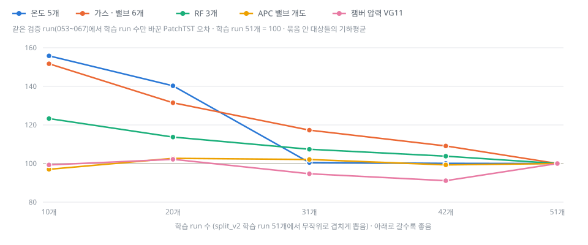

# 결과 상세 기록

README의 '결과 (Daily 갱신)'에는 날짜별 요지와 결과만 남기고, 표와 세부 수치는 여기에 둔다. 최신이 위에 있다.

## 11-15 · 0.5초 조합 최종 구성, 같은 0.5초 행 비교 (교차검증 5묶음, 548~608차)

정리 스크립트(raw_scale.py · combine_predictions.py · side_studies.py)로 저장한 예측값을 다시 계산한 값이다(학습 없음, 시험 run 미사용).
아래 '11-15 · 0.5초 조합 교차검증 5묶음' 항목의 학습 로그 추정은 이 결과로 대체한다.

<picture>
  <source media="(prefers-color-scheme: dark)" srcset="images/results_pair_dark.svg">
  
</picture>

조합은 사이클 안은 사이클 전용 모델, 나머지는 공정 전체 모델의 예측을 쓴다. 남은 오차는 원본 0.5초 값으로 같은 행에서 잰 값(%)이고,
100은 그 묶음의 첫 묶음 방식의 레시피 평균이다(교차검증 1~3은 기존 1초, 4 · 5는 기존 1초의 저장된 예측값이 없어 step 맞춤).
'0.5초 ÷ step 맞춤 − 1'은 같은 행끼리의 비라 기준과 상관없다. 사이클 전용 몫은 0.5초 레시피 평균 대비 개선율의 증가분(%p)이다.

| 대상 | step 맞춤 조합 | 0.5초 조합 | 0.5초 ÷ step 맞춤 − 1 (%) | 가장 큰 값 | 사이클 전용 몫 (%p, 가장 작은 묶음) |
|---|---:|---:|---:|---:|---:|
| NH3 | 64.9 ± 10.7 | 28.2 ± 3.6 | −56.2 ± 3.9 | −51.7 | 22.3 ± 8.5 (10.4) |
| N2-1 | 61.1 ± 11.2 | 30.8 ± 11.4 | −50.8 ± 8.5 | −36.6 | 22.2 ± 3.2 (17.8) |
| N2-4 | 64.1 ± 11.6 | 41.0 ± 8.7 | −36.3 ± 2.9 | −31.7 | 22.7 ± 5.7 (14.3) |
| DCS | 65.6 ± 9.1 | 42.4 ± 7.6 | −35.2 ± 9.9 | −21.7 | 26.0 ± 9.7 (12.3) |
| APC | 55.9 ± 20.8 | 41.7 ± 16.7 | −25.0 ± 9.3 | −16.7 | 25.7 ± 10.0 (14.8) |
| 밸브 29 | 40.9 ± 16.1 | 33.7 ± 11.6 | −16.4 ± 6.6 | −7.8 | 13.9 ± 9.6 (4.5) |
| 밸브 89 | 45.6 ± 16.4 | 38.0 ± 11.5 | −15.3 ± 5.9 | −7.7 | 18.8 ± 4.8 (13.2) |
| VG11 | 67.2 ± 10.6 | 64.0 ± 9.6 | −4.6 ± 4.3 | +0.8 | 1.2 ± 0.6 (0.6) |

- 7개 대상은 '0.5초 ÷ step 맞춤 − 1'의 가장 큰 값도 음수다. 5묶음 모두 0.5초 조합이 정확해 계획서 기준대로 0.5초 조합으로 정한다.
- VG11은 교차검증 1에서만 +0.8 %로 갈렸다. 기준대로 5묶음 평균이 작은 0.5초 조합을 쓴다.
- 사이클 전용 몫은 6개 대상이 '평균 > 표준편차의 2배, 가장 작은 묶음 > 0' 기준을 넘었다. 밸브 29와 VG11은 넘지 못했지만,
  같은 0.5초 행에서 0.5초 공정 전체만 쓴 경우보다 6개 분할(split_v2 + 교차검증 5묶음) 모두 오차가 작아(밸브 29 2.9 ~ 14.1, VG11 0.6 ~ 2.2) 조합을 쓴다.
- 학습 로그 추정과 달라진 점: DCS 사이클 전용 몫은 seed 48(606~608차)을 넣은 예측 조합에서 26.0 ± 9.7 %p로 기준을 넘었다.
  밸브 89는 같은 행 비교에서 5묶음 모두 0.5초 조합이 더 정확했다(−7.7 ~ −22.3 %).
- 0.5초 사이클 전용 설정 탐색(598~605차, side_studies 1-19): split_v2와 교차검증 1 두 곳에서 모두 '확실히 나음'인 설정이 없어
  지금 설정(patch 8초 · window 64초)을 유지한다. 교차검증 1의 DCS만 patch 16초 · window 64초가 −26.2 %로 확실히 나았다.

## 11-15 · 0.5초 조합 교차검증 5묶음, 0.5초 사이클 전용 설정 확인 (11-15)

582~608차(부가 실험, 시험 run 미사용) 결과다. 0.5초 간격 + 사이클 전용 조합은 교차검증 5묶음 모두 0.5초 레시피 평균보다 나았다.
0.5초 사이클 전용 모델의 설정은 지금 그대로(patch 8초 · window 64초) 둔다. 값은 학습 로그로 계산했고, step 맞춤 조합과의 최종 비교는 같은 0.5초 행에서 잰 값(raw_scale.py)으로 정한다.

**0.5초 간격 + 사이클 전용 조합 · 교차검증 5묶음 (552~597차)**

값은 0.5초 레시피 평균 대비 개선율(%)이다(5묶음 평균, 괄호는 묶음 범위). 조합은 구간별 MAE로 만든 추정이고(사이클 안 비율은 레시피 평균의 구간별 MAE에서 구함),
사이클 전용 몫은 조합 − 공정 전체(%p, 평균 ± 묶음 간 표준편차)다.

| 대상 | 0.5초 공정 전체 | 0.5초 + 사이클 전용 | 사이클 전용 몫 | 교차검증 4 · 5 (조합) |
|---|---:|---:|---:|---:|
| NH3 | 38.8 | 61.1 (55.7 ~ 64.2) | +22.3 ± 8.5 | 62.5 · 64.0 |
| N2-1 | 38.0 | 59.5 (41.5 ~ 66.9) | +21.5 ± 2.7 | 41.5 · 62.7 |
| 밸브 29 | 36.4 | 50.3 (46.6 ~ 55.9) | +13.9 ± 9.6 | 49.7 · 46.6 |
| 밸브 89 | 25.3 | 44.1 (40.9 ~ 47.5) | +18.8 ± 4.8 | 46.5 · 40.9 |
| APC | 17.8 | 43.5 (28.8 ~ 50.6) | +25.8 ± 10.0 | 28.8 · 49.1 |
| N2-4 | 20.5 | 41.6 (39.0 ~ 44.4) | +21.2 ± 6.0 | 41.0 · 41.5 |
| VG11 | 34.0 | 35.3 (19.4 ~ 42.9) | +1.2 ± 0.6 | 40.4 · 42.7 |
| DCS | 10.9 | 33.5 (13.7 ~ 49.8) | +22.5 ± 14.5 | 30.8 · 49.8 |

- 사이클 전용 몫은 8개 대상 · 5묶음 모두 0보다 큼. 평균이 표준편차의 2배를 넘는 대상: APC · NH3 · N2-1 · N2-4 · 밸브 89 · VG11.
  DCS(가장 작은 묶음 2.8)와 밸브 29는 묶음 간 차이가 커 기준 미달.
- 교차검증 4 · 5도 1~3과 같은 방향. 교차검증 4의 N2-1(41.5)과 APC(28.8)만 1~3의 범위(61.6 ~ 66.9, 43.6 ~ 50.6)보다 낮음.
- 11-15 기록 보충: step 맞춤 조합과 비교한 '가장 유리한 추정'은 엄밀한 하한이 아니다(사이클 전용이 나빠진 묶음은 원본 0.5초 값에서 덜 나빠진다).
  DCS · N2 · NH3는 차이가 6.7 ~ 31.7로 커 결론을 유지하고, 밸브 89는 1.7 ~ 4.1로 작아 같은 행 비교 전까지 미확정으로 둔다.

**0.5초 사이클 전용 설정 확인 (598~605차, split_v2 · 교차검증 1, seed 2개)**

- window 128초: 확실히 나은 경우 없음(오차가 낮아진 두 경우도 seed 편차 수준). split_v2에서는 6개 대상 모두 오차가 커짐.
- patch 16초 · window 64초: DCS는 교차검증 1에서 −30 %(seed 편차 2배 넘게 나음)지만 split_v2에서 +6 %(seed 편차 수준). N2-1은 두 분할 모두 +13 ~ +16 %로 나쁨. 나머지는 seed 편차 수준.
- 두 분할 모두 확실히 나은 설정이 없어 지금 설정을 유지하고 설정 탐색은 마친다.
- 602차 window 128초 작업 3개는 GPU 3을 다른 프로세스가 쓰고 있어 메모리 부족으로 실패. window 128초가 다른 분할에서 나빠 다시 돌리지 않는다.

**seed 48 추가 (606~608차, 교차검증 1~3 · 0.5초 사이클 전용 DCS · N2)**

- seed 48은 seed 46 · 47 평균과 −16 ~ +27 % 차이. N2-4 교차검증 1은 seed 2개 편차가 1.9 %인데 seed 48은 −15.8 %.
- seed 3개 편차: DCS 12 ~ 22 %, N2-1 4 ~ 8 %, N2-4 2 ~ 10 %. seed 2개로 잰 편차는 작게 잡히므로 판정은 seed 3개로 한다.

**다음 실험 (609~629차, 약 4.5시간)**

- 0.5초 조합의 모든 모델(split_v2 + 교차검증 5묶음, 가스 · 밸브 89 · APC)에 seed 48을 더해 seed 3개로 맞춘다.
- 정리 스크립트(raw_scale.py)의 교차검증 5묶음 요약으로 대상별 최종 구성을 정한다.
- 최종 구성이 정해진 대상만 0.5초 조합을 시험 run에서 평가한다(시험 run 재사용, 참고; scripts/pair_test.py).

## 11-15 · 0.5초 간격 교차검증 · 사이클 전용 조합, step 맞춤 patch 16초 (11-14 ~ 11-15)

548~581차(부가 실험, 시험 run 미사용) 결과다. 가스 · 밸브 가상 센서의 최종 구성은 0.5초 간격 + 사이클 전용 조합으로 좁혀졌다.
DCS · N2-1 · N2-4 · NH3 · 밸브 89는 교차검증 3묶음 모두 0.5초 조합이 가장 정확했다. APC · 밸브 29 · VG11은 세 묶음 방식의 조합을 같은 0.5초 행에서 잰 비교(raw_scale.py)로 정한다.

**0.5초 간격 + 사이클 전용 조합 · 교차검증 3묶음 (552~575차)**

값은 남은 오차다(기존 1초 레시피 평균의 원본 0.5초 값 오차 = 100, 교차검증 1~3 평균, 괄호는 묶음 범위).
0.5초 모델은 원본 값을 그대로 맞히므로 학습 로그의 오차가 곧 원본 값 오차다. 1초 모델 값은 원본 0.5초 값으로 다시 잰 값이다.

| 대상 | 기존 1초 공정 전체 | step 맞춤 공정 전체 | 0.5초 공정 전체 | 0.5초 + 사이클 전용 | 0.5초 레시피 평균 |
|---|---:|---:|---:|---:|---:|
| N2-1 | 76.9 | 54.8 | 40.2 | 24.5 (23.6 ~ 25.8) | 68.8 |
| 밸브 29 | 84.1 | 44.9 | 34.4 | 25.3 (22.8 ~ 26.9) | 52.4 |
| NH3 | 75.9 | 61.6 | 37.0 | 26.0 (22.9 ~ 28.3) | 64.4 |
| 밸브 89 | 84.6 | 34.2 | 40.2 | 29.7 (27.7 ~ 31.8) | 53.3 |
| APC | 89.2 | 49.4 | 45.8 | 31.0 (29.2 ~ 33.9) | 58.1 |
| N2-4 | 87.9 | 60.2 | 49.0 | 36.3 (35.6 ~ 37.2) | 62.5 |
| DCS | 89.9 | 60.7 | 53.7 | 42.7 (34.5 ~ 51.9) | 60.3 |
| VG11 | 72.3 | 71.1 | 68.9 | 68.0 (56.6 ~ 78.9) | 98.7 |

- 0.5초 사이클 전용 모델이 사이클 안 오차를 0.5초 공정 전체 모델보다 감소: VG11 47 %, N2-1 45 %, APC 33 %, NH3 30 %, N2-4 29 %, 밸브 89 · 29 26 %.
  DCS는 3 ~ 40 %로 묶음마다 다르고 seed 간 차이가 MAE의 9 ~ 19 %(설정 불안정).
- step 맞춤 조합과 비교: step 맞춤 조합은 원본 값 비교가 아직 없어, 가장 유리한 추정(step 맞춤 공정 전체의 원본 값 오차에서 조합으로 줄어든 자기 기준 오차를 모두 뺀 값)과 비교했다.
  DCS · N2-1 · N2-4 · NH3는 3묶음 모두 0.5초 조합이 8.6 ~ 31.7 낮고, 밸브 89도 1.7 ~ 4.1 낮다. APC(−8.9 ~ +3.1)와 VG11(−5.5 ~ +0.8)은 묶음마다 갈리고, 밸브 29는 판정 보류.
- 밸브 89는 0.5초 공정 전체가 step 맞춤 공정 전체보다 12 ~ 20 % 나빴지만, 사이클 전용을 더하면 앞섰다.
- split_v2(548~551차)의 0.5초 조합: NH3 29.3, 밸브 29 31.8, 밸브 89 35.5, DCS 40.4, APC 48.5, N2-4 49.0, N2-1 57.0, VG11 70.3.

**step 맞춤 patch 16초 · 교차검증 3묶음 (576~581차)**

- N2-4는 split_v2 포함 4개 분할 모두 오차 −12 ~ −31 %, seed 편차는 1/3 ~ 1/24로 감소. 판정 기준(seed 편차 2배)은 patch 8초의 seed 편차가 커서 넘지 못함.
- DCS +5 ~ −19 %, N2-1 0 ~ −6 %, 밸브 89 −1 ~ −9 %로 차이가 작음. step 맞춤이 최종 구성에서 빠지면 참고로만 쓴다.

**다음 실험 (582~608차, 약 7시간)**

- 0.5초 공정 전체 · 사이클 전용을 교차검증 4 · 5에서 학습해 5묶음으로 맞춘다.
- 0.5초 사이클 전용 설정 확인(patch 16초 · window 64 · 128초, patch 8초 · window 128초; split_v2 · 교차검증 1), DCS · N2 seed 48 추가.
- 정리 스크립트(raw_scale.py)로 세 묶음 방식의 조합을 같은 0.5초 행에서 비교해 APC · 밸브 29 · VG11의 구성을 정한다.

## 11-14 · step 맞춤 + 사이클 전용 조합 교차검증, 원본 0.5초 값 기준 재채점 (11-13 ~ 11-14)

486~547차(부가 실험, 시험 run 미사용) 결과와, 저장한 예측값을 원본 0.5초 값으로 다시 채점한 결과(학습 없음)다.
step 맞춤 1초 묶음 + 사이클 전용 모델 조합이 교차검증 5묶음에서 가장 좋았다(DCS · NH3 · N2 · 밸브 29 · 89 개선율 69~87 %).
원본 0.5초 값으로 다시 재면 1초 묶음 자체가 큰 오차 원인이었다. split_v2에서는 0.5초 간격 학습이 가장 정확했고, 이를 교차검증으로 확인한다(548~581차).

**step 맞춤 + 사이클 전용 조합 · 교차검증 5묶음 (489~508차)**

사이클 안은 사이클만 학습한 모델(window 64초, 밸브 29는 32초), 나머지는 공정 전체 모델의 예측을 쓴다. 값은 각자의 레시피 평균 대비 개선율(%)이다.

| 대상 | 기존 1초 공정 전체 | step 맞춤 공정 전체 | step 맞춤 + 사이클 전용 (평균 ± 묶음 간 표준편차) |
|---|---:|---:|---:|
| 밸브 29 | 40.4 | 25.3 (seed 다수 학습 멈춤) | 86.5 ± 2.6 |
| 밸브 89 | 36.9 | 77.6 | 81.6 ± 2.7 |
| NH3 | 52.1 | 54.8 | 74.7 ± 2.8 |
| N2-4 | 31.5 | 57.2 | 71.8 ± 3.6 |
| DCS | 25.2 | 58.1 | 71.1 ± 3.1 |
| N2-1 | 46.4 | 65.3 | 69.0 ± 12.4 |
| APC | 22.8 | 38.2 | 62.9 ± 15.1 |
| VG11 | 31.5 | 31.6 | 33.2 ± 11.0 |

- 사이클 전용을 더한 효과가 확실한 대상: APC +24.7, NH3 +19.9, N2-4 +14.6, N2-1 +3.7, VG11 +1.6 %p (5묶음 모두 증가, 평균이 표준편차의 2배 초과).
- DCS · 밸브 89는 더해진 폭이 묶음마다 다름(공정 전체 모델이 seed마다 흔들린 탓). 조합 결과 자체는 묶음 간 편차 ±3 수준.
- 밸브 29는 공정 전체 학습에서 여러 seed가 레시피 평균에 머물렀지만, 조합하면 86.5 ± 2.6로 안정.
- split_v2에서 사이클 전용 window 64초 대 32초(486~488차)는 대상별로 갈림: 조합 기준 APC 31.4 → 40.8, N2-4 74.1 → 79.0, DCS 83.5 → 82.2, 나머지는 ±0.5 이내.

**step 맞춤 1초 묶음 확정 (9개 분할: split_v2 · 교차검증 5 · 시간순 3, seed 2~3개)**

기존 1초 묶음 대비 늘어난 개선율(%p, 평균 ± 표준편차, 가장 작은 분할)이다.

| 대상 | 늘어난 개선율 | 시간순 3구간 |
|---|---|---|
| 밸브 89 | +42.4 ± 9.2 (+25.2) | +37 ~ +59 |
| DCS | +36.3 ± 11.8 (+15.4) | +37 ~ +57 |
| N2-4 | +28.4 ± 8.1 (+20.3) | +25 ~ +47 |
| N2-1 | +21.4 ± 16.5 (+1.1) | +19 ~ +58 |
| APC | +17.2 ± 6.2 (+9.5) | +19 ~ +26 |
| NH3 | +5.4 ± 8.8 (−8.0) | −0.1 ~ +22 |
| VG11 | −2.3 ± 7.9 (−23.0) | −23 ~ +3 |

- 밸브 89 · DCS · N2-4 · APC · N2-1은 9개 분할 모두에서 증가. NH3는 분할마다 다르고, VG11은 효과 없음.
- 기준선의 어려운 run ÷ 쉬운 run 오차 비율이 가스 · 밸브 대상에서 1.3~3.7배 → 대부분 0.8~1.2배(1초 묶음과 step 전환 흔들림이 겹친 효과 제거).

**원본 0.5초 값 기준 재채점 (scripts/raw_scale.py)**

묶음 방식마다 맞히는 값(1초 평균 · 0.5초 원본)이 달라 각자의 개선율은 직접 비교할 수 없다. 각 묶음의 예측을 그 묶음이 덮는 0.5초 행에 펼쳐, 같은 행 · 같은 원본 값으로 다시 쟀다.
값은 기존 1초 레시피 평균의 오차를 100으로 놓은 남은 오차다(split_v2, 공정 전체 모델, seed 평균).

| 대상 | 기존 1초 PatchTST | step 맞춤 PatchTST | 0.5초 PatchTST | 0.5초 레시피 평균 |
|---|---:|---:|---:|---:|
| NH3 | 76.0 | 72.5 | 39.4 | 63.6 |
| 밸브 29 | 80.7 | 58.4 | 42.4 | 58.3 |
| 밸브 89 | 88.9 | 48.2 | 47.4 | 57.6 |
| N2-4 | 82.3 | 69.4 | 54.9 | 67.3 |
| APC | 100.4 | 60.3 | 58.1 | 63.0 |
| DCS | 83.9 | 72.5 | 59.6 | 62.5 |
| N2-1 | 75.6 | 85.7 | 72.0 | 91.8 |
| VG11 | 73.1 | 73.5 | 71.6 | 99.6 |

- 원본 값 기준으로도 step 맞춤이 기존 1초보다 정확: 교차검증 1~3에서 밸브 89 −56 ~ −61 %, APC −39 ~ −51 %, DCS −30 ~ −35 %, N2-4 −28 ~ −35 %, N2-1 −24 ~ −33 %, NH3 −16 ~ −23 %, 밸브 29 −30 ~ −65 %, VG11 −0.4 ~ −2.3 %.
  split_v2에서는 N2-1만 +13 %로 반대였다.
- 0.5초 간격 학습이 모든 가스 · 밸브 대상에서 가장 정확(split_v2 하나). DCS · NH3 · N2-4는 0.5초 레시피 평균만으로도 step 맞춤 1초 PatchTST보다 정확.
  1초 묶음은 1초 안의 변화(밸브 개폐 · 유량 전환)를 평균으로 지우므로, 묶음 방식을 어떻게 바꿔도 원본 값과의 차이가 남는다.
- 11-10 · 11-11 정정: "0.5초 학습은 개선율이 떨어진다(DCS 43.5 → 4.6 %)"는 0.5초 레시피 평균이 이미 정확해서 생긴 숫자였다. 원본 값으로 재면 0.5초 학습이 가장 정확하다.
- 교차검증 4 · 5묶음과 시간순 3구간은 기존 1초 실험이 예측값 저장 기능 전에 돌아 원본 값 비교가 없다.

**step 맞춤 설정 탐색 (521~526차, split_v2, seed 2개)**

- patch 16초 · window 32초가 지금 설정(patch 8초)보다 DCS −31 %, N2-4 −30 %, 밸브 89 −12 %. APC는 +4 %로 비슷.
- NH3는 모든 설정에서 seed 편차가 커서 판단 불가. NH3는 사이클 전용 조합에서 안정(74.7 ± 2.8 %).

**장기 예측 (527~535차)**

- 5~10분 RevIN 끔은 APC · VG11에서만 도움. 온도는 오차 2.1~4.1배, P.POS는 12~30 % 증가, L.POS는 거리별로 갈리고 R.PWR은 3~9 % 감소.
- 30초~2분 RevIN 끔은 APC 1.6~2.2배, VG11 7~31배로 오차 증가. 이 거리에서는 RevIN 유지.
- 5~10분 구간 조합: APC는 사이클 전용 PatchTST + 사이클 밖 레시피 평균이 레시피 평균 대비 −62 %, VG11은 사이클 전용 PatchTST + 사이클 밖 LightGBM이 레시피 일정 평균 대비 −50 %.

**다음 실험 (548~581차, 약 7시간)**

- 0.5초 간격 + 사이클 전용 조합(split_v2), 0.5초 공정 전체 · 사이클 전용 교차검증 3묶음.
  원본 0.5초 값으로 기존 1초 · step 맞춤 · 0.5초의 구간 전용 조합을 같은 행에서 비교해, 가스 · 밸브 가상 센서의 최종 구성을 정한다.
- step 맞춤 patch 16초를 교차검증 3묶음에서 확인(DCS · N2 · 밸브 89).

## 11-13 · step 맞춤 1초 묶음, 학습 run 구성 정정, 장기 예측 RevIN · 구간 전용 (11-12 ~ 11-13)

432~485차 · 383~395차(부가 실험, 시험 run 미사용) 결과다. 값은 실험 로그의 검증 결과이고,
원본 0.5초 기준 비교와 run 유형별 결과는 정리 스크립트로 확인하는 중이다.
1초 묶음을 step 시작에 맞추자 밸브 89 · DCS · N2-4 · APC 가상 센서 개선율이 분할 6개 모두에서 9.7~49.5 %p 올랐다.
지금까지의 하이퍼파라미터 탐색보다 큰 변화다. 장기 예측은 RevIN을 끄면 APC · VG11의 5~10분 오차가 68 · 83 % 줄었다.

**step 맞춤 1초 묶음 (432~448 · 478~485차)**

0.5초 행 두 개씩 묶을 때 step이 바뀌면 묶음을 새로 시작했다(묶음 하나에 두 step이 섞이지 않음). 같은 설정 · 같은 seed로 기존 묶음과 비교했다.
값은 각자의 레시피 평균 대비 개선율(%)이고, 분할은 split_v2와 교차검증 5묶음이다.

| 대상 | 기존 1초 (6개 분할 평균) | step 맞춤 | 늘어난 개선율 (평균 ± 표준편차, 가장 작은 분할) |
|---|---:|---:|---|
| 밸브 89 | 38.2 | 79.2 | +40.9 ± 8.8 (+24.4) |
| DCS | 28.2 | 62.2 | +34.0 ± 7.4 (+25.2) |
| N2-4 | 32.2 | 54.2 | +22.0 ± 4.8 (+16.1) |
| APC 밸브 개도 | 20.1 | 36.0 | +16.0 ± 5.9 (+9.7) |
| N2-1 | 46.5 | 61.9 | +15.4 ± 11.4 (+0.8) |
| NH3 | 54.0 | 56.3 | +2.3 ± 9.4 (−13.9) |
| 챔버 압력 VG11 | 30.7 | 30.8 | +0.1 ± 1.6 (−3.0) |

- 밸브 89 · DCS · N2-4 · APC는 6개 분할 모두에서 올랐다(평균이 표준편차의 2배 이상). 온도 C 대조군은 그대로였다(91.9 → 91.9 %).
- 레시피 평균 자체의 오차도 줄었다(교차검증 1의 DCS 기준 −29 %). 맞히는 값이 쉬워진 부분이 있으니, 원본 0.5초 값으로 같은 기준에서 다시 잰다.
  (11-14 확인: 원본 0.5초 값으로 다시 재도 step 맞춤이 기존 1초보다 정확했다. 교차검증 1~3에서 밸브 89 −56 ~ −61 %, DCS −30 ~ −35 %)
- 밸브 29는 step 맞춤 공정 전체 학습에서 seed 12개 중 8개가 레시피 평균에 머물렀다(판정 보류). 사이클만 학습하면 멈추지 않았다(95 %).
- step 맞춤 + 사이클만 학습(split_v2, 474~477차)은 사이클 안 오차를 공정 전체 학습보다 더 줄였다.
  DCS −47 %, N2-4 −49 %, NH3 −37 %, APC −18 %, VG11 −80 %, 밸브 29 −91 %.
  공정 전체 모델과 합치면 DCS 약 84 %, N2-4 75 %, NH3 82 %, 밸브 29 93 %로 추정된다(사이클 window 비율로 계산).

**사이클 window 64초 · 교차검증 3묶음 (465~473차)**

- 7개 대상 × 3묶음 21개 모두 64초가 32초보다 나았다(사이클 안 개선율 +0.6~+11.4 %p, 대상 평균 +1.9~+5.4 %p).

**학습 run 유형 구성 (449~464차) · 11-11 결론 정정**

학습 run 25개의 유형 구성만 바꿨다. 값은 학습 run 51개의 PatchTST 오차를 100으로 놓은 값이다.

| 대상 | 쉬운 run만 | 어려운 run만 | 섞음 | 섞음 두 번째 |
|---|---:|---:|---:|---:|
| DCS | 126 | 167 | 116 | 96 |
| N2-1 | 126 | 153 | 106 | 106 |
| N2-4 | 104 | 150 | 106 | 87 |
| NH3 | 157 | 203 | 121 | 101 |
| 밸브 89 | 138 | 117 | 98 | 92 |

- 쉬운 run만으로 학습한 것이 섞은 두 묶음보다 나빴다. 11-11에 쓴 "쉬운 run 비율이 DCS를 좌우한다"는 분할 11개에서 사후에 찾은 관계였고, 이 실험에서 재현되지 않았다.
- 두 유형이 섞이면 25개로도 51개 수준에 가깝다.

**장기 예측 보완 (383~395차)**

- 5~10분 PatchTST는 RevIN을 끄면 APC 3.31 → 1.05 %, VG11 13.3 → 2.23 Torr로 오차가 68 · 83 % 줄었다.
  "window마다 수준을 지우는 RevIN이 절대 수준을 놓치게 한다"는 가설이 맞았다. 그래도 단일 모델로는 APC는 레시피 평균(0.858 %), VG11은 LightGBM(1.38 Torr)이 낫다.
- 5~10분을 사이클만 학습한 PatchTST의 사이클 안 오차는 APC 0.86 %(레시피 평균의 29 %), VG11 0.037 Torr(66 %)였다.
  사이클 밖을 레시피 평균에 맡기면 APC 5~10분 전체 오차가 약 0.28 %(레시피 평균 대비 −68 %)로 줄 것으로 추정된다.
- 거리 전용 LightGBM(잎 최소 샘플 20이 대체로 나음): 30초~2분은 APC(0.43 대 PatchTST 0.61 %) · VG11(0.15 대 0.53 Torr)에서 PatchTST보다 낫고,
  RF 매처 · 반사 전력 · 온도는 PatchTST가 낫다. 5~10분 온도는 LightGBM이 5~20 % 낫다.
- 30초~2분을 사이클만 학습하면 8개 대상 모두 사이클 안 오차가 10~62 % 줄었다(VG11 −62 %, 온도 C −47 %, RF 반사 전력 −38 %, APC −31 %).

**다음 실험 (486~547차, 약 11시간)**

- step 맞춤 확정: 원본 0.5초 기준 비교(학습 없음), 시간순 검증 3구간, seed 48 추가.
- step 맞춤 + 사이클 전용(window 64초, 밸브 29는 32초) 교차검증 5묶음, step 맞춤에서 patch 길이 × window 탐색.
- 장기 예측: 나머지 6개 대상 5~10분 RevIN 끔, APC · VG11 5~10분 사이클 전용 + RevIN 끔, 30초~2분 RevIN 끔.

## 11-11 · 구간 전용 학습 교차검증, run 유형(1초 묶음 흔들림) 확인, 최근 run 가중 학습, 예측 거리 전용 모델 (11-10 ~ 11-11)

263~362차(부가 실험, 시험 run 미사용) 결과와, 저장한 예측값 · run별 분석(학습 없음)으로 다시 계산한 값이다.
사이클 구간 전용 학습은 교차검증 3묶음 모두에서 DCS · N2-4 · APC · 밸브 89 · NH3의 개선율을 10~17 %p 올렸다.
가스 · 밸브 가상 센서의 run 간 차이는 장비 상태 변화가 아니었다. 1초 묶음과 step 전환 시점의 흔들림이 겹치는 run(어려운 run)에서 생겼고,
DCS 등은 학습 run 중 쉬운 run의 비율이 결과를 좌우했다(어제 쓴 "run 048"은 이 효과로 정정).
(11-13 정정: 같은 25개 run으로 구성만 바꾼 449~464차에서 재현되지 않았다. 두 유형이 섞여야 오차가 작다)

**사이클 구간 전용 학습 · 교차검증 3묶음 (저장한 예측값으로 조합)**

사이클 안 window는 사이클만 학습한 모델, 사이클 밖은 사이클 밖만 학습한 모델로 예측했다. 값은 레시피 평균 대비 개선율(%)이다.

| 대상 | 공정 전체 학습 (3묶음 평균) | 구간 전용 조합 | 늘어난 개선율 (평균 ± 표준편차, 가장 작은 묶음) |
|---|---:|---:|---|
| DCS | 24.6 | 41.1 | +16.5 ± 1.2 (15.7) |
| N2-4 | 29.7 | 46.5 | +16.8 ± 2.0 (14.6) |
| APC 밸브 개도 | 26.3 | 42.9 | +16.7 ± 7.5 (11.8) |
| 밸브 89 | 37.0 | 47.8 | +10.8 ± 1.5 (9.4) |
| NH3 | 50.4 | 60.0 | +9.7 ± 1.4 (8.8) |
| N2-1 | 48.2 | 51.3 | +3.1 ± 1.0 (2.2) |
| 밸브 29 | 36.5 | 52.4 | +15.9 ± 13.8 (6.0) |
| 챔버 압력 VG11 | 27.8 | 30.7 | +2.9 ± 4.4 (0.4) |

- 6개 대상(DCS · N2-4 · APC · 밸브 89 · NH3 · N2-1)은 평균이 표준편차의 2배를 넘고 가장 작은 묶음도 0보다 크다. 밸브 29는 묶음마다 차이가 크고, VG11은 효과가 작다.
- 어제 사이클 window 비율로 추정한 값(교차검증 3/5: APC 30 → 42 %, DCS 21 → 37 %, N2-4 28 → 44 %)과 실제 조합 결과가 같았다.
- 기본 분할(split_v2)에서도 DCS 43.5 → 62.4 %, N2-4 36.0 → 58.2 %, 밸브 89 45.0 → 66.6 %, 밸브 29 62.5 → 69.7 %, NH3 63.6 → 67.7 %로 올랐다.
- seed 2개의 예측을 평균하면 0.2~2.3 %p가 더 오른다.
- 사이클 window 길이는 64초가 32초보다 가스 · APC · VG11 7개 대상에서 0.4~7.5 % 나았다(밸브 29만 32초가 나음, split_v2 한 분할).
- 사이클 안은 PatchTST, 사이클 밖은 LightGBM으로 나누면 가스 · 밸브는 오히려 나빠졌다(LightGBM의 사이클 밖 오차가 큼).
  PatchTST와 LightGBM의 예측 평균도 RF 매처 P.POS(+1.6 %p)를 빼면 PatchTST 단독보다 못했다.
- 미래값 10~30초도 사이클만 학습하면 사이클 안 남은 오차(현재값 유지 대비)가 VG11 32 %, APC 25 %, RF 반사 전력 23 %, 매처 P.POS 12 % 줄었다.
  다만 오차 대부분이 사이클 밖이라 run 전체 개선율은 P.POS 77.4 → 80.0 %만 눈에 띄고 나머지는 −0.4~+0.2 %p였다.

**run 유형: 1초 묶음과 step 전환 흔들림 (run별 분석, 학습 없음)**

- 학습 · 검증 run 62개의 사이클 구간 평균은 가스 · 밸브 모두 run 사이에 거의 같았다(통신 끊김 run 055를 빼면 표준편차 0.6배 이내).
  변화점도 뚜렷한 곳이 없었다(효과 크기 2 미만, 온도 C의 2.2는 평균 변화 0.0 %). 장비 상태가 시기마다 바뀐 흔적은 없다.
- 달라진 것은 레시피 평균과의 차이였다. 001~002 · 008~012 · 025~036 · 051~054 · 065는 +1 표준편차 안팎, 나머지 대부분은 −1 안팎으로 run이 묶음 단위로 갈렸다.
  이 구분은 지난번 위상 점검의 어려운 · 쉬운 run과 같다(상관 0.95). 그 점검에서 0.5초 간격이나 step에 맞춘 묶음으로 계산하면 이 차이가 사라졌다.
  step 전환 시점이 0.5초씩 흔들리는 것이 1초 묶음과 겹치는 run이 어려운 run이다.
- PatchTST도 어려운 run에서는 오차를 크게 줄이지 못했다. 교차검증 5묶음의 run 61개에서 남은 오차(레시피 평균 = 100)는 다음과 같았다.

| 대상 | 쉬운 run | 어려운 run |
|---|---:|---:|
| 밸브 29 | 34 | 79 |
| 밸브 89 | 32 | 85 |
| N2-1 | 34 | 66 |
| NH3 | 38 | 51 |
| DCS | 54 | 81 |
| N2-4 | 56 | 77 |

  - 가스 · 밸브 6개 기하평균은 40 대 70이다. 절대 오차로는 어려운 run이 약 3.8배 크다. run별 상관은 0.76이다.
- 학습 run 구성: 검증 run(053~067)이 같은 분할 11개 중, 학습 run에서 쉬운 run이 46 % 미만인 4개(무작위 20 · 31 · 42개, 최근 30개)는 DCS 오차가 나머지 7개보다 36 % 컸다.
  run 수와는 관계가 없었다(순위 상관 +0.18). run 048이 들어간 최근 30개도 쉬운 run이 37 %라 나빴다.
  N2-1(−10 %) · N2-4(−14 %)도 같은 방향이고, NH3 · 밸브 89는 약했다.
  (11-13 정정: 이 관계는 사후 상관이었다. 쉬운 run만으로 학습하면 섞은 묶음보다 나빴다)
- 밸브 29는 다르다. 초기 run(001~011)이 빠지면 오차가 2배 이상인데(최근 30 · 40개 0.0042 · 0.0039, 초기 11 + 최근 19개 0.0019),
  최근 40개는 쉬운 run이 53 %라 유형 비율로는 설명되지 않는다. 초기 run의 무엇이 필요한지는 아직 모른다.
- 0.5초 간격 학습은 기준선의 run 유형 차이를 없앴지만, PatchTST 개선율도 DCS 43.5 → 4.6 %, 밸브 29 62.5 → 27.4 %, 밸브 89 45.0 → 17.6 %로 떨어졌다(APC · VG11 · 온도는 그대로).
  1초 묶음은 쉬운 run에서 흔들림을 가려 주고 있었고, 지금 가스 · 밸브의 큰 개선율 일부는 이 효과일 수 있다. step 시작에 맞춘 1초 묶음으로 확인한다(432~448차).
  (11-14 정정: 개선율이 낮았던 것은 0.5초 레시피 평균이 이미 정확해서다. 원본 0.5초 값으로 재면 0.5초 학습이 가장 정확했다)

**최근 run 가중 학습 (312~325차)**

run을 버리지 않고, 최근 run의 학습 window를 더 자주 뽑았다(반감기: 그 수만큼 앞선 run은 절반만 뽑음).

| 대상 | 가중 없음 대비 오차 | 맞는 반감기 |
|---|---:|---|
| 밸브 89 | −23 % | 20개 · 10개 |
| APC 밸브 개도 | −13 % | 10개 |
| DCS | −12 % | 20개 |
| 챔버 압력 VG11 | −11 % | 10개 |
| 밸브 29 | −6 % | 20개 |
| 온도 5개 | +3 ~ +55 % (나빠짐) | 가중하지 않음 |

- 검증 직전 run(042~050)은 대부분 쉬운 run이라, 가스 · 밸브의 가중 효과 일부는 위의 구성 효과일 수 있다.
  시간순 검증 3구간(396~419차)과 유형 구성 실험(449~464차)으로 나눠 본다.

**예측 거리별 모델 (30초~10분, 검증 MAE)**

거리마다 가장 정확한 모델이다(window 192초, LightGBM은 기본 설정, 학습 모델은 seed 평균).

| 대상 | 30초 | 1분 | 2분 | 5분 | 10분 |
|---|---|---|---|---|---|
| VG11 (Torr) | LightGBM 0.109 | LightGBM 0.143 | LightGBM 0.230 | LightGBM 0.574 | LightGBM 2.28 |
| APC 밸브 개도 (%) | PatchTST 0.323 | PatchTST 0.551 | LightGBM 0.533 | 레시피 평균 0.843 | 레시피 평균 0.873 |
| RF 매처 L.POS · P.POS | PatchTST | PatchTST | PatchTST | PatchTST | PatchTST |
| RF 반사 전력 | PatchTST | PatchTST | PatchTST | PatchTST ≈ iTransformer | PatchTST |
| 온도 U · C · L | PatchTST · LightGBM이 거리마다 번갈아 나음 (차이 2~30 %) | | | | |

- VG11은 모든 거리에서 LightGBM이 가장 정확했다(PatchTST는 30초 0.212, 10분 18.6 Torr).
- APC는 1분까지 PatchTST, 2분은 LightGBM, 5~10분은 학습 모델보다 레시피 평균이 나았다.
  LightGBM 잎 최소 샘플을 20으로 바꾸면 APC 1~2분도 LightGBM이 가장 낫다(0.412 · 0.491 %).
- 검증 run을 절반으로 나눠 한쪽에서 고른 모델로 다른 쪽을 채점하면, VG11(30초~5분)과 RF 반사 전력(30초~2분)은 같은 모델이 뽑혔다.
  나머지는 절반마다 고른 모델이 달랐다(가장 나은 두 모델의 차이가 작음).

**다음 실험**

- 363~431차(진행 중, 약 13시간): 사이클 전용 + 최근 run 가중, 구간 전용 교차검증 4 · 5묶음, 5~10분 보완, 시간순 검증 + 가중.
- 432~485차(약 9시간): step 시작에 맞춘 1초 묶음(split_v2 · 교차검증 5묶음 · 사이클 전용), 학습 run 유형 구성(쉬운 run만 · 어려운 run만 · 섞음 2가지, 각 25개),
  교차검증 1~3묶음에서 사이클 window 64초.

## 11-10 · 시간순 검증, 학습 run 수 · 최근 run, 구간 전용 학습, 장기 예측 모델 비교 (11-08 ~ 11-10)

11-08 이후로는 채택 판정을 바꾸는 실험 없이, 지금 결과가 어디서 나오는지 확인하는 부가 실험만 돌렸다(147~230차, 시험 run 미사용).
가스·밸브는 run을 더 모으고 최근 run 비중을 높이면 나아질 여지가 있고, 사이클 구간만 따로 학습하면 사이클 안 오차가 크게 줄어드는 대상이 많았다.
APC · VG11은 run 수보다 어떤 시기의 run을 쓰느냐에 좌우됐다.

**학습 run 수 곡선 (178~207차)**

검증 run(053~067)은 그대로 두고 학습 run만 51개 중 10 · 20 · 31 · 42개로 줄여(작은 묶음이 큰 묶음에 포함) 같은 설정으로 다시 학습했다.

<picture>
  <source media="(prefers-color-scheme: dark)" srcset="images/results_learning_dark.svg">
  
</picture>

- 온도 5개: 31개까지 줄고(10개일 때 156 → 31개 100) 그 뒤로는 그대로다. 온도는 지금 run 수로 충분하다.
- 가스·밸브 6개: 51개까지 계속 줄어든다(152 → 131 → 117 → 109 → 100). run을 더 모으면 더 나아질 여지가 있다.
  (11-11 정정: 두 번째 추첨에서 run 수보다 048~050 같은 특정 시기 run이 들어갔는지의 차이로 확인됐다)
- RF 3개(매처 위치 2개 · 반사 전력)는 완만하게 줄고(123 → 100), APC · VG11은 run 수와 상관없이 오르내린다(91~103).

**최근 run만 학습 (208~216차)과 시간순 검증 (147~164차)**

- 같은 검증 구간(053~067)에서 같은 20개를 쓰더라도, 바로 앞 시기의 run 20개로 학습하면 무작위로 고른 20개보다 가스·밸브·APC 오차가 14~38 % 작았다.
- 누적 51개와 비교하면 APC는 최근 20개가 12 % 더 나았고(seed 편차 밖), N2-4 · 밸브 89도 11~13 % 나았지만 seed 편차 수준이다.
  DCS는 비슷했고, NH3 · N2-1은 4~7 %, VG11은 42 % 못했다. 가스·밸브·APC는 최근 run이 중요하고, VG11은 넓은 기간의 run이 필요하다.
- 시간순 검증(앞쪽 run으로 학습해 바로 다음 run 묶음으로 검증)에서 APC의 기준선 대비 개선은 17 → 13 → −2 → 6 %(기존 검증) → 0 %(시험),
  VG11은 −29 → −11 → 6 → 26 %(기존 검증) → −77 %(시험)로 묶음마다 크게 달랐다. 시기에 따라 결과가 바뀌는 대상이다.
- 센서 하나만 고장 난 경우(같은 계열 센서는 입력에 남김, 165~170차)는 같은 계열을 모두 뺀 기존 결과와 거의 같았다(VG11 26.0 → 26.4 %). 입력 목록을 확인한 뒤 결론을 낸다.

**사이클 구간만 학습 (217~222차)**

window 끝이 ALD 사이클 안인 것만으로 학습하고, 공정 전체로 학습한 모델과 같은 사이클 window에서 오차를 비교했다.

| 대상 | 사이클 안 오차 변화 (사이클만 학습 ÷ 공정 전체 학습) |
|---|---|
| 온도 U · CU · C · L zone | 37~76 % 감소 (CL zone은 12 % 증가) |
| 챔버 압력 VG11 | 71 % 감소 (레시피 평균보다 123 % 나빴던 사이클 구간이 35 % 나아짐) |
| DCS · N2-4 · 밸브 29 · 밸브 89 | 20~40 % 감소 |
| NH3 | 11 % 감소 |
| N2-1 · APC · RF 반사 전력 · 매처 Load 위치 | ±3 % 안팎 (변화 없음) |
| 매처 Phase 위치 | 8 % 증가 |

공정 전체를 함께 배우면 승온 · 안정화 구간의 큰 오차에 맞추느라 사이클 구간이 희생되는 대상이 많다. 사이클 안과 밖을 각각 전용 모델로 학습해 합치는 방식을 다음 실험에서 확인한다.

**장기 예측 30초~10분 (재실행 231~238차 반영)**

- 140~146차에서 온도 · VG11은 조기 종료가 일찍 걸려(VG11 34 epoch, 온도 56~75 epoch) 덜 학습된 결과였다. 같은 설정 · seed로 다시 돌리니
  끝까지 학습되어(120~170 epoch) 오차가 25~28 % 줄었고, APC · RF는 두 실행이 거의 같았다. 같은 설정에서도 조기 종료 시점이 실행마다 달라질 수 있다.
  아래는 재실행 기준이며, 이전에 적은 장기 예측 수치(거리별 개선율, window 640초 효과)는 이것으로 바꾼다.
- 레시피 평균은 예측 시점에 실제로 돌던 step을 trace에서 읽으므로 미래 step 시각을 아는 기준이다. 미리 알 수 있는 정보만 쓰는
  레시피 일정 평균(지금 step과 학습 run의 보통 step 길이 · 순서로 예측 시점의 step을 추정)과 비교하면, 레시피 평균이 온도에서 42~115 %,
  RF 반사 전력에서 44 %, APC에서 19 % 유리했다. 장기 예측에서 레시피 평균이 강했던 것은 미래 step 시각을 알았기 때문이다.

| 대상 | PatchTST | LightGBM | iTransformer | DLinear | 레시피 평균 (참고) |
|---|---:|---:|---:|---:|---:|
| 온도 U · C · L zone | **92 · 92 · 89** | 91 · 91 · 89 | 82 · 83 · 69 | 38 · 40 · 10 | 32 · 30 · 54 |
| RF 매처 Load · Phase 위치 | **80 · 78** | 76 · 60 | 78 · 60 | 69 · 43 | 0 · 3 |
| RF 반사 전력 | **65** | 36 | **65** | 30 | 31 |
| 챔버 압력 VG11 | −100 | **74** | −122 | −523 | 1 |
| APC 밸브 개도 | −76 | 14 | −179 | −276 | **16** |

값은 다섯 거리(30초 · 1분 · 2분 · 5분 · 10분) 평균 오차의 레시피 일정 평균 대비 개선율(%)이다.

- 온도 · RF 3개는 PatchTST가 가장 나았다(65~92 %). VG11 · APC는 PatchTST가 레시피 일정 평균보다 못해, 정한 규칙대로 장기 예측에서는
  다른 모델(LightGBM 74 · 14 %) 후보로 둔다. 거리별 결과와 거리별 모델 선택은 저장한 예측값으로 다시 정리한다.
- window 640초(171~177차)는 충분히 학습한 192초와 비교하면 온도 U · C 오차가 14~16 % 줄었고, VG11 · RF 매처 위치는 오히려 나빠졌다.
  APC는 seed 간 차이가 커서(1.20 ± 0.58 %) 판단을 미룬다.

**0.5초 간격 학습 (226~230차)**

1초로 묶지 않고 0.5초 원본으로 학습하면 가스·밸브의 레시피 평균 대비 개선율이 오히려 줄었다(밸브 29 63 → 27 %, DCS 44 → 5 %, NH3 64 → 38 %, 밸브 89 45 → 18 %).
APC · VG11 · 온도는 비슷했다. 1초 묶음을 유지한다.
(11-14 정정: 개선율이 낮았던 것은 0.5초 레시피 평균이 이미 정확해서다. 원본 0.5초 값으로 재면 0.5초 학습이 가스 · 밸브 대상에서 가장 정확했다)

**진행 중인 실험 (231~287차)과 그다음 (288~362차)**

- 장기 예측: PatchTST를 같은 설정으로 다시 돌려 레시피 일정 평균과 비교하고, 거리별로 PatchTST · LightGBM 중 나은 쪽을 고르는 방식을 검증 run을 절반씩 나눠 확인한다.
- 구간 전용 모델: 가상 센서를 사이클 밖만으로도 학습해 사이클 전용 모델과 합친 결과를 보고, 미래값 10~30초 예측에도 사이클 전용 학습을 적용한다.
- 학습 기간 길이: 최근 10 · 30 · 40개 run으로 학습해, 최근 20개 · 누적 51개와 함께 몇 개가 가장 나은지 정한다.
- 두 번째 추첨: 학습 run 20 · 31 · 42개를 다른 조합으로 다시 뽑아, VG11 · APC가 run 수보다 어떤 run이냐에 좌우되는지 확인한다.
- PatchTST와 LightGBM 예측의 평균이 각각보다 나은지 다시 학습하지 않고 계산한다.
- 288~362차: 구간 전용 모델 조합을 교차검증 3묶음에서 확인하고, 최근 run에 가중치를 둔 학습(반감기 10 · 20 · 40개), VG11 · APC 장기 예측 설정 탐색, 예측 거리 전용 모델(30초~2분 · 5~10분)을 돌린다.

## 11-08 · 시험 run 평가, 원인 분석, 교차검증, 예측 거리 확장 (11-03 ~ 11-08)

미래값 예측 8개는 처음 보는 시험 run에서도 검증과 같은 수준이었다(대상 평균 남은 오차 7.9 → 7.9).
가상 센서는 온도 5개와 RF 반사 전력이 시험에서도 기준선 대비 86~91 % 줄었지만, 가스·밸브 6개와 RF 매처 위치 2개는 개선 폭이
19~57 %로 줄었고, APC는 기준선과 같아졌으며(0.2 %), VG11은 기준선보다 나빠졌다(−77 %).

<picture>
  <source media="(prefers-color-scheme: dark)" srcset="images/results_test_dark.svg">
  
</picture>

**가상 센서가 시험 run에서 떨어진 원인 (드리프트 · 과적합 여부 확인)**

- 가스·밸브 6개는 run이 두 무리로 갈린다. 레시피 평균(기준선) 오차가 4~6배 큰 run이 따로 있고, PatchTST의 남은 오차도 이 run들에서 크다.
- 이런 run은 학습 run에도 절반가량 있고 날짜와 상관없이 섞여 있다. 시간이 갈수록 나빠지는 드리프트는 아니다.
- 0.5초 원본 그대로 계산하거나 step이 바뀔 때마다 1초 묶음을 새로 시작하면 두 무리의 기준선 오차 차이가 사라진다(2.6배 → 1.0배).
  0.5초 데이터를 1초로 묶는 전처리와 step 표시 시점의 흔들림(±0.5초)이 겹쳐 생긴 차이로 본다.
- 시험 run에는 이런 run이 11개 중 7개로 검증(4개)보다 많이 들어가 평균이 떨어졌다. 오차가 작은 run끼리는 검증 26 · 시험 30으로 비슷하다.
  큰 run끼리는 검증 50 · 시험 73인데, 검증의 큰 run 4개 중 058 · 065는 덜 어려웠다.
- APC · VG11은 검증 run 11개의 평균이 run 몇 개에 좌우됐다. 아래 교차검증으로 다시 판정했다.

<picture>
  <source media="(prefers-color-scheme: dark)" srcset="images/results_runs_dark.svg">
  
</picture>

**교차검증 결과 (120~139차, 11-06 ~ 11-07)**

시험 run은 쓰지 않고 학습·검증 run 62개(04-15 ~ 05-10)를 5묶음으로 나눠, 최종 설정을 묶음마다 다시 학습했다.

- 8개 대상 모두 5묶음 전부에서 기준선보다 나았고, 평균이 묶음 간 표준편차의 2배를 넘어 미리 정한 기준대로 채택을 유지한다.
- 가스·밸브 6개는 묶음 평균 25~52 % 감소였다. DCS · N2-4 · 밸브 89는 시험 결과가 교차검증보다 낮은데,
  시험 run에 기준선 오차가 큰 run이 많이 들어간 영향과 맞는다.
- APC(23 ± 6 %)와 VG11(31 ± 12 %)은 교차검증에서는 모든 묶음에서 나았지만, 가장 나중 run인 시험 run(05-10 ~ 05-15)에서는
  기준선과 같거나 나빴다. VG11은 시험 run 070 이후 모든 run에서 기준선보다 나빴다. 시기에 따른 변화일 수 있어 시간순 검증으로 확인한다.
- 구간별로 보면 APC는 사이클 안에서 좋아지고(13~31 %) 사이클 밖은 기준선과 비슷하거나 약간 나쁘다(−10~0 %).
  VG11은 반대로 사이클 밖에서 좋아지고(13~43 %) 사이클 안은 기준선보다 나쁘다.

<picture>
  <source media="(prefers-color-scheme: dark)" srcset="images/results_cv_dark.svg">
  
</picture>

**예측 거리 확장 (140~146차, 11-07)**

최종 설정 그대로 30초 · 1분 · 2분 · 5분 · 10분 뒤 값을 예측했다. 아래는 다섯 거리의 평균이다(검증 run).

| 대상 | 10~30초 예측 개선율 | 30초~10분 예측 개선율 | 30초~10분 오차: 사이클 안 · 밖 |
|---|---:|---:|---|
| 온도 U · C · L zone | 93~96 % | 91~92 % | 0.04~0.17 · 0.68~0.81 ℃ |
| RF 반사 전력 | 91 % | 81 % | 0.27 · 0.006 |
| APC 밸브 개도 | 95 % | 78 % | 0.84 · 2.15 % |
| RF 매처 Phase 위치 | 76 % | 71 % | 0.87 · 0.18 |
| 챔버 압력 VG11 | 96 % | 68 % | 0.29 · 9.7 Torr |
| RF 매처 Load 위치 | 60 % | 45 % | 0.84 · 0.11 |

- 개선율은 모두 현재값 유지 대비다. 8개 대상 모두 긴 예측에서도 현재값 유지보다 45~92 % 나았지만, 10~30초보다 개선 폭이 줄었다.
- 온도 · VG11 · APC는 사이클 안 오차가 작고, 감압 · 승온 · 벤트처럼 공정 단계가 바뀌는 사이클 밖에서 크게 틀렸다.
  RF 관련 신호(반사 전력 · 매처 위치)는 반대로 사이클 안 오차가 더 크다.
- 레시피 평균 기준선이 빠진 채로 돌아서(대시보드가 이전 코드로 요청을 만듦), 레시피 평균과의 비교와 예측 거리별 오차는 보충해서 반영한다.

**다음 실험**

- 예측 거리 확장 보충: 레시피 평균 기준선을 더하고 30초 ~ 10분 거리별 오차를 정리해 쓸 수 있는 예측 거리를 정한다 (학습 없음).
- APC · VG11 가상 센서 시간순 검증: 앞쪽 run으로 학습하고 바로 다음 run 묶음으로 검증하기를 시간 순서대로 반복해, 시기에 따라 성능이 떨어지는지 확인한다.
- VG11 · APC 구간별 결합: 사이클 안 · 밖에서 더 나은 쪽(PatchTST 또는 레시피 평균)을 쓰는 방식을 교차검증으로 판단한다.
